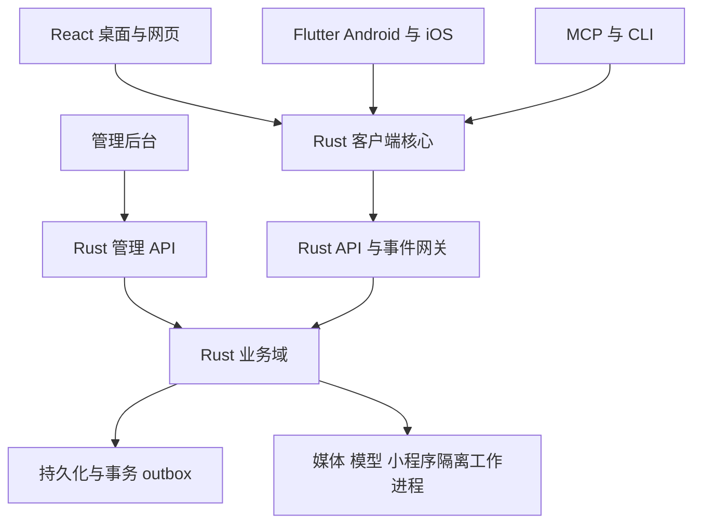

# wxlike 全入口、全平台开发与多人协作总指南

版本：2.0，2026-10-24。性质：待实施的开发设计与发包依据，不是已完成交付声明。

代码基线：`bear20252026/wxlike@d0bef13ad60c1f8b56a741789aab93c66026ae8b`。
UI 基线：用户上传的 `undefined-text-input (3).zip`，SHA256=`1d141fbf0241223201380ad91f590d45ca17fa7582b9d0b5ba7805e32f3be276`。
已核查：UI 有 10 个桌面页面、27 个手机页面；15 个 TS/TSX 文件中有 331 个 onClick 属性语法位置、202 个 notify/onNotify 调用位置。这里是源码位置数，不是去重后的业务功能数；map 生成的多个按钮须按每个枚举值验收。UI 生产构建、TypeScript 检查通过；未接业务网络、原生能力或持久化。当前后端不是零起点，本指南要求复用已有实现和测试。

## 0. 最终范围与完成定义

必须交付：①桌面 Win/macOS/Linux（Tauri + React）；②网页（React + Rust WASM SDK）；③Android/iOS（Flutter + Rust UniFFI）；④同一服务端代码在 Linux 生产/Docker 运行、Win/macOS 可运行；⑤独立管理后台；⑥应用内小程序容器；⑦MCP/CLI AI 命令面。三类客户端，不是只有三个操作系统。

“同一套 Rust 核心”的约束：业务校验、权限规则、金额/订单计算、消息幂等/排序/同步、设备与密钥生命周期、命令目录及小程序宿主授权都用 Rust；TS/Dart/Swift/Kotlin 负责布局、输入、OS API、媒体设备与 FFI 适配，不再实现第二套金额、消息投递、权限算法。服务端是最终授权与交易事实来源，客户端共享 Rust 不能替代服务端验证。各端不必链接同一个二进制，不将服务端数据库/axum 带入手机和 WASM。

“全入口字面功能完成”：用户点击后真的发生对应读取/写入/设备操作，并在另一账号或服务端形成可验证结果；成功提示只能来自确定成功状态；刷新、重启、网络恢复后状态一致。禁用、隐藏、写“开发中”可以用于中间版本，但不能用来通过最终全范围验收。外部供应商尚未开通的功能标记 BLOCKED_EXTERNAL，不能假装完成。

产品默认是自主 wxlike 生态。微信样式、文案和示例数据不能证明能访问真实微信好友、微信支付、微信小程序、公众号平台。若要求这些生态互通，须另有官方可用接口和实际授权，作为外部依赖登记；不得靠模拟网页、未公开协议或静态二维码交差。

### 0.1 入口闭环记录

每个入口登记 `entry_id, platform, source, rendered_variant, action_id, task_id, domain_owner, api, permission, states, test_id, provider_dependency, status`。本包附 331 个 onClick 源码位置的种子清单；这不是完整运行时控件审计，G00-01 必须展开 map/菜单/快捷键、无 handler 的可点击图标、输入回车、拖拽和系统返回等，形成最终清单。演示网站的视图选择/滚动导航单独标为 showcase，不混入产品业务；产品中的设备同步、窗口控制不能借此删除。

状态：PLANNED → CONTRACT_READY → IMPLEMENTING → INTEGRATED → CI_VERIFIED → DEVICE_VERIFIED → ACCEPTED；BLOCKED_EXTERNAL 单独计数。最终发布 ACCEPTED 覆盖全部产品入口，且阻塞项为 0。

## 1. 已有代码与计划改造边界

已存在：platform 账号/好友/群/朋友圈/收藏/虚拟钱包/媒体/密钥与审核；net QUIC/WS、认证、离线 claim/ack 与 delivery outbox；client HTTP Executor；core Olm/Megolm；rtc/sfu/video；admin；cmd/cli/mcp；移动登录/会话/聊天；桌面/Web 客户端。

已核查的缺口：手机实时接收、网络恢复触发和重试后的列表刷新；桌面口令派生快照 API 已有而 SecretStore 仍用同目录 key 文件；多设备密钥分发未完整；端到端处理确认不能仅等同 socket write；内容平台/卡券/服务聚合/真实支付尚未形成完整业务。本指南不能拿已关闭旧 issue 当这些能力已验收的证据。

当前 ureq 3.5.0、async-nats 0.50.0、Tantivy 0.27 已合入，禁止重复发“迁移 ureq 3”任务。根与桌面有独立锁文件，都要扫描。当前 CI 和 audit 绿不代表新增全平台目标已覆盖；覆盖率与 unwrap 统计目前非严格阻断。

用户列出的 8 个 refs 镜像本次环境没有找到，不能声称已本地逐行审查。本包的 upstream_manifest.json 来自联网读取的远端 HEAD/目录/许可证样本；正式移植必须检验开发者本地镜像 SHA 与此记录，且再次扫描公告。记录的 HEAD 是定位锚点，不是安全发行版本推荐。

## 2. 总体架构与 ADR

### ADR-01：模块化单体、共享业务核心、少量隔离工作进程

对外只有 Rust API/事件网关和独立 Rust 管理 API。身份、会话、聊天、内容、交易、目录等先在单服务进程分域，域间通过 Rust 服务接口调用；禁止为了并行按人拆成十几个远程微服务。转码、模型推理和不可信应用执行隔离为工作进程，仍由同仓库 Rust 程序调度。数据库、S3、Redis/NATS、coturn、FFmpeg 属通用基础设施，不是第二套业务核心。



### ADR-02：客户端核心的编译边界

- `wxlike-types`：稳定 ID、DTO、错误码、状态、序列化，不依赖数据库、网络或 UI。
- `wxlike-domain`：纯业务不变量与策略函数；服务端再次执行，客户端仅预检/呈现。
- `wxlike-client-core`：命令调度、会话状态、outbox/sync/密钥状态，依赖 ports。
- `wxlike-client-native`：Tokio HTTP/QUIC/WS、SQLite 缓存、OS SecretStore 适配。
- `wxlike-client-web`：同核心的 wasm32 构建；Rust 驱动 browser fetch/WS/IndexedDB，经窄 web-sys 适配器，不包含服务器和原生线程。
- `crates/ffi`：UniFFI 长期对象、异步任务和可取消事件订阅；Dart isolate 继续沿用。
- Tauri commands 和网页 WASM 暴露同一 `dispatch(ActionRequest)`、`subscribe(EventCursor)`；Flutter 包装同一接口。不能继续手写三套 bincode enum 序号。

这些是目标 crate 名，G00 在 Wave 0 建目录与迁移映射，G01 实现。旧 crates/core/client/net/cmd 不全部重写，先抽纯类型与 ports，保留旧入口兼容层；先有兼容测试再删除旧路径。Rust WASM 的编译通过、浏览器实际存储/收发/加解密可运行是单独验收，不把 native 测试通过推论成 WASM 可用。

### ADR-03：服务端存储与部署配置

保留现有 SQLite/WAL 单节点作为迁移期 profile，不把 SQLite 文件挂到多主机共享卷。完整生产目标采用 PostgreSQL 作为统一服务端业务事实库，客户端继续 SQLite/IndexedDB；新资金业务仅在经事务与恢复验收的生产 profile 开放。由 G00-04 领导专门迁移波次，G01提供 repo ports，各业务组只实现域内 repository；G00唯一登记 SQL 迁移序号。

目标 PostgreSQL 在 Linux/Docker、Win/macOS 都是相同数据库依赖，Win/Mac Rust 服务可连接远程或本机 PG；不能因为 Win/Mac 可跑就自动要求内嵌数据库。迁移期 SQLite 服务可做开发/旧数据导入，不承诺它与 PG 永久维持两个生产真相。迁移完成前不得将多 hub + 各自本地 SQLite 宣称为一致的生产集群。

迁移：Repository trait → SQLite 旧行为契约 → PG schema/索引/约束 → 离线一致性导入（ID、seq、游标、金额守恒、密文原样）→ 预生产影子读取对账 → 短暂停写、最终增量、切配置 → 留可回退快照。禁止未设计的跨库双写；资金落账与订单状态/发件箱同库事务。全文索引是可重建投影，不承担授权真相。

媒体通过现有 MediaStore 接 OpenDAL/S3；数据库存逻辑引用/ACL，不向客户端把内容哈希当永久授权。Redis 只做租约/限流/临时状态，MQ 只运送事件；不能把余额真相放 Redis。实际容量和 SLO 在 G00-05 负载包测出，不预先承诺万人/百万连接。

### ADR-04：统一协议与兼容性

HTTP `/api/v1/*` 采用 JSON DTO，现有 `/api/*` 保持一个明确兼容窗口；实时走版本化 `ClientHello/Auth/Subscribe/Command/Event/Ack/Resume`，QUIC/WS 同 envelope 语义。首轮不硬切 bincode 版本：先为现有二进制格式生成跨端 fixture、定义 protocol v3，再允许可协商升级；已安装旧客户端能被明确提示更新而非乱码断连。

ID 为不透明字符串；现有 16-byte msg_id 必须原样保留，不为使用 UUID 库重写历史 ID。金额是整数最小币种单位，带 currency，不用 float；u64 seq、版本、金额在 JSON/JS 边界以十进制字符串表示，杜绝 >2^53 精度损失。时间戳为 UTC 毫秒，权威排序和过期由服务端时间产生，保留 client_sent_at 仅供诊断。

```json
{"action_id":"msg.send","request_id":"opaque-id","schema_version":1,"idempotency_key":"device:opaque","params":{"conv_id":"opaque-conv","body":{"type":"text","text":"你好"}}}
```

```json
{"event_id":"opaque-event","aggregate_id":"opaque-conv","aggregate_version":"42","event_type":"message.accepted","server_time_ms":"1790000000000","payload":{"msg_id":"opaque","seq":"42"}}
```

错误统一 `code,message,field_errors,retryable,retry_after_ms,request_id`。公共错误码 `UNAUTHENTICATED/FORBIDDEN/VALIDATION/CONFLICT/RATE_LIMITED/REQUIRES_CONFIRMATION/DEPENDENCY_UNAVAILABLE`；已提交但响应丢失用幂等查询，不把所有网络错误归为“没发生”。GET 不做业务扣减；claim OTK 改为明确命令/POST，保留旧接口兼容期。

客户端状态：DRAFT → LOCAL_QUEUED → SENDING → SERVER_ACCEPTED → DEVICE_STORED → READ；失败区分可重试与终态。socket write 只到传输成功，不等于 DEVICE_STORED；服务端 receipt/设备存储确认各有定义。Outbox/dedup/投递任务必须同一消息 ID，重复请求补未完成收件人，不产生第二笔业务。

### ADR-05：域接口与事件驱动边界

API handler 只解析/鉴权/调用 usecase，UseCase 持有 UnitOfWork，Repository 不发网络；业务事务写 domain_event/outbox，commit 后 worker 投影到搜索/通知/推送。跨域以公开 Rust trait 和 ID 引用，禁止直接 UPDATE 其他域表；资金与订单原子边界由 CommerceUseCase 在同 PG 事务内编排。第三方回调经过验签/去重/状态机，不直接把 HTTP 200 当付款成功。

给每个域独立 `contracts/domains/<domain>/`、`crates/features/<domain>/{domain,application,infrastructure,http,tests}`。每个域导出 `routes(state)`、`register_commands(registry)`、`register_jobs(registry)`、`capabilities()`，由 G00 在组合根装配；组员在自己的 integration-request.yaml 声明需求，不同时改 server/main/lib。

### ADR-06：小程序的可移植执行模型

首发包规范为签名 manifest + 完整资源摘要 + HTML/CSS/JS UI + 受限宿主桥；清单、权限判定、包验证、版本水位和宿主命令都在 Rust。桌面使用独立无特权 WebView，网页独立 origin sandbox iframe，移动独立 WKWebView/Android WebView；不可信页面绝不拥有 Tauri 全局 IPC、主应用 token 或本地文件系统。

Boa 是兼容/可控逻辑执行器候选；Wasmtime 仅作为服务器/桌面可选扩展，不将任意 JIT 当作 iOS 必备能力。iOS 选择 HTML/JS 与平台允许的执行模式，实际商店审核单独列 Gate；网页不能依赖 OS 进程隔离，必须以 origin、iframe sandbox、CSP 和 broker 限权。资源预算按内存/CPU/并发/桥调用/磁盘/网络分别测试。

### ADR-07：RTC 引擎唯一，避免拼两套房间真相

保留现有 str0m/rtc/sfu 作为首选基线，先由 G09-01 跑跨网和移动采集可行性矩阵。媒体采集/渲染可调用成熟平台组件，但房间成员、呼叫状态、token 和权限由 Rust 服务控制。LiveKit 作为架构/客户端参考；若候选验证显示当前引擎无法满足各端需求，只能由全局 ADR 一次性改选，不允许一组接 LiveKit 房间、另一组继续自研 SFU。

DTLS-SRTP 传输加密不等于经 SFU 后仍端到端加密。UI 的“端到端加密”必须绑定已实现的媒体 E2EE 协议与设备认证；未达此能力时不允许显示该承诺。既然设计要求全功能，G09-04必须完成此项或全范围发布仍不通过。

### ADR-08：性能、离线与移动生命周期

React/Flutter仅投影当前可见分页，不同时保留所有视频/聊天；虚拟列表、图片缩略图、取消订阅、惰性初始化、后台限速是必需项。统一缓存淘汰策略由 Rust core 生成决定；端点可按 OS 内存压力要求缩减。模型默认服务端按需加载，手机不常驻大模型。建议初始验收预算：桌面主会话页 RSS 目标 <250MiB、Android 前台 PSS <180MiB（标准数据集/机型另附，不作为无条件承诺）；数据集为 1000 会话、每会话 200 条缓存、10张缩略图，视频/模型峰值另记。测量超标必须有优化卡，不隐去指标。

iOS/Android 前台实时 WS/QUIC + resume cursor；后台由 APNs/厂商推送唤醒线索，恢复后主动增量同步，不能靠永久后台 socket 或推送正文当消息真相。网络变化触发有界队列泵；断网、进程被杀、token过期分别处理；私密正文默认不进推送。

## 3. 全入口功能域与真实实现要求

| UI 功能 | 业务域负责人 | UI负责人 | 最低真实闭环 |
|---|---|---|---|
| 聊天列表/置顶/未读/群聊/全部已读 | G03 | G10/G12 | 服务端偏好与游标；跨端同步；重启保留；过滤真正改变集合 |
| 文本/图片/语音/文件/链接/表情/引用/撤回/转发 | G03+G04 | G10/G12 | 上传引用/安全预览/发送状态/失败补偿；撤回与权限真实执行 |
| 联系人/新朋友/星标/备注/标签/共同群/群管理 | G02 | G10/G12 | 双向关系与反滥用；共同群受授权；操作幂等 |
| 朋友圈/相册/赞/评论/举报/屏蔽 | G05 | G11/G13 | 发布-审核-可见性-互动通知；删帖后的索引与附件一致 |
| 收藏/笔记/分享/复制/排序 | G05 | G11/G13 | 独立收藏对象、全文/类型筛选、系统剪贴板真调用、持久笔记 |
| 文件中心/拖拽/截图/下载/迁移/清理 | G04 | G10/G11/G12/G13 | 原生/浏览器权限适配；进度、取消、校验、ACL、恢复 |
| 视频号/关注/热门/直播/发布 | G05+G04+G09 | G11/G13 | 自主创作者内容流、播放器、互动、推流、停播回收 |
| 公众号文章/在看/分享/关注 | G05 | G11/G13 | 自主发布者文章管理与订阅；非微信平台既有公众号导入承诺 |
| 小程序最近/分类/推荐/打开 | G08 | G11/G13 | 可运行安装包、权限、更新、撤销与真实应用内容 |
| 余额/账单/转账/红包/充值/提现/银行卡 | G06 | G11/G13 | 虚拟账本与真实资金分账；支付机构实际联调与对账 |
| 收付款二维码 | G06+G07 | G11/G13 | 标准二维码、短期支付意图、扫码确认、金额/收款人校验 |
| 会员卡/优惠券/票证/核销 | G06 | G11/G13 | 可发行、领取、使用和一次性核销；商户后台真实存在 |
| 扫码/闪光灯/相册识码/识物/翻译 | G07 | G11/G13 | 相机帧、图像解码、模型/供应商识别、超时和隐私设置 |
| 附近/位置/摇一摇 | G07 | G11/G13 | 实时授权位置、近似公开、匹配TTL、拉黑举报与反枚举 |
| 手机充值/缴费/医疗/出行/票务/酒店/电影/公益/购物/游戏 | G07+G06+G08 | G11/G13 | 服务目录→报价→订单→支付→供应商结果→取消退款/客服 |
| 账号安全/通知/外观/快捷键/自启/关于/退出 | G02+G03+G04 | G10/G13 | 配置落盘并生效、通知与设备权限真实、退出撤销会话并清敏感缓存 |
| 搜一搜/热搜/分类结果 | G05+G07 | G10/G13 | 各域授权搜索聚合、真实趋势计算；不把静态关键词冒充热搜 |
| 通话/静音/扬声器/摄像头/最小化 | G09 | G11/G13 | 实际媒体轨控制、呼叫状态和各平台音频路由 |
| 手机与桌面同步 | G03 | G10/G12 | 同用户设备游标、状态与消息一致；不是两个 React 内存对象 |
| AI 命令/管理后台 | G15/G14 | G14 | 与普通客户端同业务用例，额外scope/审计，不开隐蔽越权入口 |

### 3.1 外部依赖登记与金融边界

全功能不能从示例数据“搬”出真实银行、医院、运营商、交通、酒店和公益机构。代码组必须实现真实可切换 ProviderPort，并通过供应商 sandbox/预生产/必要的受控生产验收；资金支付和真实服务动作由有权限的产品负责人组织验证，不自动替用户付款/开户。供应商、区域、费率、凭据、回调域名、证书、数据处理范围和退订/退款政策填写 provider-register.csv。实际供应商尚未确定的入口仍属于最终范围，状态保持 BLOCKED_EXTERNAL；本指南给出了可写代码和验收契约，不伪造采购结果。

交易相关含真实钱的余额不能复用开发 fund faucet 注入。客户银行卡仅保存机构 token 与必要掩码，原始卡密/PAN/CVV 不落应用库。虚拟账本与法币账户分别展示，充值到账只能由已核验回调/查询和对账证据确认。提现是申请→校验→锁额→提交→处理中→成功/失败解冻的状态机，不以按钮响应写“已到账”。具体外部服务资格和上架条款由负责人按现行官方要求确认；开源代码不能代替该条件。

## 4. 防冲突协作制度

### 4.1 唯一归属

公共文件只由 G00 集成负责人修改：根 Cargo.toml/Cargo.lock、ui/src-tauri/Cargo.lock、pnpm/package lock、workspace配置、server组合根、platform/lib.rs、platform/db.rs、客户端根router、全局主题token、CODEOWNERS、工作流汇总、迁移序号总表、vendor清单和NOTICE索引。业务组可在独立 crate 内声明依赖，但根锁只由集成机器人再生。

G00 Wave 0 先迁出旧大型文件：`ui/src-tauri/src/lib.rs` 按 commands/auth/chat/media/secret/call/system 分模块；`ui/src/ui.ts` 按 feature 拆分；`crates/platform/src/db.rs` 分成迁移登记与域迁移；`crates/client/src/execute.rs` 分成域命令表。只移动、接模块和补兼容测试，不夹业务改动。迁完公布 path-map-v1，各组只在新路径工作。

| 组 | 唯一可写业务路径（计划目录，G00先建） | 禁改边界 |
|---|---|---|
| G00 架构/集成 | composition/**、contracts/common/**、schema/registry/**、根清单/锁/总router/CI汇总 | 不代替域组实现功能；契约变更留RFC |
| G01 Rust SDK/生成 | crates/client-core/**、client-native/**、client-web/**、types/**、ffi/**、tools/codegen/** | 不实现钱包/好友/订单服务端规则 |
| G02 身份/关系 | crates/features/identity/**、relations/**、security/** | 不写消息/付款数据表 |
| G03 消息/同步 | crates/features/messaging/**、crates/net/**、mq/**、message/** | E2EE算法模块归G02；媒体对象归G04 |
| G04 文件/媒体 | crates/features/media/**、crates/video/**、storage/** | RTC房间归G09；视频Feed归G05 |
| G05 内容/社交 | crates/features/content/**、favorites/**、discovery-content/**、search/** | 识物/服务搜索归G07；资金归G06 |
| G06 交易/卡券 | crates/features/commerce/**、crates/ledger/** | 不在UI写财务算法；供应商服务目录归G07 |
| G07 发现/服务/模型 | crates/features/discovery/**、service-catalog/**、vision/**、translation/** | 交易落账调用G06；图片存储调用G04 |
| G08 小程序 | crates/container/**、dpage/**、features/miniapps/**、packages/mini-sdk/** | 主应用权限/凭据不授予guest |
| G09 RTC | crates/rtc/**、sfu/**、features/calls/** | 不写媒体文件任务与账号/群成员事实 |
| G10 React核心 | apps/desktop-web/src/features/{auth,chat,contacts,settings,search}/**、shell/** | 公共UI原子G00分配子包；不改G11页面 |
| G11 React扩展 | apps/desktop-web/src/features/{content,files,video,commerce,mini,discover,calls}/** | SDK、router装配、核心chat禁止改 |
| G12 Flutter核心 | apps/mobile/lib/features/{auth,chat,contacts}/**、shell/**、platform/** | 不改G13扩展页、生成Dart绑定 |
| G13 Flutter扩展 | apps/mobile/lib/features/{content,video,commerce,mini,discover,settings,calls,search}/** | 原生桥新增需求交G12平台owner |
| G14 管理台 | apps/admin/**、crates/admin/** | 不写域表；域管理命令由域组提供 |
| G15 AI命令 | crates/cmd/**、cli/**、mcp/**、agent-policy/** | 不凭管理员token直连DB或任意HTTP |
| G16 DevOps/验收 | deploy/**、containers/**、tests/e2e/**、tests/fault/**、ci/jobs/** | 不直接改公共workflow；交G00装配 |
| G17 安全/复用治理 | security/**、third_party/reviews/**、tests/security/**、tools/source-audit/** | 产品补丁交owner，不越过owner抢改 |

这些 glob 中 `{a,b}` 是文档简写，CODEOWNERS必须展开成明确行；G00 维护机器可读 owners.json，CI 对变更逐路径解析“最具体规则优先”，无法匹配或匹配两个owner即拒绝。生成物由 G01 生成，不手工改。每组多人时按下文卡顺序串行，或先由该组负责人分配互斥子目录并更新owners；不能两人同时拿同一域的同名文件。

补充精确归属：`crates/core/src/e2ee.rs`归G02，纯策略`crates/domain/**`归G01。各组的`contracts/domains/<domain>/**`、`schema/proposals/Gxx/**`和`integration-requests/Gxx/**`归对应组，G00只改公共契约、编号登记与装配；不能将整个integration-requests目录同时声明G00独占。owners.json给出展开后的互斥目录；迁移到真实仓库后再由G00生成CODEOWNERS并验证所有旧路径归属。

### 4.2 分支、迁移与合并

一卡一分支一worktree，`feat/FP-Gxx-nn`，从已合入的contract tag创建；不要把另一个未合并功能分支当基线。每PR原则上一个任务的可回滚纵向增量，纯搬移/格式化/依赖升级与业务分开。根文件改动写 `integration-requests/Gxx/<task>.yaml`，含依赖、route挂载、command挂载、配置、migration提案；G00在对应串行集成PR执行。

PR必须包含：baseSHA/contract版本、入口ID、允许文件、数据库/协议兼容性、upstream来源与许可证、测试证据、回滚步骤。merge queue在最新main重新跑必需检查；rebase时不运行全仓格式化，不用“接受我方/对方全部”解决冲突。出现公共类型/迁移/余额语义冲突即退回契约阶段，而不是合并后靠运行猜。

数据库迁移由域组在 `schema/proposals/Gxx/` 提供无编号草稿和回填方案；G00分配唯一单调编号、审查跨域约束，并串行落主干。采用 expand→backfill→switch→contract，删除字段至少跨一个兼容窗口；回滚优先旧二进制继续读expand schema，不把破坏性down migration当资金回滚。

合并顺序固定：纯移动 → ports/DTO/fixture → Repository与迁移 → 域用例/API → SDK绑定 → UI集成 → 端到端/平台签名 → 外部服务验收。与同一数据结构有关的卡不能被“独立路径”掩盖依赖。每波最多合入一个协议版本变化，兼容层移除由G00批准。

## 5. 跨端 API/事件/安全契约

### 5.1 操作与域数据

Identity：User/Device/Session/FriendRequest/FriendEdge/Group/Member；Messaging：ConversationPreference/Message/DeliveryTask/DeviceCursor/Receipt；Media：Object/Reference/UploadSession；Content：Post/Audience/Comment/Reaction/Article/Subscription/Favorite/StickerPack；Commerce：Account/LedgerEntry/PaymentIntent/Transfer/Withdrawal/Refund/CardToken/Coupon/Ticket/RedPacket；Discovery：ServiceOffer/Quote/ProviderOrder/GeoPresence/Match；Mini：App/Release/Install/Grant；RTC：Call/Participant/MediaSession；Admin：Operator/Role/Permission/Audit/ReviewCase。

每个字段由域schema给类型、长度、nullable、索引、生命周期、可见性与owner。禁止各组另建同名User、Money、Message。跨域通过外键/opaque ID与服务接口，内容和金融不能使用聊天 msg_id 当订单主键；关联用origin_message_id。

### 5.2 统一 Action Catalog

所有UI动作映射稳定 action_id（如 identity.friend.request、messaging.send、content.post.publish、commerce.payment.confirm、mini.install）。catalog记录参数schema、返回schema、scope、资源约束、确认强度、幂等/重试、审计、可离线性和支持平台。

不同表面共用同一 ActionDispatcher；不是强迫所有低层OS动作走远程API。截图/文件选择/摄像头采集是PlatformPort，本地完成后只把有授权的引用交域命令。MCP不能把host.camera.read等私有平台能力列为无确认工具。服务端在身份/资源/域角色上再次判定；UI、CLI的scope不足只能更严格，不能给管理员API开后门。

### 5.3 Rust契约示例（设计草图，非已可编译实现）

```rust
pub trait MessagingPort: Send + Sync {
    async fn submit(&self, actor: &ActorContext, cmd: SendMessage)
        -> Result<AcceptedMessage, DomainError>;
    async fn resume(&self, actor: &ActorContext, cursor: DeviceCursor)
        -> Result<EventBatch, DomainError>;
}
pub struct ActorContext {
    pub user_id: UserId,
    pub device_id: DeviceId,
    pub session_id: SessionId,
    pub scopes: ScopeSet,
    pub request_id: RequestId,
}
pub trait PaymentProvider: Send + Sync {
    async fn create_intent(&self, cmd: ProviderIntent) -> Result<ProviderResult, ProviderError>;
    async fn query(&self, reference: ProviderReference) -> Result<ProviderResult, ProviderError>;
    async fn refund(&self, cmd: ProviderRefund) -> Result<ProviderResult, ProviderError>;
    fn verify_webhook(&self, headers: &Headers, raw_body: &[u8]) -> Result<VerifiedEvent, ProviderError>;
}
```

trait异步对象安全与运行时选型由G01落实（泛型或async-trait/boxed future），不要将示例直接当可dyn的完整声明。CancellationToken、deadline和trace_id贯穿原生、WASM和FFI；同步FFI绝不跑在Flutter UI isolate。

## 6. 全局安全与近期公告

核查时间2026-10-24。以下是已联网确认的公告，不是断言本项目都受影响；实际适用性由锁文件、启用features和运行路径确认。补丁版本只是当日最低条件，冻结依赖时重查，不用“最新HEAD”代替已验证发行版。

| 组件/公告 | 当日核查结论 | 本项目动作 |
|---|---|---|
| webpki-roots RUSTSEC-2026-0381 | 1.x父依赖需>=1.0.10；0.26.11兼容包本身不含独立根库 | 保留现有修复，根/桌面/WASM依赖图分别扫描 |
| rustls-webpki RUSTSEC-2026-0382 | 稳定修复分支>=0.103.16且<0.104.0-alpha.1 | 防止新库拉回旧分支；不能只看顶层rustls |
| ctutils RUSTSEC-2026-0385 | 修复>=0.4.4；现有锁已0.4.5 | 密钥操作常量时间，新增模型/crypto依赖也检查 |
| Wasmtime RUSTSEC-2026-0379，Critical 9.9 | 修复36.0.19..<37、48.0.7..<49、>=49.0.4 | 若启用Wasmtime，选择同时覆盖全部公告的维护分支；此条影响aarch64更关乎手机/ARM服务器 |
| Wasmtime RUSTSEC-2026-0380，Critical 9.9 | 修复36.0.19..<37 或>=43.0.0 | 与0379取交集，如49.0.4+仅是当日候选，不单独保证全公告安全 |
| @vitejs/plugin-rsc GHSA-59pf-q495-3c99，Critical | 受影响<0.5.38，修复0.5.38；涉及被vendor的RSC | UI是普通React/Vite SPA，未检出plugin-rsc，不误报React版本即受影响；新增RSC前需专项评审 |
| ammonia RUSTSEC-2026-0373 | 修复>=4.2.4 或4.1.8..<4.2 | HTML/CSS净化器候选必须选修复版本，默认禁style和外链资源 |
| coturn GHSA-f6hc-79w3-p8pq / GHSA-847g-qmc6-6m4r | 官方均列修复4.17.0；分别涉及mobility配额及even-port耗尽，Moderate不是Critical | 镜像锁digest、禁无需求功能、短期凭据、配额与监控；重查更新公告 |

安全基线：无认证拒绝；token摘要/OS密钥库；E2EE不降明文；签名预密钥和设备变更确认；每条私有数据读写检查对象归属；结构化错误不漏token；所有外部URL/重定向/DNS/代理出站走统一SSRF策略；图片/视频/包/模型有解码后大小、时长和执行预算；HTML净化并CSP；小程序签名覆盖全部资源；AI取出的聊天内容永远当数据不能当系统指令。

资金、账户恢复、后台提权、插件授权等敏感动作要近期重新认证或明确确认。幂等键必须和actor、action、资源、参数摘要绑定，不能让用户用同key替换付款内容；webhook去重和状态转换用事务/行锁验证；并发红包、提现与退款不能突破守恒。不能用浮点、UI余额、缓存余额决定是否够钱。

## 7. 云端 CI 与发布矩阵

“同一套门禁”是同一仓库工作流与同一源码SHA的跨目标矩阵，不是只在Linux跑一次。G16写独立ci/jobs/Gxx片段，G00唯一装配workflow。云端承担全量构建、重型测试；本地只跑按卡所需轻检查，遵循现有仓库节制缓存的规则。共享路径/契约变更强制全矩阵，不能靠paths过滤跳过下游。

| Gate | 目标与实际要求 |
|---|---|
| C0契约 | schema兼容、生成物零diff、所有action有执行器、所有入口映射与测试、owner检查 |
| C1 Rust | Linux/Windows/macOS，目标features分别check/test/clippy/doc；关键生产features不能仅默认关闭 |
| C2 React/Web | typecheck、unit、Playwright双账号真实服务端、wasm32构建、浏览器WASM加密/存储/WS |
| C3桌面 | Windows安装包、macOS arm64/x64、Linux包；Tauri IPC/原生文件/权限/更新测试；签名产物独立gate |
| C4 Android | arm64 release APK/AAB、生成FFI/so、manifest权限、模拟器仪器测试、真机夜间证据 |
| C5 iOS | macOS runner构建XCFramework(设备+模拟器)、Flutter集成测试、模拟器启动；有凭据时签名archive/IPA |
| C6服务端 | Linux amd64/arm64 Docker非root、多阶段；Win/Mac原生启动健康/API/迁移同契约 |
| C7管理/Agent | RBAC/MFA/CSRF/审计、MCP协议一致性、stdio/HTTP授权、CLI machine JSON输出 |
| C8资金/供应商 | PG并发账本、签名回调重放、退款、订单超时、供应商sandbox；真实联调证据单独gate |
| C9安全 | cargo audit/deny、npm审计、SBOM/容器/secret scan、source引入清单、模糊/越权/SSRF/包炸弹测试 |
| C10质量/性能 | 关键域覆盖率门槛、突变测试样本、内存/延迟/断线数据集；逐步把新域阈值设硬，不把non-blocking报表说成门禁 |
| C11最终发布 | 同SHA、版本/协议/schema矩阵、全部设备验收、签名哈希、恢复演练、供应商凭据可用、回滚包 |

iOS/macOS签名、APNs、支付与其他供应商、安卓国内推送凭据属于SECRET/EXTERNAL门禁，缺失时明确BLOCKED，不在正式发布把skip视为成功。PR可跑无签名/沙盒测试，但“全范围可发布”必须汇聚签名与实际设备Gate。不可在不可信PR上开放这些secret；使用受控环境部署与短期凭证。工作流action按审核后的完整SHA固定，Dependabot更新；不是永远固定某个过期tag。

## 8. 完整交付波次

W0（先串行）：G00/G01/G17盘点入口/许可，拆公共文件、冻结DTO/路由/目录owner、CI骨架。输出contract-v1和可运行旧功能，未完成不得散发多人改同入口。

W1：G02身份密钥、G03消息状态、G04存储、G01各端SDK、G16基础CI；G10/G12只接mock ports做界面开发，不把mock当集成验收。

W2：G00组织PG迁移；G05内容、G06交易、G07发现服务、G08小程序、G09RTC在冻结ports上并行；各域迁移按序集成。PG核心未完成不得混合两个生产账本。

W3：G10/11 React、G12/13 Flutter、G14管理、G15AI逐个纵向接真服务；复杂功能按既定命令由域组交SDK扩展请求；不要相互复制业务规则。

W4：供应商真实联调、推送、音视频跨网、签名/上架包、小程序三类宿主、数据迁移/备份恢复、跨设备密钥与攻击测试；所有入口从INTEGRATED升DEVICE_VERIFIED。

W5：独立验收人从种子清单展开所有variant做全回归，所有对外文案与实际语义对齐；全部ACCEPTED且BLOCKED_EXTERNAL=0后才称完整交付。没有任何代码设计能保证绝不发生合并冲突，本制度通过单owner、契约先行、合并队列和不变量测试降低冲突并使其可定位。

初始资源建议按18个职责组分配，可由8–12人兼任互不同时写相同路径的组；G00集成和G17安全复核保持独立评审。不是要求18人同时开工。完整范围超出几周UI接线，工期由逐卡估时、外部供应商与真机排期确定；首个里程碑用G10/G12的双账号文本纵向切片验证节奏，再估完整排期。

## 9. 每卡统一交付物

每卡必交：需求对应入口列表、代码/契约/数据迁移、upstream_manifest条目、功能和对抗测试、云端CI链接、实际设备证据、配置文档、回滚/兼容窗口、已知限制。禁止只提交壳、TODO、假数据、成功toast或“框架已完成”。任务卡正文在本包teams/下；task_board.csv可用于导入管理工具，GitHub任务编号见issues/index.md；未指定真人账号，先按职责组认领。

## 10. 研究来源与边界

本包references.md详细记录用户指定8仓及新增候选的可借部分、禁复制范围和联网定位；upstream_manifest.json保存检索时完整SHA。本次仅发布规划/设计与任务管理文件，没有实现Rust产品业务或复制第三方实现。许可判断是工程准入分类，具体引入必须由G17按文件头/NOTICE/商用目录再核；不是对整个仓库提供无限制搬运保证。

主要公告与平台来源：

- https://rustsec.org/advisories/RUSTSEC-2026-0381.html
- https://rustsec.org/advisories/RUSTSEC-2026-0382.html
- https://rustsec.org/advisories/RUSTSEC-2026-0385.html
- https://rustsec.org/advisories/RUSTSEC-2026-0379.html
- https://rustsec.org/advisories/RUSTSEC-2026-0380.html
- https://rustsec.org/advisories/RUSTSEC-2026-0373.html
- https://github.com/vitejs/vite-plugin-react/security/advisories/GHSA-59pf-q495-3c99
- https://github.com/coturn/coturn/security/advisories/GHSA-f6hc-79w3-p8pq
- https://github.com/coturn/coturn/security/advisories/GHSA-847g-qmc6-6m4r
- https://v2.tauri.app/security/capabilities/
- https://docs.wasmtime.dev/stability-platform-support.html
- https://modelcontextprotocol.io/docs/2026-07-28/tutorials/security/security_best_practices
- https://developer.apple.com/app-store/review/guidelines/ （iOS小程序/支付/分发按提交时现行规则专项验收）
