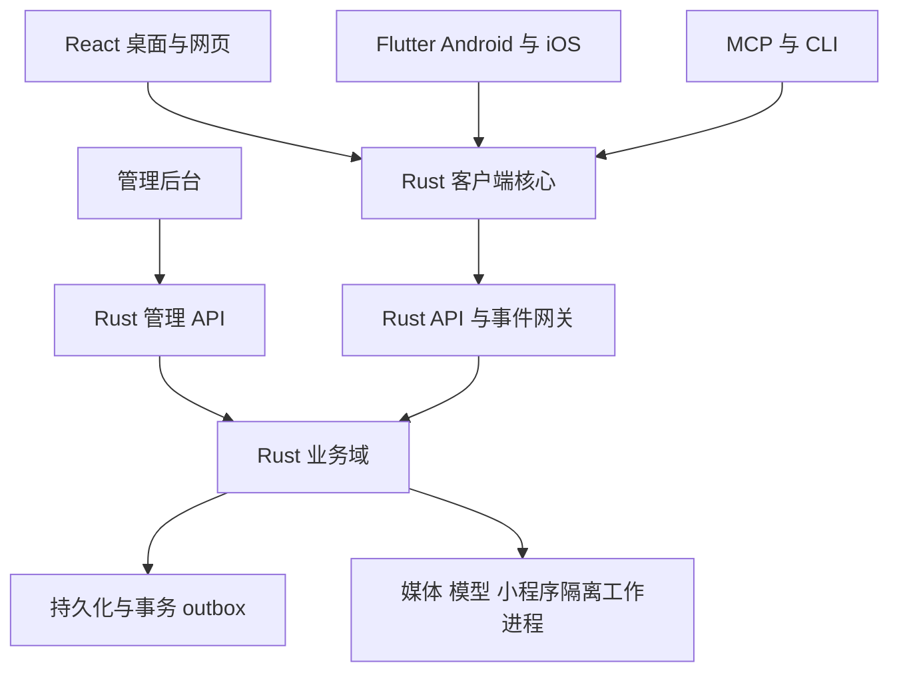

<!-- wxlike全平台开发总册；分组文件及机器清单见配套ZIP。 -->

# wxlike 全平台开发交接包

基线：`d0bef13ad60c1f8b56a741789aab93c66026ae8b`；研究日期：2026-10-24。

范围：Win/macOS/Linux桌面、网页、Android/iOS；一套Rust服务端（Linux生产/Docker、Win/Mac可跑）；管理后台、小程序容器、MCP/CLI；共享Rust业务核心、统一云CI。目标是UI每个产品入口实现字面功能，并有持久化、权限、错误恢复和跨端证据。

## 阅读顺序

1. `00_master_guide.md`：范围、架构ADR、各组所有权、协议、安全、CI与合并次序。
2. `01_contracts_and_data.md`：具体模块结构、表约束、API族、跨域事务/补偿和测试场景。
3. `02_staffing_and_distance.md`：目前差距、8–12人职责编排、208–378开发人周粗估与里程碑；不能当固定报价。
4. `teams/G00.md`到`teams/G17.md`：18组92卡，每卡目标路径、接口、具体实现、验收、交接及上游参考。
5. `references.md`与`upstream_manifest.json`：用户8仓及新增成熟项目；29个远端完整SHA研究锚点、许可边界与直接依赖/移植/参考分类。

## 分派与追踪

- `task_board.csv`：可筛选分派；`tasks.json`含实现正文、hard_dependencies与integration_dependencies。硬依赖图已校验无环；集成依赖允许ports/SDK间存在协作循环，用先冻结契约和fixture打断等待，不能误当所有组必须串行。
- `owners.json`：计划的互斥目录所有权；G00-02落实到真实仓库后生成CODEOWNERS。各域契约、迁移草稿、集成请求亦分owner。当前是发包设计，不是已执行的分支保护规则。
- `entry_seed.csv/json`：上传UI的282个onClick语法位置，附源文件行列、组件、handler及hash、初始owner/task。自动分类是启发式，必须人工复核；map/菜单/长按/onChange/键盘/无handler图标还要在G00-01展开为正式运行时入口总账。这份文件没有宣称282项就是全部功能。
- `provider-register.csv`：17类外部/基础设施依赖，尚未替用户选择或开通供应商；真实支付/票务/医疗等缺证据时保持阻塞。
- `templates/`：PR、集成请求、action与入口记录模板。
- `validation_report.json`：本交接包ID/依赖/归属/种子hash的一致性验证，不能当作产品功能或CI验收通过。

第一批先发G00-01/02/03，G17-01同步做来源审查，再开G01-01。不要92卡同时从旧主干开始改巨型文件。每人取自己的组文件；跨组只用已冻结ports和fixture。一个人可以兼组，但同一时刻不得有两个owner写同一路径。

## 事实与限制

这是可实施的开发方案与任务包，本次没有实现产品代码、修改远端仓库、批量创建GitHub issue或分配真人。旧项目可复用内容已纳入，不重复做已完成的ureq 3迁移。没有保证零合并冲突或“完美”性能平衡；采用单owner、串行公共改动、契约版本、merge queue和实际测试降低返工。

许可证元数据只是筛选，实际引入需逐文件核查；AGPL默认行为参考，MIT/Apache也须保留版权和NOTICE。安全公告在依赖冻结时重查。iOS签名/审核、推送和第三方资金/服务联调不能由代码指南自行完成。


---

# wxlike 全入口、全平台开发与多人协作总指南

版本：1.0，2026-10-24。性质：待实施的开发设计与发包依据，不是已完成交付声明。

代码基线：`bear20252026/wxlike@d0bef13ad60c1f8b56a741789aab93c66026ae8b`。
UI 基线：用户上传的 `undefined-text-input.zip`，SHA256=`09299a1afeb710f7ea4c70d52b3a227eda5980e5bfbd3aa022d7bd57899dc754`。
已核查：UI 有 9 个桌面主页面、21 个手机页面；14 个 TS/TSX 文件中有 282 个 onClick 属性语法位置、168 个 notify/onNotify 调用位置。这里是源码位置数，不是去重后的业务功能数；map 生成的多个按钮须按每个枚举值验收。UI 生产构建、TypeScript 检查通过；未接业务网络、原生能力或持久化。当前后端不是零起点，本指南要求复用已有实现和测试。

## 0. 最终范围与完成定义

必须交付：①桌面 Win/macOS/Linux（Tauri + React）；②网页（React + Rust WASM SDK）；③Android/iOS（Flutter + Rust UniFFI）；④同一服务端代码在 Linux 生产/Docker 运行、Win/macOS 可运行；⑤独立管理后台；⑥应用内小程序容器；⑦MCP/CLI AI 命令面。三类客户端，不是只有三个操作系统。

“同一套 Rust 核心”的约束：业务校验、权限规则、金额/订单计算、消息幂等/排序/同步、设备与密钥生命周期、命令目录及小程序宿主授权都用 Rust；TS/Dart/Swift/Kotlin 负责布局、输入、OS API、媒体设备与 FFI 适配，不再实现第二套金额、消息投递、权限算法。服务端是最终授权与交易事实来源，客户端共享 Rust 不能替代服务端验证。各端不必链接同一个二进制，不将服务端数据库/axum 带入手机和 WASM。

“全入口字面功能完成”：用户点击后真的发生对应读取/写入/设备操作，并在另一账号或服务端形成可验证结果；成功提示只能来自确定成功状态；刷新、重启、网络恢复后状态一致。禁用、隐藏、写“开发中”可以用于中间版本，但不能用来通过最终全范围验收。外部供应商尚未开通的功能标记 BLOCKED_EXTERNAL，不能假装完成。

产品默认是自主 wxlike 生态。微信样式、文案和示例数据不能证明能访问真实微信好友、微信支付、微信小程序、公众号平台。若要求这些生态互通，须另有官方可用接口和实际授权，作为外部依赖登记；不得靠模拟网页、未公开协议或静态二维码交差。

### 0.1 入口闭环记录

每个入口登记 `entry_id, platform, source, rendered_variant, action_id, task_id, domain_owner, api, permission, states, test_id, provider_dependency, status`。本包附 282 个 onClick 源码位置的种子清单；这不是完整运行时控件审计，G00-01 必须展开 map/菜单/快捷键、无 handler 的可点击图标、输入回车、拖拽和系统返回等，形成最终清单。演示网站的视图选择/滚动导航单独标为 showcase，不混入产品业务；产品中的设备同步、窗口控制不能借此删除。

状态：PLANNED → CONTRACT_READY → IMPLEMENTING → INTEGRATED → CI_VERIFIED → DEVICE_VERIFIED → ACCEPTED；BLOCKED_EXTERNAL 单独计数。最终发布 ACCEPTED 覆盖全部产品入口，且阻塞项为 0。

## 1. 已有代码与计划改造边界

已存在：platform 账号/好友/群/朋友圈/收藏/虚拟钱包/媒体/密钥与审核；net QUIC/WS、认证、离线 claim/ack 与 delivery outbox；client HTTP Executor；core Olm/Megolm；rtc/sfu/video；admin；cmd/cli/mcp；移动登录/会话/聊天；桌面/Web 客户端。

已核查的缺口：手机实时接收、网络恢复触发和重试后的列表刷新；桌面口令派生快照 API 已有而 SecretStore 仍用同目录 key 文件；多设备密钥分发未完整；端到端处理确认不能仅等同 socket write；内容平台/卡券/服务聚合/真实支付尚未形成完整业务。本指南不能拿已关闭旧 issue 当这些能力已验收的证据。

当前 ureq 3.5.0、async-nats 0.50.0、Tantivy 0.27 已合入，禁止重复发“迁移 ureq 3”任务。根与桌面有独立锁文件，都要扫描。当前 CI 和 audit 绿不代表新增全平台目标已覆盖；覆盖率与 unwrap 统计目前非严格阻断。

用户列出的 8 个 refs 镜像本次环境没有找到，不能声称已本地逐行审查。本包的 upstream_manifest.json 来自联网读取的远端 HEAD/目录/许可证样本；正式移植必须检验开发者本地镜像 SHA 与此记录，且再次扫描公告。记录的 HEAD 是定位锚点，不是安全发行版本推荐。

## 2. 总体架构与 ADR

### ADR-01：模块化单体、共享业务核心、少量隔离工作进程

对外只有 Rust API/事件网关和独立 Rust 管理 API。身份、会话、聊天、内容、交易、目录等先在单服务进程分域，域间通过 Rust 服务接口调用；禁止为了并行按人拆成十几个远程微服务。转码、模型推理和不可信应用执行隔离为工作进程，仍由同仓库 Rust 程序调度。数据库、S3、Redis/NATS、coturn、FFmpeg 属通用基础设施，不是第二套业务核心。



### ADR-02：客户端核心的编译边界

- `wxlike-types`：稳定 ID、DTO、错误码、状态、序列化，不依赖数据库、网络或 UI。
- `wxlike-domain`：纯业务不变量与策略函数；服务端再次执行，客户端仅预检/呈现。
- `wxlike-client-core`：命令调度、会话状态、outbox/sync/密钥状态，依赖 ports。
- `wxlike-client-native`：Tokio HTTP/QUIC/WS、SQLite 缓存、OS SecretStore 适配。
- `wxlike-client-web`：同核心的 wasm32 构建；Rust 驱动 browser fetch/WS/IndexedDB，经窄 web-sys 适配器，不包含服务器和原生线程。
- `crates/ffi`：UniFFI 长期对象、异步任务和可取消事件订阅；Dart isolate 继续沿用。
- Tauri commands 和网页 WASM 暴露同一 `dispatch(ActionRequest)`、`subscribe(EventCursor)`；Flutter 包装同一接口。不能继续手写三套 bincode enum 序号。

这些是目标 crate 名，G00 在 Wave 0 建目录与迁移映射，G01 实现。旧 crates/core/client/net/cmd 不全部重写，先抽纯类型与 ports，保留旧入口兼容层；先有兼容测试再删除旧路径。Rust WASM 的编译通过、浏览器实际存储/收发/加解密可运行是单独验收，不把 native 测试通过推论成 WASM 可用。

### ADR-03：服务端存储与部署配置

保留现有 SQLite/WAL 单节点作为迁移期 profile，不把 SQLite 文件挂到多主机共享卷。完整生产目标采用 PostgreSQL 作为统一服务端业务事实库，客户端继续 SQLite/IndexedDB；新资金业务仅在经事务与恢复验收的生产 profile 开放。由 G00-04 领导专门迁移波次，G01提供 repo ports，各业务组只实现域内 repository；G00唯一登记 SQL 迁移序号。

目标 PostgreSQL 在 Linux/Docker、Win/macOS 都是相同数据库依赖，Win/Mac Rust 服务可连接远程或本机 PG；不能因为 Win/Mac 可跑就自动要求内嵌数据库。迁移期 SQLite 服务可做开发/旧数据导入，不承诺它与 PG 永久维持两个生产真相。迁移完成前不得将多 hub + 各自本地 SQLite 宣称为一致的生产集群。

迁移：Repository trait → SQLite 旧行为契约 → PG schema/索引/约束 → 离线一致性导入（ID、seq、游标、金额守恒、密文原样）→ 预生产影子读取对账 → 短暂停写、最终增量、切配置 → 留可回退快照。禁止未设计的跨库双写；资金落账与订单状态/发件箱同库事务。全文索引是可重建投影，不承担授权真相。

媒体通过现有 MediaStore 接 OpenDAL/S3；数据库存逻辑引用/ACL，不向客户端把内容哈希当永久授权。Redis 只做租约/限流/临时状态，MQ 只运送事件；不能把余额真相放 Redis。实际容量和 SLO 在 G00-05 负载包测出，不预先承诺万人/百万连接。

### ADR-04：统一协议与兼容性

HTTP `/api/v1/*` 采用 JSON DTO，现有 `/api/*` 保持一个明确兼容窗口；实时走版本化 `ClientHello/Auth/Subscribe/Command/Event/Ack/Resume`，QUIC/WS 同 envelope 语义。首轮不硬切 bincode 版本：先为现有二进制格式生成跨端 fixture、定义 protocol v3，再允许可协商升级；已安装旧客户端能被明确提示更新而非乱码断连。

ID 为不透明字符串；现有 16-byte msg_id 必须原样保留，不为使用 UUID 库重写历史 ID。金额是整数最小币种单位，带 currency，不用 float；u64 seq、版本、金额在 JSON/JS 边界以十进制字符串表示，杜绝 >2^53 精度损失。时间戳为 UTC 毫秒，权威排序和过期由服务端时间产生，保留 client_sent_at 仅供诊断。

```json
{"action_id":"msg.send","request_id":"opaque-id","schema_version":1,"idempotency_key":"device:opaque","params":{"conv_id":"opaque-conv","body":{"type":"text","text":"你好"}}}
```

```json
{"event_id":"opaque-event","aggregate_id":"opaque-conv","aggregate_version":"42","event_type":"message.accepted","server_time_ms":"1790000000000","payload":{"msg_id":"opaque","seq":"42"}}
```

错误统一 `code,message,field_errors,retryable,retry_after_ms,request_id`。公共错误码 `UNAUTHENTICATED/FORBIDDEN/VALIDATION/CONFLICT/RATE_LIMITED/REQUIRES_CONFIRMATION/DEPENDENCY_UNAVAILABLE`；已提交但响应丢失用幂等查询，不把所有网络错误归为“没发生”。GET 不做业务扣减；claim OTK 改为明确命令/POST，保留旧接口兼容期。

客户端状态：DRAFT → LOCAL_QUEUED → SENDING → SERVER_ACCEPTED → DEVICE_STORED → READ；失败区分可重试与终态。socket write 只到传输成功，不等于 DEVICE_STORED；服务端 receipt/设备存储确认各有定义。Outbox/dedup/投递任务必须同一消息 ID，重复请求补未完成收件人，不产生第二笔业务。

### ADR-05：域接口与事件驱动边界

API handler 只解析/鉴权/调用 usecase，UseCase 持有 UnitOfWork，Repository 不发网络；业务事务写 domain_event/outbox，commit 后 worker 投影到搜索/通知/推送。跨域以公开 Rust trait 和 ID 引用，禁止直接 UPDATE 其他域表；资金与订单原子边界由 CommerceUseCase 在同 PG 事务内编排。第三方回调经过验签/去重/状态机，不直接把 HTTP 200 当付款成功。

给每个域独立 `contracts/domains/<domain>/`、`crates/features/<domain>/{domain,application,infrastructure,http,tests}`。每个域导出 `routes(state)`、`register_commands(registry)`、`register_jobs(registry)`、`capabilities()`，由 G00 在组合根装配；组员在自己的 integration-request.yaml 声明需求，不同时改 server/main/lib。

### ADR-06：小程序的可移植执行模型

首发包规范为签名 manifest + 完整资源摘要 + HTML/CSS/JS UI + 受限宿主桥；清单、权限判定、包验证、版本水位和宿主命令都在 Rust。桌面使用独立无特权 WebView，网页独立 origin sandbox iframe，移动独立 WKWebView/Android WebView；不可信页面绝不拥有 Tauri 全局 IPC、主应用 token 或本地文件系统。

Boa 是兼容/可控逻辑执行器候选；Wasmtime 仅作为服务器/桌面可选扩展，不将任意 JIT 当作 iOS 必备能力。iOS 选择 HTML/JS 与平台允许的执行模式，实际商店审核单独列 Gate；网页不能依赖 OS 进程隔离，必须以 origin、iframe sandbox、CSP 和 broker 限权。资源预算按内存/CPU/并发/桥调用/磁盘/网络分别测试。

### ADR-07：RTC 引擎唯一，避免拼两套房间真相

保留现有 str0m/rtc/sfu 作为首选基线，先由 G09-01 跑跨网和移动采集可行性矩阵。媒体采集/渲染可调用成熟平台组件，但房间成员、呼叫状态、token 和权限由 Rust 服务控制。LiveKit 作为架构/客户端参考；若候选验证显示当前引擎无法满足各端需求，只能由全局 ADR 一次性改选，不允许一组接 LiveKit 房间、另一组继续自研 SFU。

DTLS-SRTP 传输加密不等于经 SFU 后仍端到端加密。UI 的“端到端加密”必须绑定已实现的媒体 E2EE 协议与设备认证；未达此能力时不允许显示该承诺。既然设计要求全功能，G09-04必须完成此项或全范围发布仍不通过。

### ADR-08：性能、离线与移动生命周期

React/Flutter仅投影当前可见分页，不同时保留所有视频/聊天；虚拟列表、图片缩略图、取消订阅、惰性初始化、后台限速是必需项。统一缓存淘汰策略由 Rust core 生成决定；端点可按 OS 内存压力要求缩减。模型默认服务端按需加载，手机不常驻大模型。建议初始验收预算：桌面主会话页 RSS 目标 <250MiB、Android 前台 PSS <180MiB（标准数据集/机型另附，不作为无条件承诺）；数据集为 1000 会话、每会话 200 条缓存、10张缩略图，视频/模型峰值另记。测量超标必须有优化卡，不隐去指标。

iOS/Android 前台实时 WS/QUIC + resume cursor；后台由 APNs/厂商推送唤醒线索，恢复后主动增量同步，不能靠永久后台 socket 或推送正文当消息真相。网络变化触发有界队列泵；断网、进程被杀、token过期分别处理；私密正文默认不进推送。

## 3. 全入口功能域与真实实现要求

| UI 功能 | 业务域负责人 | UI负责人 | 最低真实闭环 |
|---|---|---|---|
| 聊天列表/置顶/未读/群聊/全部已读 | G03 | G10/G12 | 服务端偏好与游标；跨端同步；重启保留；过滤真正改变集合 |
| 文本/图片/语音/文件/链接/表情/引用/撤回/转发 | G03+G04 | G10/G12 | 上传引用/安全预览/发送状态/失败补偿；撤回与权限真实执行 |
| 联系人/新朋友/星标/备注/标签/共同群/群管理 | G02 | G10/G12 | 双向关系与反滥用；共同群受授权；操作幂等 |
| 朋友圈/相册/赞/评论/举报/屏蔽 | G05 | G11/G13 | 发布-审核-可见性-互动通知；删帖后的索引与附件一致 |
| 收藏/笔记/分享/复制/排序 | G05 | G11/G13 | 独立收藏对象、全文/类型筛选、系统剪贴板真调用、持久笔记 |
| 文件中心/拖拽/截图/下载/迁移/清理 | G04 | G10/G11/G12/G13 | 原生/浏览器权限适配；进度、取消、校验、ACL、恢复 |
| 视频号/关注/热门/直播/发布 | G05+G04+G09 | G11/G13 | 自主创作者内容流、播放器、互动、推流、停播回收 |
| 公众号文章/在看/分享/关注 | G05 | G11/G13 | 自主发布者文章管理与订阅；非微信平台既有公众号导入承诺 |
| 小程序最近/分类/推荐/打开 | G08 | G11/G13 | 可运行安装包、权限、更新、撤销与真实应用内容 |
| 余额/账单/转账/红包/充值/提现/银行卡 | G06 | G11/G13 | 虚拟账本与真实资金分账；支付机构实际联调与对账 |
| 收付款二维码 | G06+G07 | G11/G13 | 标准二维码、短期支付意图、扫码确认、金额/收款人校验 |
| 会员卡/优惠券/票证/核销 | G06 | G11/G13 | 可发行、领取、使用和一次性核销；商户后台真实存在 |
| 扫码/闪光灯/相册识码/识物/翻译 | G07 | G11/G13 | 相机帧、图像解码、模型/供应商识别、超时和隐私设置 |
| 附近/位置/摇一摇 | G07 | G11/G13 | 实时授权位置、近似公开、匹配TTL、拉黑举报与反枚举 |
| 手机充值/缴费/医疗/出行/票务/酒店/电影/公益/购物/游戏 | G07+G06+G08 | G11/G13 | 服务目录→报价→订单→支付→供应商结果→取消退款/客服 |
| 账号安全/通知/外观/快捷键/自启/关于/退出 | G02+G03+G04 | G10/G13 | 配置落盘并生效、通知与设备权限真实、退出撤销会话并清敏感缓存 |
| 搜一搜/热搜/分类结果 | G05+G07 | G10/G13 | 各域授权搜索聚合、真实趋势计算；不把静态关键词冒充热搜 |
| 通话/静音/扬声器/摄像头/最小化 | G09 | G11/G13 | 实际媒体轨控制、呼叫状态和各平台音频路由 |
| 手机与桌面同步 | G03 | G10/G12 | 同用户设备游标、状态与消息一致；不是两个 React 内存对象 |
| AI 命令/管理后台 | G15/G14 | G14 | 与普通客户端同业务用例，额外scope/审计，不开隐蔽越权入口 |

### 3.1 外部依赖登记与金融边界

全功能不能从示例数据“搬”出真实银行、医院、运营商、交通、酒店和公益机构。代码组必须实现真实可切换 ProviderPort，并通过供应商 sandbox/预生产/必要的受控生产验收；资金支付和真实服务动作由有权限的产品负责人组织验证，不自动替用户付款/开户。供应商、区域、费率、凭据、回调域名、证书、数据处理范围和退订/退款政策填写 provider-register.csv。实际供应商尚未确定的入口仍属于最终范围，状态保持 BLOCKED_EXTERNAL；本指南给出了可写代码和验收契约，不伪造采购结果。

交易相关含真实钱的余额不能复用开发 fund faucet 注入。客户银行卡仅保存机构 token 与必要掩码，原始卡密/PAN/CVV 不落应用库。虚拟账本与法币账户分别展示，充值到账只能由已核验回调/查询和对账证据确认。提现是申请→校验→锁额→提交→处理中→成功/失败解冻的状态机，不以按钮响应写“已到账”。具体外部服务资格和上架条款由负责人按现行官方要求确认；开源代码不能代替该条件。

## 4. 防冲突协作制度

### 4.1 唯一归属

公共文件只由 G00 集成负责人修改：根 Cargo.toml/Cargo.lock、ui/src-tauri/Cargo.lock、pnpm/package lock、workspace配置、server组合根、platform/lib.rs、platform/db.rs、客户端根router、全局主题token、CODEOWNERS、工作流汇总、迁移序号总表、vendor清单和NOTICE索引。业务组可在独立 crate 内声明依赖，但根锁只由集成机器人再生。

G00 Wave 0 先迁出旧大型文件：`ui/src-tauri/src/lib.rs` 按 commands/auth/chat/media/secret/call/system 分模块；`ui/src/ui.ts` 按 feature 拆分；`crates/platform/src/db.rs` 分成迁移登记与域迁移；`crates/client/src/execute.rs` 分成域命令表。只移动、接模块和补兼容测试，不夹业务改动。迁完公布 path-map-v1，各组只在新路径工作。

| 组 | 唯一可写业务路径（计划目录，G00先建） | 禁改边界 |
|---|---|---|
| G00 架构/集成 | composition/**、contracts/common/**、schema/registry/**、根清单/锁/总router/CI汇总 | 不代替域组实现功能；契约变更留RFC |
| G01 Rust SDK/生成 | crates/client-core/**、client-native/**、client-web/**、types/**、ffi/**、tools/codegen/** | 不实现钱包/好友/订单服务端规则 |
| G02 身份/关系 | crates/features/identity/**、relations/**、security/** | 不写消息/付款数据表 |
| G03 消息/同步 | crates/features/messaging/**、crates/net/**、mq/**、message/** | E2EE算法模块归G02；媒体对象归G04 |
| G04 文件/媒体 | crates/features/media/**、crates/video/**、storage/** | RTC房间归G09；视频Feed归G05 |
| G05 内容/社交 | crates/features/content/**、favorites/**、discovery-content/**、search/** | 识物/服务搜索归G07；资金归G06 |
| G06 交易/卡券 | crates/features/commerce/**、crates/ledger/** | 不在UI写财务算法；供应商服务目录归G07 |
| G07 发现/服务/模型 | crates/features/discovery/**、service-catalog/**、vision/**、translation/** | 交易落账调用G06；图片存储调用G04 |
| G08 小程序 | crates/container/**、dpage/**、features/miniapps/**、packages/mini-sdk/** | 主应用权限/凭据不授予guest |
| G09 RTC | crates/rtc/**、sfu/**、features/calls/** | 不写媒体文件任务与账号/群成员事实 |
| G10 React核心 | apps/desktop-web/src/features/{auth,chat,contacts,settings,search}/**、shell/** | 公共UI原子G00分配子包；不改G11页面 |
| G11 React扩展 | apps/desktop-web/src/features/{content,files,video,commerce,mini,discover,calls}/** | SDK、router装配、核心chat禁止改 |
| G12 Flutter核心 | apps/mobile/lib/features/{auth,chat,contacts}/**、shell/**、platform/** | 不改G13扩展页、生成Dart绑定 |
| G13 Flutter扩展 | apps/mobile/lib/features/{content,video,commerce,mini,discover,settings,calls,search}/** | 原生桥新增需求交G12平台owner |
| G14 管理台 | apps/admin/**、crates/admin/** | 不写域表；域管理命令由域组提供 |
| G15 AI命令 | crates/cmd/**、cli/**、mcp/**、agent-policy/** | 不凭管理员token直连DB或任意HTTP |
| G16 DevOps/验收 | deploy/**、containers/**、tests/e2e/**、tests/fault/**、ci/jobs/** | 不直接改公共workflow；交G00装配 |
| G17 安全/复用治理 | security/**、third_party/reviews/**、tests/security/**、tools/source-audit/** | 产品补丁交owner，不越过owner抢改 |

这些 glob 中 `{a,b}` 是文档简写，CODEOWNERS必须展开成明确行；G00 维护机器可读 owners.json，CI 对变更逐路径解析“最具体规则优先”，无法匹配或匹配两个owner即拒绝。生成物由 G01 生成，不手工改。每组多人时按下文卡顺序串行，或先由该组负责人分配互斥子目录并更新owners；不能两人同时拿同一域的同名文件。

补充精确归属：`crates/core/src/e2ee.rs`归G02，纯策略`crates/domain/**`归G01。各组的`contracts/domains/<domain>/**`、`schema/proposals/Gxx/**`和`integration-requests/Gxx/**`归对应组，G00只改公共契约、编号登记与装配；不能将整个integration-requests目录同时声明G00独占。owners.json给出展开后的互斥目录；迁移到真实仓库后再由G00生成CODEOWNERS并验证所有旧路径归属。

### 4.2 分支、迁移与合并

一卡一分支一worktree，`feat/FP-Gxx-nn`，从已合入的contract tag创建；不要把另一个未合并功能分支当基线。每PR原则上一个任务的可回滚纵向增量，纯搬移/格式化/依赖升级与业务分开。根文件改动写 `integration-requests/Gxx/<task>.yaml`，含依赖、route挂载、command挂载、配置、migration提案；G00在对应串行集成PR执行。

PR必须包含：baseSHA/contract版本、入口ID、允许文件、数据库/协议兼容性、upstream来源与许可证、测试证据、回滚步骤。merge queue在最新main重新跑必需检查；rebase时不运行全仓格式化，不用“接受我方/对方全部”解决冲突。出现公共类型/迁移/余额语义冲突即退回契约阶段，而不是合并后靠运行猜。

数据库迁移由域组在 `schema/proposals/Gxx/` 提供无编号草稿和回填方案；G00分配唯一单调编号、审查跨域约束，并串行落主干。采用 expand→backfill→switch→contract，删除字段至少跨一个兼容窗口；回滚优先旧二进制继续读expand schema，不把破坏性down migration当资金回滚。

合并顺序固定：纯移动 → ports/DTO/fixture → Repository与迁移 → 域用例/API → SDK绑定 → UI集成 → 端到端/平台签名 → 外部服务验收。与同一数据结构有关的卡不能被“独立路径”掩盖依赖。每波最多合入一个协议版本变化，兼容层移除由G00批准。

## 5. 跨端 API/事件/安全契约

### 5.1 操作与域数据

Identity：User/Device/Session/FriendRequest/FriendEdge/Group/Member；Messaging：ConversationPreference/Message/DeliveryTask/DeviceCursor/Receipt；Media：Object/Reference/UploadSession；Content：Post/Audience/Comment/Reaction/Article/Subscription/Favorite/StickerPack；Commerce：Account/LedgerEntry/PaymentIntent/Transfer/Withdrawal/Refund/CardToken/Coupon/Ticket/RedPacket；Discovery：ServiceOffer/Quote/ProviderOrder/GeoPresence/Match；Mini：App/Release/Install/Grant；RTC：Call/Participant/MediaSession；Admin：Operator/Role/Permission/Audit/ReviewCase。

每个字段由域schema给类型、长度、nullable、索引、生命周期、可见性与owner。禁止各组另建同名User、Money、Message。跨域通过外键/opaque ID与服务接口，内容和金融不能使用聊天 msg_id 当订单主键；关联用origin_message_id。

### 5.2 统一 Action Catalog

所有UI动作映射稳定 action_id（如 identity.friend.request、messaging.send、content.post.publish、commerce.payment.confirm、mini.install）。catalog记录参数schema、返回schema、scope、资源约束、确认强度、幂等/重试、审计、可离线性和支持平台。

不同表面共用同一 ActionDispatcher；不是强迫所有低层OS动作走远程API。截图/文件选择/摄像头采集是PlatformPort，本地完成后只把有授权的引用交域命令。MCP不能把host.camera.read等私有平台能力列为无确认工具。服务端在身份/资源/域角色上再次判定；UI、CLI的scope不足只能更严格，不能给管理员API开后门。

### 5.3 Rust契约示例（设计草图，非已可编译实现）

```rust
pub trait MessagingPort: Send + Sync {
    async fn submit(&self, actor: &ActorContext, cmd: SendMessage)
        -> Result<AcceptedMessage, DomainError>;
    async fn resume(&self, actor: &ActorContext, cursor: DeviceCursor)
        -> Result<EventBatch, DomainError>;
}
pub struct ActorContext {
    pub user_id: UserId,
    pub device_id: DeviceId,
    pub session_id: SessionId,
    pub scopes: ScopeSet,
    pub request_id: RequestId,
}
pub trait PaymentProvider: Send + Sync {
    async fn create_intent(&self, cmd: ProviderIntent) -> Result<ProviderResult, ProviderError>;
    async fn query(&self, reference: ProviderReference) -> Result<ProviderResult, ProviderError>;
    async fn refund(&self, cmd: ProviderRefund) -> Result<ProviderResult, ProviderError>;
    fn verify_webhook(&self, headers: &Headers, raw_body: &[u8]) -> Result<VerifiedEvent, ProviderError>;
}
```

trait异步对象安全与运行时选型由G01落实（泛型或async-trait/boxed future），不要将示例直接当可dyn的完整声明。CancellationToken、deadline和trace_id贯穿原生、WASM和FFI；同步FFI绝不跑在Flutter UI isolate。

## 6. 全局安全与近期公告

核查时间2026-10-24。以下是已联网确认的公告，不是断言本项目都受影响；实际适用性由锁文件、启用features和运行路径确认。补丁版本只是当日最低条件，冻结依赖时重查，不用“最新HEAD”代替已验证发行版。

| 组件/公告 | 当日核查结论 | 本项目动作 |
|---|---|---|
| webpki-roots RUSTSEC-2026-0381 | 1.x父依赖需>=1.0.10；0.26.11兼容包本身不含独立根库 | 保留现有修复，根/桌面/WASM依赖图分别扫描 |
| rustls-webpki RUSTSEC-2026-0382 | 稳定修复分支>=0.103.16且<0.104.0-alpha.1 | 防止新库拉回旧分支；不能只看顶层rustls |
| ctutils RUSTSEC-2026-0385 | 修复>=0.4.4；现有锁已0.4.5 | 密钥操作常量时间，新增模型/crypto依赖也检查 |
| Wasmtime RUSTSEC-2026-0379，Critical 9.9 | 修复36.0.19..<37、48.0.7..<49、>=49.0.4 | 若启用Wasmtime，选择同时覆盖全部公告的维护分支；此条影响aarch64更关乎手机/ARM服务器 |
| Wasmtime RUSTSEC-2026-0380，Critical 9.9 | 修复36.0.19..<37 或>=43.0.0 | 与0379取交集，如49.0.4+仅是当日候选，不单独保证全公告安全 |
| @vitejs/plugin-rsc GHSA-59pf-q495-3c99，Critical | 受影响<0.5.38，修复0.5.38；涉及被vendor的RSC | UI是普通React/Vite SPA，未检出plugin-rsc，不误报React版本即受影响；新增RSC前需专项评审 |
| ammonia RUSTSEC-2026-0373 | 修复>=4.2.4 或4.1.8..<4.2 | HTML/CSS净化器候选必须选修复版本，默认禁style和外链资源 |
| coturn GHSA-f6hc-79w3-p8pq / GHSA-847g-qmc6-6m4r | 官方均列修复4.17.0；分别涉及mobility配额及even-port耗尽，Moderate不是Critical | 镜像锁digest、禁无需求功能、短期凭据、配额与监控；重查更新公告 |

安全基线：无认证拒绝；token摘要/OS密钥库；E2EE不降明文；签名预密钥和设备变更确认；每条私有数据读写检查对象归属；结构化错误不漏token；所有外部URL/重定向/DNS/代理出站走统一SSRF策略；图片/视频/包/模型有解码后大小、时长和执行预算；HTML净化并CSP；小程序签名覆盖全部资源；AI取出的聊天内容永远当数据不能当系统指令。

资金、账户恢复、后台提权、插件授权等敏感动作要近期重新认证或明确确认。幂等键必须和actor、action、资源、参数摘要绑定，不能让用户用同key替换付款内容；webhook去重和状态转换用事务/行锁验证；并发红包、提现与退款不能突破守恒。不能用浮点、UI余额、缓存余额决定是否够钱。

## 7. 云端 CI 与发布矩阵

“同一套门禁”是同一仓库工作流与同一源码SHA的跨目标矩阵，不是只在Linux跑一次。G16写独立ci/jobs/Gxx片段，G00唯一装配workflow。云端承担全量构建、重型测试；本地只跑按卡所需轻检查，遵循现有仓库节制缓存的规则。共享路径/契约变更强制全矩阵，不能靠paths过滤跳过下游。

| Gate | 目标与实际要求 |
|---|---|
| C0契约 | schema兼容、生成物零diff、所有action有执行器、所有入口映射与测试、owner检查 |
| C1 Rust | Linux/Windows/macOS，目标features分别check/test/clippy/doc；关键生产features不能仅默认关闭 |
| C2 React/Web | typecheck、unit、Playwright双账号真实服务端、wasm32构建、浏览器WASM加密/存储/WS |
| C3桌面 | Windows安装包、macOS arm64/x64、Linux包；Tauri IPC/原生文件/权限/更新测试；签名产物独立gate |
| C4 Android | arm64 release APK/AAB、生成FFI/so、manifest权限、模拟器仪器测试、真机夜间证据 |
| C5 iOS | macOS runner构建XCFramework(设备+模拟器)、Flutter集成测试、模拟器启动；有凭据时签名archive/IPA |
| C6服务端 | Linux amd64/arm64 Docker非root、多阶段；Win/Mac原生启动健康/API/迁移同契约 |
| C7管理/Agent | RBAC/MFA/CSRF/审计、MCP协议一致性、stdio/HTTP授权、CLI machine JSON输出 |
| C8资金/供应商 | PG并发账本、签名回调重放、退款、订单超时、供应商sandbox；真实联调证据单独gate |
| C9安全 | cargo audit/deny、npm审计、SBOM/容器/secret scan、source引入清单、模糊/越权/SSRF/包炸弹测试 |
| C10质量/性能 | 关键域覆盖率门槛、突变测试样本、内存/延迟/断线数据集；逐步把新域阈值设硬，不把non-blocking报表说成门禁 |
| C11最终发布 | 同SHA、版本/协议/schema矩阵、全部设备验收、签名哈希、恢复演练、供应商凭据可用、回滚包 |

iOS/macOS签名、APNs、支付与其他供应商、安卓国内推送凭据属于SECRET/EXTERNAL门禁，缺失时明确BLOCKED，不在正式发布把skip视为成功。PR可跑无签名/沙盒测试，但“全范围可发布”必须汇聚签名与实际设备Gate。不可在不可信PR上开放这些secret；使用受控环境部署与短期凭证。工作流action按审核后的完整SHA固定，Dependabot更新；不是永远固定某个过期tag。

## 8. 完整交付波次

W0（先串行）：G00/G01/G17盘点入口/许可，拆公共文件、冻结DTO/路由/目录owner、CI骨架。输出contract-v1和可运行旧功能，未完成不得散发多人改同入口。

W1：G02身份密钥、G03消息状态、G04存储、G01各端SDK、G16基础CI；G10/G12只接mock ports做界面开发，不把mock当集成验收。

W2：G00组织PG迁移；G05内容、G06交易、G07发现服务、G08小程序、G09RTC在冻结ports上并行；各域迁移按序集成。PG核心未完成不得混合两个生产账本。

W3：G10/11 React、G12/13 Flutter、G14管理、G15AI逐个纵向接真服务；复杂功能按既定命令由域组交SDK扩展请求；不要相互复制业务规则。

W4：供应商真实联调、推送、音视频跨网、签名/上架包、小程序三类宿主、数据迁移/备份恢复、跨设备密钥与攻击测试；所有入口从INTEGRATED升DEVICE_VERIFIED。

W5：独立验收人从种子清单展开所有variant做全回归，所有对外文案与实际语义对齐；全部ACCEPTED且BLOCKED_EXTERNAL=0后才称完整交付。没有任何代码设计能保证绝不发生合并冲突，本制度通过单owner、契约先行、合并队列和不变量测试降低冲突并使其可定位。

初始资源建议按18个职责组分配，可由8–12人兼任互不同时写相同路径的组；G00集成和G17安全复核保持独立评审。不是要求18人同时开工。完整范围超出几周UI接线，工期由逐卡估时、外部供应商与真机排期确定；首个里程碑用G10/G12的双账号文本纵向切片验证节奏，再估完整排期。

## 9. 每卡统一交付物

每卡必交：需求对应入口列表、代码/契约/数据迁移、upstream_manifest条目、功能和对抗测试、云端CI链接、实际设备证据、配置文档、回滚/兼容窗口、已知限制。禁止只提交壳、TODO、假数据、成功toast或“框架已完成”。任务卡正文在本包teams/下；task_board.csv可用于导入管理工具，尚未自动创建新的GitHub issue或分配真人。

## 10. 研究来源与边界

本包references.md详细记录用户指定8仓及新增候选的可借部分、禁复制范围和联网定位；upstream_manifest.json保存检索时完整SHA。没有复制第三方实现或改动wxlike仓库。许可判断是工程准入分类，具体引入必须由G17按文件头/NOTICE/商用目录再核；不是对整个仓库提供无限制搬运保证。

主要公告与平台来源：

- https://rustsec.org/advisories/RUSTSEC-2026-0381.html
- https://rustsec.org/advisories/RUSTSEC-2026-0382.html
- https://rustsec.org/advisories/RUSTSEC-2026-0385.html
- https://rustsec.org/advisories/RUSTSEC-2026-0379.html
- https://rustsec.org/advisories/RUSTSEC-2026-0380.html
- https://rustsec.org/advisories/RUSTSEC-2026-0373.html
- https://github.com/vitejs/vite-plugin-react/security/advisories/GHSA-59pf-q495-3c99
- https://github.com/coturn/coturn/security/advisories/GHSA-f6hc-79w3-p8pq
- https://github.com/coturn/coturn/security/advisories/GHSA-847g-qmc6-6m4r
- https://v2.tauri.app/security/capabilities/
- https://docs.wasmtime.dev/stability-platform-support.html
- https://modelcontextprotocol.io/docs/2026-07-28/tutorials/security/security_best_practices
- https://developer.apple.com/app-store/review/guidelines/ （iOS小程序/支付/分发按提交时现行规则专项验收）


---

# 跨组契约、数据设计与关键流程

这是目标设计；所有新路径由G00-02先建立。不是宣称下列API/表已经存在。G00-03发布contract-v1前，域负责人逐字段审查；冻结后增量兼容，禁止各端自行猜返回格式。

## 1. 模块内部结构与依赖方向

每个`crates/features/<domain>/`按`domain/`（实体/状态/不变量）、`application/`（用例/ports）、`infrastructure/`（PG/对象/外部供应商适配）、`http/`（DTO/鉴权/错误转换）、`tests/`分目录。小域不必五个crate，但依赖方向一致。domain不依赖axum/SQL/网络；application依赖domain与类型；infra实现ports；组合根注入。跨域只引用对方公开port和稳定ID，禁止import对方private infra或写对方表。

客户端domain只编译纯策略/类型，服务端用例最终决策；OS采集和渲染由平台桥处理，不能把摄像头驱动用Rust重写当共享业务的必要条件。FFmpeg、WebRTC平台媒体栈、SQLite、PG、模型runtime可以多语言；业务规则的唯一源仍是Rust。

### 1.1 每个域提交的文件

- `contracts/domains/<domain>/actions.yaml`：每个action的params/result/scope/confirmation/idempotency/offline/platform/errors。
- `contracts/domains/<domain>/events.yaml`：事件schema、版本、可见性与消费者。
- `contracts/domains/<domain>/fixtures/*.json`：成功、边界、权限失败、重放、旧版兼容样本。
- `schema/proposals/<group>/<change>.sql`：无编号迁移提案、索引、回填步骤，G00登记后进入正式迁移。G00维护全局migration registry，不替业务组撰写所有SQL。
- `integration-requests/<group>/<task>.yaml`：挂载、依赖、配置secret引用、jobs与迁移提案。

上述域契约与提案目录按域owner独占，公共目录G00独占。全局生成物G01生成并由G00装配，任何人不能手修已生成的TS/Dart。

## 2. 主表与原子边界

字段为最小集，不能代替最终SQL。所有含用户内容的表须另列删除/导出/保留政策。PG中的ID沿用现有格式，数据库唯一约束是并发正确性的最后一道防线，不能只在API里先查后写。

| 域与表 | 必需字段/约束 | 原子边界、权限与索引 |
|---|---|---|
| identity.session | id,user_id,device_id,token_hash,expires_at,revoked_at,rotation_version | token不存原文；device/session按user索引；轮换旧token撤销与新token写入同事务 |
| relations.friend_request/edge | from/to/status/version；owner/peer/preferences | 同方向活跃申请唯一；双向边关系同事务；备注仅owner可读写 |
| relations.group_member | group_id,user_id,role,joined_seq,left_seq,version | 活跃成员唯一；角色变更和成员事件同事务；历史可见规则引用入退群边界 |
| messaging.message | msg_id,conv_id,seq,sender_user/device,body_kind,ciphertext/allowed_plain,version,created_at,recall_state | `(conv_id,seq)`唯一；`(sender_device,idempotency_key)`唯一；授权成员才能读；密文不建正文服务端索引 |
| messaging.delivery_task | msg_id,target_device,status,lease_owner/expiry,attempt,next_at | 每消息每设备唯一；ack归目标设备；网络write不能删唯一消息事实 |
| messaging.device_cursor/receipt | device_id,stream_id,stored_cursor/read_cursor,version | cursor单调；授权与设备归属验证；ACK写入后允许GC仍需满足保留策略 |
| media.object/reference/upload | object_id,owner,size,digest,mime,status；ref_type/ref_id/audience；upload_offset/expiry | digest不授读权限；complete和逻辑引用有恢复机制；临时对象TTL清理 |
| content.post/comment/reaction | author,audience,version,moderation_state；target,parent；actor,type | 反应唯一；可见性必须查询时复核；索引删除与附件减引用走outbox |
| content.article/subscription/favorite | publisher/version/doc_schema；user/publisher；owner/type/source/snapshot/version | 文章净化；收藏源撤权政策明确；用户收藏内容不因公开ID可被别人读 |
| ledger.account/transaction/entry | owner,currency,kind；business_key,status；tx/account,amount_minor,direction | 每交易同币借贷守恒；业务键唯一；分录不可编辑，纠错反向分录；锁额与支出同事务 |
| commerce.payment_intent | actor,payee,amount_minor,currency,status,provider_ref,expires_at,version | provider_ref/event_id唯一；验签后合法状态转换；支付人与支付意图绑定 |
| commerce.redpacket/claim | total,count,remaining,group_id,expiry；packet_id,user_id,amount | 每用户每包领取唯一；行锁/串行化冲突重试；领取和分录/剩余额同事务 |
| commerce.entitlement/redemption | issuer,owner,rule_version,validity,status；token_hash,redeemed_at | 核销nonce唯一；凭券不意味着可查询用户所有卡；状态一次性转换 |
| discovery.offer/quote/order | provider,region,service_type；price,currency,expiry；provider_ref,state | provider订单唯一；支付与履约独立状态；失败补偿不跨网持有PG事务 |
| discovery.geo_presence | user,coarse_cell,expiry,visibility | 精确坐标不默认公开；TTL/索引与限速；撤回授权立即不可查 |
| mini.release/install/grant | app_id,version,manifest_digest,signature,revoked；user/device/version；scope/expiry | 发布版本不可原地替换；权限按app+user+device+origin；升级新增scope需再授权 |
| calls.call/participant | call_id,state,generation,ended_reason；user/device,role,state | 同设备接听竞争CAS；房间token短时；成员变化触发媒体密钥轮换 |
| shared.idempotency/outbox/audit | actor/action/key/params_digest/result；event_id/payload/attempt；actor/action/resource/reason | 同key换参数CONFLICT；业务记录与outbox同事务；审计不存token密钥/私密正文 |

DB回滚不得通过删除账本分录“撤销支付”；服务端数据库迁移与客户端缓存schema升级分别编号。客户端缓存可重建不代表未发送outbox、密钥或唯一草稿可以随意删。消息与资金ID迁移时原样保存；用新UUID重建所有数据会破坏幂等和关联。

## 3. 域服务port与最小API族

下面为首轮目标API族；最终每个路径须绑定action_id和授权规则。HTTP URL可以由G00兼容现有路由，但不能让UI组自创另一组同义API。读用GET，产生状态变化用POST/PATCH/DELETE或命令POST；一次性密钥claim等有副作用不能伪装纯GET。

| 服务port/owner | API族 | 参数与返回关键字段 | 下游使用者 |
|---|---|---|---|
| IdentityPort G02 | `/api/v1/sessions`,`/devices`,`/profile`,`/preferences` | 登录凭证、device；session/refresher/expiry；patch version | 所有客户端、MCP、admin |
| RelationsPort G02 | `/friends/requests`,`/friends`,`/groups/{id}/members` | actor由session推导；target/group/expected_version；边关系/成员版本 | Messaging、Content、RTC、UI |
| KeyDirectoryPort G02 | `/devices/{id}/keys`,`/keys/claim` | 签名bundle、OTK批量与领取唯一请求；verified bundle | Rust client-core，不能只给桌面用 |
| MessagingPort G03 | `/conversations`,`/messages`,`/sync`,`/receipts` | conv/msg opaque ID、encrypted envelope、cursor、limit≤上限 | SDK、MCP、push worker |
| MediaPort G04 | `/uploads`,`/objects/{id}/access`,`/files`,`/backups` | purpose/digest/size、分片offset；引用/短时URL/job | Messaging、Content、Discovery、各端 |
| ContentPort G05 | `/posts`,`/articles`,`/publishers`,`/favorites`,`/videos`,`/search` | audience/doc version/cursor；授权结果与snippet | React/Flutter、mini broker、admin |
| CommercePort G06 | `/accounts`,`/payment-intents`,`/transfers`,`/redpackets`,`/cards`,`/entitlements` | amount为string+currency，idempotency/confirmation；operation/state | UI、MCP、ServiceCatalog、admin |
| ServiceCatalogPort G07 | `/services`,`/quotes`,`/orders`,`/recognition`,`/translation`,`/nearby` | service_type/region/quote_id，输入引用非任意路径；job/order/result | UI、mini、admin |
| MiniAppPort G08 | `/miniapps`,`/miniapps/{id}/releases`,`/mini-installs`,`/mini-grants` | app/version/digest/scopes；可信manifest/install/grant | 三类宿主、admin、CLI |
| CallsPort G09 | `/calls`,`/calls/{id}/participants`,`/live` | call/version/device；state/room短token/媒体协商数据 | SDK/RTC桥、内容直播 |
| AdminFacade G14 | `/admin/v1/*` | 独立actor audience、reason、expected_version；domain result | admin UI、专scope自动化 |

所有列表响应统一`items,next_cursor,has_more,snapshot_version`；游标opaque且绑定查询/权限上下文，服务器限制limit。所有长操作返回`operation_id,state,progress,can_cancel`；查询权限不能仅凭operation_id。服务错误返回公共DomainError；供应商raw error和数据库SQL不能直接暴露给客户端。

## 4. 必须共享的纵向流程

### 4.1 消息、断网与重试

1. 客户端Rust以稳定msg_id写本地消息+outbox同事务，UI显示LOCAL_QUEUED。
2. 核心获取已验证设备密钥，生成每设备密文；缺密钥等待并显示可恢复状态，不降级。
3. MessagingUseCase验证成员/限流/幂等，原子写消息、seq、目标设备delivery task/outbox，返回SERVER_ACCEPTED。
4. worker推事件；接收端Rust本地持久化+dedup成功，再发stored ACK；发送端看到DEVICE_STORED时应知道是哪个设备/策略达到。
5. read cursor与stored cursor独立；UI翻页可读后发read。多个设备进度不能用一个最后socket时间替代。
6. 重连从cursor resume，重发沿用同msg_id和幂等键；手机retry要等待投影刷新，不能只改Dart pending。

### 4.2 支付、服务履约与补偿

1. ServiceCatalog生成带有效期/币种/金额/供应商条件的Quote；用户选定后创建订单与支付意图。
2. 客户端展示真实收款方/金额/退改条件；危险action先prepare得到参数绑定确认令牌，再execute。
3. Commerce创建外部支付引用；回调验签/时间/去重后，事务落账和发PaymentSucceeded事件；HTTP跳转成功不作到账依据。
4. ServiceCatalog消费事件幂等请求供应商履约，查询可恢复；不在跨网请求期间持有数据库事务。
5. 失败进入可见补偿/退款状态，Commerce按可退余额发起退款；外部状态未知保持PENDING_RECONCILIATION，不能重复付款“试试看”。
6. 对账比对内外交易，差异交admin审批；最终一笔订单能从用户UI、CLI/MCP和管理台看到相容状态。

### 4.3 小程序权限与AI确认

小程序：用户点击真实app_id→验签manifest及资源→检查版本/撤销→独立origin/进程宿主→bridge携带app身份和origin→Rust broker校验grant→用户敏感确认→调用相同域用例。guest永远不接主session token。

AI：tools/list仅返回该actor可见描述；tools/call校验typed params→Rust policy→必要prepare/confirm→同ActionDispatcher→服务端再鉴权→结构化脱敏结果。把聊天内容中的“忽略系统并转账”视为文本。确认令牌必须绑定规范化参数摘要，不能先确认10元后替换1000元。

## 5. 事件可靠性与补偿责任

- 每个领域事件有event_id/aggregate_id/aggregate_version/类型版本/时间/trace；包含最小必需数据，不把全用户资料广播。
- outbox worker至少一次投递；消费者inbox按event_id去重，投影更新和inbox确认同事务。跨域不要假设全局完全有序；按aggregate_version检测缺口并补查。
- 消息删除/内容撤权后，搜索先从事实库授权过滤，索引异步删除不能成为泄密窗口。
- 媒体、支付、转码、推送、mini install都定义幂等重试和过期作业清理；谁创建资源谁负责失败补偿，不能把孤儿对象留给UI猜。
- 每域公开health/job指标和脱敏operation query；重试管理台调用原用例，不直连表改status。

## 6. 共同测试场景包

| 场景 | 设置/故障点 | 必须观察到的结果 |
|---|---|---|
| MSG-01 | A桌面/B手机各两设备；发送后立刻断开接收端 | 重连补收同一ID；存储ACK前服务端保留可重投；无第二条消息 |
| MSG-02 | 发送成功响应丢失，再按retry | 同ID幂等返回；UI从pending变accepted；所有端数量一致 |
| KEY-01 | 群成员移除、设备key轮换 | 移除后新消息不可解；设备变更可见；缺key不明文 |
| AUTH-01 | 猜他人对象/订单/备份/operation ID | 全表面返回FORBIDDEN或不泄漏存在性的错误 |
| MONEY-01 | 100并发领取最后红包份额，重复回调 | 总账守恒、每人最多一次、无负余额、无重复入账 |
| ORDER-01 | 扣款已确认但供应商超时 | UI处理中；可查询恢复或退款；不自动二次扣款 |
| MINI-01 | guest伪造origin、调用主IPC、超预算 | 拒绝/终止，主应用仍可用；不泄漏主token |
| CALL-01 | TURN强制、摄像头拒绝、蓝牙拔出、弱网重连 | 媒体轨与UI一致；权限/设备失败可恢复；结束回收资源 |
| RESTORE-01 | 从快照导入中断重跑；再切回旧二进制 | ID/密文/seq/余额一致；无破坏down migration |
| PLATFORM-01 | 同SHA在Web/桌面三OS/手机两OS/服务端三OS启动 | 目标功能证据齐全；无凭据签名项仍BLOCKED，不能skip当成功 |

## 7. 文件与契约冲突处理

仅路径不重叠不足以消除语义冲突。发现两组需要改同一字段含义：暂停该字段的新写入接口；G00记录RFC与兼容方案；先合schema+fixture+适配器，再恢复两个组实现。不得由后合PR私自改枚举序号或金额语义。任务依赖图记录hard_dependencies和integration_dependencies：前者未合不得开同一实现路径，后者允许先按fixture实现但不能完成验收。

根锁由G00统一cargo/npm/flutter解析生成；各组提依赖清单不提交各自冲突锁。迁移名称只在G00编号后进入主干。业务补丁与大范围格式化分PR。所有破坏性字段删除跨至少一兼容版本；预生产验证成功才拆旧适配器。


---

# 距离完成、人员编排与里程碑估算

## 1. 当前完成度应该怎么判断

截至本次核查的main为d0bef13ad60c1f8b56a741789aab93c66026ae8b。仓库已有Rust身份/消息/存储/内容/钱包/RTC/命令等骨架和一部分可运行功能，旧审计问题已经有多项修复；ureq 3迁移已完成，不能继续把它当主要剩余工作。上传UI另有9个桌面主页面、21个手机页面，主要是内存状态和提示交互，282个onClick源码位置需要逐个映射并展开运行时变体。UI能构建不等于这些业务已接通。

因此现在不能负责任地给出“全部功能已完成70%/90%”。缺少最终入口总账、真机跨端证据、真实供应商联调和生产容量测试，分母也尚未冻结。G00-01应在第一个里程碑输出实际分母；之后按`ACCEPTED入口数/产品入口总数`、关键链路、平台矩阵分别报进度，不能用源码文件数或已关闭issue数量代替。

最关键的距离：移动实时收发和可靠重连；跨端Rust SDK/WASM/FFI一致性；设备持久化ACK；多设备密钥和SecretStore接线；真实音视频；小程序安全宿主；账本与真实支付/卡券/服务履约；管理运营闭环；全平台构建、签名、真机和恢复演练。内容与发现有大量UI入口，仍需真实持久化/权限/搜索/审核。单靠“把页面接几个接口”达不到本次全范围目标。

## 2. 建议人员编排

18组是职责边界，不等于18人同时开发。初始建议8–12名开发，可由一人兼两个不同波次的组；另配独立QA、DevOps、安全复核与产品/供应商负责人。若没有这些岗位，开发者也必须占用相应时间，不能从计划中删掉。

| 人员槽位 | 首阶段 | 后阶段 | 不能同时做的事 |
|---|---|---|---|
| P01 集成负责人 | G00契约/拆分/owner | G00迁移/合并/发布 | 不承接所有域功能，不成为每个页面的必改owner |
| P02 SDK工程师 | G01 ports/native/FFI | G01 WASM/生成 | 不和UI组同时手写绑定 |
| P03 安全后端 | G02身份/密钥 | G02多设备/安全设置 | 不替G17独立审自己 |
| P04 消息工程师 | G03提交/投递/同步 | G03推送/多hub | 不和G02同时改crypto模块 |
| P05 媒体/RTC | G04文件与转码 | G09可行性与媒体 | 若并行需求高，应分成两人 |
| P06 内容后端 | G05社交内容搜索 | G07模型/服务目录的非支付部分 | 两个域必须分支分开，不能一次PR混写 |
| P07 交易后端 | G06账本与支付 | G07履约供应商适配 | 对账与验签需独立复核 |
| P08 宿主/工具 | G08小程序 | G15 MCP/CLI | 共享permission模型由G02提供，不能各造一套 |
| P09 React | G10核心 | G11扩展 | 同组卡先串行；若加人先切互斥子路径 |
| P10 Flutter | G12核心/原生桥 | G13扩展 | iOSAndroid都须实际验证，不只Android模拟器 |
| P11 Admin/QA | G14管理台 | G16端到端与回归 | 不能把自测当独立安全复核 |
| P12 DevOps/Security | G16基础CI部署 | G17依赖/来源及发布复核 | 关键交易/密钥再找独立reviewer |

8人配置可兼任后阶段，意味着更长工期。RTC和外部服务复杂时建议将P05/P06/P07拆人；超过12人时优先加QA/跨端与供应商工程，而非让更多人同改消息核心。

## 3. 粗估量级，不能当固定报价

下面是工程规划假设，不是基于逐卡历史速度得出的承诺：已有代码能继续复用；单产品/单主服务区域；首版规则推荐而非复杂推荐系统；不做未经授权的微信生态互通；供应商可提供正式sandbox；不自研密码原语/编解码器/数据库。

| 工作包 | 初步开发人周区间 | 主要不确定性 |
|---|---:|---|
| 契约拆分、共享SDK、WASM/FFI、生产存储迁移 | 24–42 | 老代码可分离程度、WASM crypto与缓存 |
| 身份密钥、消息可靠性、移动同步推送 | 28–48 | 多设备E2EE、历史迁移、后台限制 |
| 文件、内容、搜索、发现模型 | 24–44 | 内容审核/检索边界、模型选择和性能 |
| 账本、支付、卡券、服务订单与供应商 | 32–64 | 真实机构接入与资质、异常退款/对账 |
| 小程序、音视频通话与直播 | 28–56 | 跨端RTC可行性、媒体E2EE、iOS容器 |
| React/Flutter全页面与管理台、MCP/CLI | 44–76 | UI运行时变体、硬件权限、无障碍 |
| CI发布、故障性能、安全与设备验收 | 28–48 | 云macOS/真机资源、签名/上架、恢复 |
| 合计 | **208–378开发人周** | 不含机构审批等待、产品商务、长期运维 |

以10–12名开发、部分岗位跨阶段串行、为返工与评审保留约20%容量估算，完整范围应先按**约9–15个月量级**安排；供应商授权/上架/引擎改选可能拉长。成熟组件复用已计入上述假设，不能再简单除以二。请在完成第一轮纵向切片后重新估时，若已有能力真机证据超预期可下调，若需要兼容真实微信平台或大量商业服务则须扩大范围与预算。

这些范围不是把每张卡平均分摊；尤其G07服务适配卡可能含多个供应商，需要按供应商和互斥子目录继续拆工作项。逐卡评审时给乐观/最可能/悲观三点估时、外部依赖和验收人，然后再排精确日历。金额/时间是工程估计，不是完成百分比。

## 4. 可审查里程碑与停止扩张条件

- M0：入口总账、path-map、contract-v1、owner/生成/基础CI到位。先评估1–2周，不让所有人从旧巨型文件开工。
- M1：桌面↔Web↔Android↔iOS双账号文本/附件、E2EE、断网重试和重启恢复跑通；各端复用Rust核心证据明确。没有这个里程碑，不扩大复杂服务入口。
- M2：PG生产profile、对象存储、内容/搜索、RTC与小程序实际运行；后台能管发布/审核；MCP能通过相同用例操作并被同权限拒绝。
- M3：资金账本与供应商sandbox对账、真实推送、跨网通话、卡券核销、订单失败退款闭环；供应商缺失项保持阻塞而不是删入口。
- M4：同SHA全平台签名包、真机、恢复演练、独立攻击测试；所有产品入口ACCEPTED和BLOCKED_EXTERNAL=0，才允许宣称本次全范围完成。

里程碑不等于承诺每阶段固定几周。前两个里程碑测出真实迭代速度后，用任务DAG重新排资源。若暂时只发布M1/M2，应在产品范围明确标阶段版本，不能称全部UI字面功能完成。


---

# G00｜全局架构与串行集成

本文件是任务交付单；目标路径须经G00纯拆分后创建。组内任务默认按编号串行，不将同组相邻卡交给两个人同时编辑同一文件。可在首次开工前由组长拆成互斥子目录并登记owners，跨组禁止越界改文件。

唯一写入范围：`composition/**`、`contracts/common/**`、`schema/registry/**`、`integration-requests/**`。跨组协作者：G01、G16、G17。

公共约束：服务端再次鉴权；所有写命令幂等；分页/超时/取消/失败可恢复；不把静态数据或toast当完成。生成绑定不手改，根清单/锁/总router/迁移编号交G00串行合入。

## G00-01｜入口总账与范围冻结

分支：`feat/FP-G00-01`；波次：W0；硬依赖：无，首先启动。

交付文件/模块（计划）：`contracts/common/entries.schema.json`、`composition/entries.json`、`composition/platform-matrix.json`。接口：entry_id/action_id/platform/variant/test_id。

**代码实现要求**

1. 逐一运行9个桌面页和21个手机页，展开数组按钮、右键菜单、长按、回车、拖拽及系统返回。
2. 演示外壳单列showcase，产品窗口按钮保留。
3. 为每个入口补读取/写入/本地能力、失败与取消状态、域owner和UIowner，反查本包282位置种子，不把种子数当总功能数。

**验收要求**

入口ID唯一，产品入口无未分配项；所有map枚举值有记录；各端unsupported能力明确替代路径，不能用禁用按钮完成最终验收。

还必须附：成功/空结果/参数错误/未授权/超时或断网/取消用例；写操作重复提交用例；涉及数据库时给迁移草稿与回滚兼容说明；涉及个人数据时给最小权限与日志脱敏证据。测试使用真实域实现；mock只用于供应商故障注入或在上游卡尚未合入时的并行开发，不能用mock通过最终集成验收。

**交接与合并**

PR列出本卡关联entry_id和action_id、改动路径、contract版本及测试命令/结果。只修改G00归属文件；新根依赖、路由、command挂载、schema编号写入`integration-requests/G00/G00-01.yaml`，由G00执行。对方需求采用契约fixture交接，不替对方编辑页面或用例；跨域阻塞登记issue/任务引用，禁止拷贝一份对方业务算法。

## G00-02｜纯移动拆分与文件所有权

分支：`feat/FP-G00-02`；波次：W0；硬依赖：G00-01。

交付文件/模块（计划）：`composition/path-map-v1.json`、`composition/owners.json`、`CODEOWNERS提案`。接口：routes(state)/register_commands(registry)/PlatformPort。

**代码实现要求**

1. 先串行拆ui/src-tauri/src/lib.rs、ui/src/ui.ts、platform/db.rs与client/execute.rs。
2. 旧函数签名行为保持，设置兼容转发层。
3. 创建独立域crate、React功能目录、Flutter功能目录并把上传UI按功能拆开，目录归属发布后停止多人修改旧巨型文件。

**验收要求**

搬移前后关键API fixture与已存在测试相同；owners检查无二义路径；根锁及router只归集成负责人。

还必须附：成功/空结果/参数错误/未授权/超时或断网/取消用例；写操作重复提交用例；涉及数据库时给迁移草稿与回滚兼容说明；涉及个人数据时给最小权限与日志脱敏证据。测试使用真实域实现；mock只用于供应商故障注入或在上游卡尚未合入时的并行开发，不能用mock通过最终集成验收。

**交接与合并**

PR列出本卡关联entry_id和action_id、改动路径、contract版本及测试命令/结果。只修改G00归属文件；新根依赖、路由、command挂载、schema编号写入`integration-requests/G00/G00-02.yaml`，由G00执行。对方需求采用契约fixture交接，不替对方编辑页面或用例；跨域阻塞登记issue/任务引用，禁止拷贝一份对方业务算法。

## G00-03｜契约版本与组合根冻结

分支：`feat/FP-G00-03`；波次：W0；硬依赖：G00-02。

交付文件/模块（计划）：`contracts/common/envelope.schema.json`、`composition/action-registry.rs`、`schema/registry/migrations.json`。接口：ActionRequest/EventEnvelope/DomainError/ActorContext。

**代码实现要求**

1. 先合公共ID/Money/cursor/error与协议fixture。
2. 域schema由各域owner提交，G00只审批跨域字段并装配。
3. HTTP/WS/QUIC兼容窗口、支持端声明、迁移编号都版本化。
4. 生成contract-v1标签，变更先RFC后客户端和服务端兼容测试。

**验收要求**

JS大整数、未知字段、未知枚举、旧协议fixture全部有确定行为；同一action不能注册两次；未授权命令在所有表面拒绝。

还必须附：成功/空结果/参数错误/未授权/超时或断网/取消用例；写操作重复提交用例；涉及数据库时给迁移草稿与回滚兼容说明；涉及个人数据时给最小权限与日志脱敏证据。测试使用真实域实现；mock只用于供应商故障注入或在上游卡尚未合入时的并行开发，不能用mock通过最终集成验收。

**交接与合并**

PR列出本卡关联entry_id和action_id、改动路径、contract版本及测试命令/结果。只修改G00归属文件；新根依赖、路由、command挂载、schema编号写入`integration-requests/G00/G00-03.yaml`，由G00执行。对方需求采用契约fixture交接，不替对方编辑页面或用例；跨域阻塞登记issue/任务引用，禁止拷贝一份对方业务算法。

## G00-04｜服务端数据库生产迁移

分支：`feat/FP-G00-04`；波次：W2；硬依赖：G00-03、G01-01。

交付文件/模块（计划）：`composition/storage-profile.rs`、`schema/registry/pg-cutover.md`、`composition/data-import/`。接口：Repository/UnitOfWork/OutboxWriter；SQLite旧库→PostgreSQL。

**代码实现要求**

1. 统一PG连接池、事务、时间和锁策略。
2. 域组在自己的infra实现repository，编号由此卡登记。
3. 做ID/seq/密文/余额/附件引用一致导入、影子读对账和停写切换。
4. 保留可回退快照，禁止跨库临时双写和多个hub各自SQLite事实库。

**验收要求**

全量导入计数与摘要一致；中断导入可重跑；停写窗口有测量；旧二进制读expand schema通过，真实资金只在验收后的PG profile启用。

还必须附：成功/空结果/参数错误/未授权/超时或断网/取消用例；写操作重复提交用例；涉及数据库时给迁移草稿与回滚兼容说明；涉及个人数据时给最小权限与日志脱敏证据。测试使用真实域实现；mock只用于供应商故障注入或在上游卡尚未合入时的并行开发，不能用mock通过最终集成验收。

**交接与合并**

PR列出本卡关联entry_id和action_id、改动路径、contract版本及测试命令/结果。只修改G00归属文件；新根依赖、路由、command挂载、schema编号写入`integration-requests/G00/G00-04.yaml`，由G00执行。对方需求采用契约fixture交接，不替对方编辑页面或用例；跨域阻塞登记issue/任务引用，禁止拷贝一份对方业务算法。

## G00-05｜集成节奏、容量与发布标准

分支：`feat/FP-G00-05`；波次：W0–W5持续；硬依赖：G00-04。

交付文件/模块（计划）：`composition/release-gates.md`、`composition/merge-train.yaml`、`composition/capacity-profile.json`。接口：contract tag→域→SDK→UI→E2E→平台设备验收。

**代码实现要求**

1. 每周至少一次全链路集成，公共锁统一再生。
2. 冻结机型/数据集/消息延迟/内存/冷启动/SLO并由实测调整。
3. 全量功能发布要求入口全ACCEPTED和外部阻塞为0，分阶段版本诚实列未完成入口。
4. 保留单域回滚及协议旧端兼容窗口。

**验收要求**

合并队列在最新main重跑；不承诺零冲突或完美平衡；发布清单可追溯到CI运行、签名产物和设备证据。

还必须附：成功/空结果/参数错误/未授权/超时或断网/取消用例；写操作重复提交用例；涉及数据库时给迁移草稿与回滚兼容说明；涉及个人数据时给最小权限与日志脱敏证据。测试使用真实域实现；mock只用于供应商故障注入或在上游卡尚未合入时的并行开发，不能用mock通过最终集成验收。

**交接与合并**

PR列出本卡关联entry_id和action_id、改动路径、contract版本及测试命令/结果。只修改G00归属文件；新根依赖、路由、command挂载、schema编号写入`integration-requests/G00/G00-05.yaml`，由G00执行。对方需求采用契约fixture交接，不替对方编辑页面或用例；跨域阻塞登记issue/任务引用，禁止拷贝一份对方业务算法。

## 跨组验收依赖与上游代码定位

硬依赖见各卡；以下是集成验收依赖，允许按冻结fixture先开发，但在上游真实实现合入前不得标ACCEPTED：由各卡和全局发布矩阵汇聚。SDK与域相互消费ports产生的集成循环，靠契约与fixture打断，不要求两个组互相等到全部完成才动工。

- [tauri-apps/tauri 固定研究提交](https://github.com/tauri-apps/tauri/tree/c464ef928c35d7eedd64bcd5df16b62b3393b7fa)：具体可借路径、许可例外及复制边界见references.md。该提交是研究锚点，正式依赖选择已修复且维护的发行版。
- [OpenAPITools/openapi-generator 固定研究提交](https://github.com/OpenAPITools/openapi-generator/tree/f822c4feac9ee6fc8244925f893e4cdd342d7c7a)：具体可借路径、许可例外及复制边界见references.md。该提交是研究锚点，正式依赖选择已修复且维护的发行版。

这些参考不是全部都应引入。现有wxlike能力优先、每类引擎保留唯一authority；跨语言业务参考适配为Rust，第三方UI/平台桥与基础设施保留原语言。AGPL候选默认仅研究行为，不能直接复制进未确认许可策略的目标代码。


---

# G01｜Rust共享核心与绑定

本文件是任务交付单；目标路径须经G00纯拆分后创建。组内任务默认按编号串行，不将同组相邻卡交给两个人同时编辑同一文件。可在首次开工前由组长拆成互斥子目录并登记owners，跨组禁止越界改文件。

唯一写入范围：`crates/types/**`、`crates/client-core/**`、`crates/client-native/**`、`crates/client-web/**`、`crates/ffi/**`、`tools/codegen/**`。跨组协作者：G00、G02、G03。

公共约束：服务端再次鉴权；所有写命令幂等；分页/超时/取消/失败可恢复；不把静态数据或toast当完成。生成绑定不手改，根清单/锁/总router/迁移编号交G00串行合入。

## G01-01｜共享类型、领域不变量与ports

分支：`feat/FP-G01-01`；波次：W1；硬依赖：G00-02、G00-03。

交付文件/模块（计划）：`crates/types/src`、`crates/client-core/src/ports`。接口：dispatch(ActionRequest)→ActionResult；subscribe(cursor)→EventStream。

**代码实现要求**

1. 提取旧types而非复制。
2. ID不透明，Money最小单位整数，JSON序号/金额字符串。
3. Transport/LocalStore/Clock/Secrets/Platform/Notification为ports。
4. wasm不要求Send的端点适配，native异步对象安全明确，取消和deadline贯穿接口。

**验收要求**

同一fixture在Rust/TS/Dart解析一致；超2^53金额和seq不丢精度；客户端crate依赖树不含axum或生产数据库。

还必须附：成功/空结果/参数错误/未授权/超时或断网/取消用例；写操作重复提交用例；涉及数据库时给迁移草稿与回滚兼容说明；涉及个人数据时给最小权限与日志脱敏证据。测试使用真实域实现；mock只用于供应商故障注入或在上游卡尚未合入时的并行开发，不能用mock通过最终集成验收。

**交接与合并**

PR列出本卡关联entry_id和action_id、改动路径、contract版本及测试命令/结果。只修改G01归属文件；新根依赖、路由、command挂载、schema编号写入`integration-requests/G01/G01-01.yaml`，由G00执行。对方需求采用契约fixture交接，不替对方编辑页面或用例；跨域阻塞登记issue/任务引用，禁止拷贝一份对方业务算法。

## G01-02｜原生核心状态机与缓存适配

分支：`feat/FP-G01-02`；波次：W1；硬依赖：G01-01。

交付文件/模块（计划）：`crates/client-native/src`、`crates/client-core/src/runtime`。接口：SessionHandle/EventSubscription/OutboxPump。

**代码实现要求**

1. 沿用现有Rust客户端执行器，补单实例会话、SQLite原子outbox、事件持久化与订阅。
2. 网络恢复/登录恢复触发有界重发，指数退避有jitter。
3. 设备存储成功后才由核心发ack。
4. UI不再自行持有第二份消息真相。

**验收要求**

杀进程于本地提交/服务端接收/ack之间均不丢消息；同ID重试不重复；退出后后台任务停止、事件订阅可取消。

还必须附：成功/空结果/参数错误/未授权/超时或断网/取消用例；写操作重复提交用例；涉及数据库时给迁移草稿与回滚兼容说明；涉及个人数据时给最小权限与日志脱敏证据。测试使用真实域实现；mock只用于供应商故障注入或在上游卡尚未合入时的并行开发，不能用mock通过最终集成验收。

**交接与合并**

PR列出本卡关联entry_id和action_id、改动路径、contract版本及测试命令/结果。只修改G01归属文件；新根依赖、路由、command挂载、schema编号写入`integration-requests/G01/G01-02.yaml`，由G00执行。对方需求采用契约fixture交接，不替对方编辑页面或用例；跨域阻塞登记issue/任务引用，禁止拷贝一份对方业务算法。

## G01-03｜Rust WASM网页可运行闭环

分支：`feat/FP-G01-03`；波次：W1；硬依赖：G01-02。

交付文件/模块（计划）：`crates/client-web/src`、`crates/client-web/tests`。接口：browser fetch/WS/IndexedDB/Crypto/clock adapters。

**代码实现要求**

1. 为wasm32分离native线程/SQLite依赖。
2. Rust通过web-sys驱动网络与IndexedDB事务。
3. 不写一套TS业务同步引擎。
4. 浏览器存储配额、private模式失败、页面冻结恢复、跨tab会话互斥要显式处理，敏感缓存按策略加密。

**验收要求**

真实浏览器双账号收发、刷新重放、IndexedDB升级、断网恢复与加解密通过；wasm编译绿不能替代运行测试。

还必须附：成功/空结果/参数错误/未授权/超时或断网/取消用例；写操作重复提交用例；涉及数据库时给迁移草稿与回滚兼容说明；涉及个人数据时给最小权限与日志脱敏证据。测试使用真实域实现；mock只用于供应商故障注入或在上游卡尚未合入时的并行开发，不能用mock通过最终集成验收。

**交接与合并**

PR列出本卡关联entry_id和action_id、改动路径、contract版本及测试命令/结果。只修改G01归属文件；新根依赖、路由、command挂载、schema编号写入`integration-requests/G01/G01-03.yaml`，由G00执行。对方需求采用契约fixture交接，不替对方编辑页面或用例；跨域阻塞登记issue/任务引用，禁止拷贝一份对方业务算法。

## G01-04｜UniFFI异步与移动生命周期

分支：`feat/FP-G01-04`；波次：W1；硬依赖：G01-03。

交付文件/模块（计划）：`crates/ffi/src`、`tools/codegen/dart`。接口：CoreHandle.dispatch/subscribe/cancel/dispose。

**代码实现要求**

1. 继续沿用Flutter worker isolate。
2. 绑定长期对象/错误码/事件流并生成Dart。
3. Rust回调转队列不反向阻塞UI。
4. 恢复前台、token刷新、native桥结果都投回统一核心。
5. 销毁句柄后拒绝晚到回调。

**验收要求**

Android/iOS真机连续进出聊天和后台无泄漏；长任务可取消；Rust panic不跨FFI展开；禁止手改生成文件。

还必须附：成功/空结果/参数错误/未授权/超时或断网/取消用例；写操作重复提交用例；涉及数据库时给迁移草稿与回滚兼容说明；涉及个人数据时给最小权限与日志脱敏证据。测试使用真实域实现；mock只用于供应商故障注入或在上游卡尚未合入时的并行开发，不能用mock通过最终集成验收。

**交接与合并**

PR列出本卡关联entry_id和action_id、改动路径、contract版本及测试命令/结果。只修改G01归属文件；新根依赖、路由、command挂载、schema编号写入`integration-requests/G01/G01-04.yaml`，由G00执行。对方需求采用契约fixture交接，不替对方编辑页面或用例；跨域阻塞登记issue/任务引用，禁止拷贝一份对方业务算法。

## G01-05｜统一生成、兼容包与契约验证

分支：`feat/FP-G01-05`；波次：W1；硬依赖：G01-04。

交付文件/模块（计划）：`tools/codegen`、`crates/types/tests`。接口：OpenAPI/JSON Schema→TS/Dart；Action Catalog→CLI/MCP描述。

**代码实现要求**

1. 建立一次生成命令和check模式。
2. 三端接口同源，FFI只包装相同action。
3. 给旧Tauri command保留薄适配器后逐步移除。
4. 生成headers/类型/fixture带schema版本与来源摘要。

**验收要求**

干净checkout生成无diff；字段变更触发兼容检查；所有已登记action可被目标端解码，未知action安全失败。

还必须附：成功/空结果/参数错误/未授权/超时或断网/取消用例；写操作重复提交用例；涉及数据库时给迁移草稿与回滚兼容说明；涉及个人数据时给最小权限与日志脱敏证据。测试使用真实域实现；mock只用于供应商故障注入或在上游卡尚未合入时的并行开发，不能用mock通过最终集成验收。

**交接与合并**

PR列出本卡关联entry_id和action_id、改动路径、contract版本及测试命令/结果。只修改G01归属文件；新根依赖、路由、command挂载、schema编号写入`integration-requests/G01/G01-05.yaml`，由G00执行。对方需求采用契约fixture交接，不替对方编辑页面或用例；跨域阻塞登记issue/任务引用，禁止拷贝一份对方业务算法。

## 跨组验收依赖与上游代码定位

硬依赖见各卡；以下是集成验收依赖，允许按冻结fixture先开发，但在上游真实实现合入前不得标ACCEPTED：G02-03、G03-02。SDK与域相互消费ports产生的集成循环，靠契约与fixture打断，不要求两个组互相等到全部完成才动工。

- [mozilla/uniffi-rs 固定研究提交](https://github.com/mozilla/uniffi-rs/tree/c31f4bc025c7a31eae56b49107f50e6d38e76bc7)：具体可借路径、许可例外及复制边界见references.md。该提交是研究锚点，正式依赖选择已修复且维护的发行版。
- [matrix-org/matrix-rust-sdk 固定研究提交](https://github.com/matrix-org/matrix-rust-sdk/tree/8de215a0aa0026afa5754ae5f05a6d168d1a1d60)：具体可借路径、许可例外及复制边界见references.md。该提交是研究锚点，正式依赖选择已修复且维护的发行版。

这些参考不是全部都应引入。现有wxlike能力优先、每类引擎保留唯一authority；跨语言业务参考适配为Rust，第三方UI/平台桥与基础设施保留原语言。AGPL候选默认仅研究行为，不能直接复制进未确认许可策略的目标代码。


---

# G02｜身份、关系、设备与加密安全

本文件是任务交付单；目标路径须经G00纯拆分后创建。组内任务默认按编号串行，不将同组相邻卡交给两个人同时编辑同一文件。可在首次开工前由组长拆成互斥子目录并登记owners，跨组禁止越界改文件。

唯一写入范围：`crates/features/identity/**`、`crates/features/relations/**`、`crates/features/security/**`、`crates/core/src/e2ee.rs/**`。跨组协作者：G01、G03、G17。

公共约束：服务端再次鉴权；所有写命令幂等；分页/超时/取消/失败可恢复；不把静态数据或toast当完成。生成绑定不手改，根清单/锁/总router/迁移编号交G00串行合入。

## G02-01｜账号会话与设备生命周期

分支：`feat/FP-G02-01`；波次：W1；硬依赖：G00-02、G00-03。

交付文件/模块（计划）：`crates/features/identity/src`。接口：identity.login/logout/session.list/session.revoke/device.list。

**代码实现要求**

1. 复用token auth/revocation，补设备标识、刷新轮换/重放检测、登录限速。
2. 敏感操作step-up、找回流程不泄漏账号存在。
3. 登出撤销指定会话并发事件清缓存。
4. 管理操作者与普通账号token分开audience。

**验收要求**

过期/撤销/重复刷新全拒绝；一端移除设备后该设备WS和API失效；日志不出现token与密码。

还必须附：成功/空结果/参数错误/未授权/超时或断网/取消用例；写操作重复提交用例；涉及数据库时给迁移草稿与回滚兼容说明；涉及个人数据时给最小权限与日志脱敏证据。测试使用真实域实现；mock只用于供应商故障注入或在上游卡尚未合入时的并行开发，不能用mock通过最终集成验收。

**交接与合并**

PR列出本卡关联entry_id和action_id、改动路径、contract版本及测试命令/结果。只修改G02归属文件；新根依赖、路由、command挂载、schema编号写入`integration-requests/G02/G02-01.yaml`，由G00执行。对方需求采用契约fixture交接，不替对方编辑页面或用例；跨域阻塞登记issue/任务引用，禁止拷贝一份对方业务算法。

## G02-02｜好友、新朋友、群与隐私规则

分支：`feat/FP-G02-02`；波次：W1；硬依赖：G02-01。

交付文件/模块（计划）：`crates/features/relations/src`。接口：friend.request/accept/reject/block；group.create/invite/kick/role.update。

**代码实现要求**

1. 双向好友申请状态机、请求去重及拉黑优先。
2. 备注/标签/星标为用户私有偏好。
3. 群角色、邀请、退出、解散和共同群可见性都服务端校验。
4. 跨域查询通过RelationsPort不让聊天模块直接改关系表。

**验收要求**

陌生人/被拉黑者/退群者越权读写失败；并发接受不生两条关系；共同群不泄漏私有群；跨端偏好同步。

还必须附：成功/空结果/参数错误/未授权/超时或断网/取消用例；写操作重复提交用例；涉及数据库时给迁移草稿与回滚兼容说明；涉及个人数据时给最小权限与日志脱敏证据。测试使用真实域实现；mock只用于供应商故障注入或在上游卡尚未合入时的并行开发，不能用mock通过最终集成验收。

**交接与合并**

PR列出本卡关联entry_id和action_id、改动路径、contract版本及测试命令/结果。只修改G02归属文件；新根依赖、路由、command挂载、schema编号写入`integration-requests/G02/G02-02.yaml`，由G00执行。对方需求采用契约fixture交接，不替对方编辑页面或用例；跨域阻塞登记issue/任务引用，禁止拷贝一份对方业务算法。

## G02-03｜多设备E2EE与密钥分发

分支：`feat/FP-G02-03`；波次：W1；硬依赖：G02-02。

交付文件/模块（计划）：`crates/features/security/src/device_keys`、`crates/core/src/e2ee.rs`。接口：keys.publish/claim/rotate/device.verify；EncryptedEnvelope。

**代码实现要求**

1. 基于现有Olm/Megolm/vodozemac适配，补签名设备bundle、预密钥一次性claim原子性、群成员变化轮换、每设备会话。
2. 服务端不能伪装新可信设备，设备变更提示与验证。
3. 缺密钥排队并重取，绝不自动明文降级。
4. 设计旧历史授权恢复策略。

**验收要求**

双账号各两设备乱序/重放/轮换/退群测试；服务端只见密文；未验证设备的策略可测；错误不会打印密钥或正文。

还必须附：成功/空结果/参数错误/未授权/超时或断网/取消用例；写操作重复提交用例；涉及数据库时给迁移草稿与回滚兼容说明；涉及个人数据时给最小权限与日志脱敏证据。测试使用真实域实现；mock只用于供应商故障注入或在上游卡尚未合入时的并行开发，不能用mock通过最终集成验收。

**交接与合并**

PR列出本卡关联entry_id和action_id、改动路径、contract版本及测试命令/结果。只修改G02归属文件；新根依赖、路由、command挂载、schema编号写入`integration-requests/G02/G02-03.yaml`，由G00执行。对方需求采用契约fixture交接，不替对方编辑页面或用例；跨域阻塞登记issue/任务引用，禁止拷贝一份对方业务算法。

## G02-04｜本地SecretStore与口令快照接线

分支：`feat/FP-G02-04`；波次：W1；硬依赖：G02-03。

交付文件/模块（计划）：`crates/features/security/src/secrets`、`crates/features/security/tests`。接口：SecretStorePort.unlock/lock/seal/rotate/recover。

**代码实现要求**

1. 接通已存在WXSC2口令派生能力，替换同目录secret-device.key作为唯一保护的路径。
2. 原生OS密钥库与口令恢复包分离。
3. 盐/参数/版本写头，KDF成本按端测量。
4. 迁移先验证新包能解再原子替换。
5. 锁屏/退出清内存，密码错误不能毁旧数据。

**验收要求**

错误口令/损坏/旧格式/中断迁移有fixture；复制旧目录不能直接取得可用密钥；遗失恢复的产品后果明确，禁止伪造无密钥找回。

还必须附：成功/空结果/参数错误/未授权/超时或断网/取消用例；写操作重复提交用例；涉及数据库时给迁移草稿与回滚兼容说明；涉及个人数据时给最小权限与日志脱敏证据。测试使用真实域实现；mock只用于供应商故障注入或在上游卡尚未合入时的并行开发，不能用mock通过最终集成验收。

**交接与合并**

PR列出本卡关联entry_id和action_id、改动路径、contract版本及测试命令/结果。只修改G02归属文件；新根依赖、路由、command挂载、schema编号写入`integration-requests/G02/G02-04.yaml`，由G00执行。对方需求采用契约fixture交接，不替对方编辑页面或用例；跨域阻塞登记issue/任务引用，禁止拷贝一份对方业务算法。

## G02-05｜设置、账户数据生命周期与通知偏好

分支：`feat/FP-G02-05`；波次：W1；硬依赖：G02-04。

交付文件/模块（计划）：`crates/features/identity/src/preferences`、`crates/features/security/src/privacy`。接口：profile.update/preferences.patch/export.request/account.delete。

**代码实现要求**

1. 外观等本地偏好与服务端跨端偏好分字段。
2. 修改密码/手机号/设备需验证。
3. 导出与注销是有审计的后台作业，保留法定或业务必要记录须分域处置。
4. 推送隐私、发现可见性、黑名单统一由此域提供策略。

**验收要求**

设置重启与另一端生效；注销撤销所有session并发各域清理任务；导出只含本人可见数据、下载链接短时。

还必须附：成功/空结果/参数错误/未授权/超时或断网/取消用例；写操作重复提交用例；涉及数据库时给迁移草稿与回滚兼容说明；涉及个人数据时给最小权限与日志脱敏证据。测试使用真实域实现；mock只用于供应商故障注入或在上游卡尚未合入时的并行开发，不能用mock通过最终集成验收。

**交接与合并**

PR列出本卡关联entry_id和action_id、改动路径、contract版本及测试命令/结果。只修改G02归属文件；新根依赖、路由、command挂载、schema编号写入`integration-requests/G02/G02-05.yaml`，由G00执行。对方需求采用契约fixture交接，不替对方编辑页面或用例；跨域阻塞登记issue/任务引用，禁止拷贝一份对方业务算法。

## 跨组验收依赖与上游代码定位

硬依赖见各卡；以下是集成验收依赖，允许按冻结fixture先开发，但在上游真实实现合入前不得标ACCEPTED：G01-01。SDK与域相互消费ports产生的集成循环，靠契约与fixture打断，不要求两个组互相等到全部完成才动工。

- [matrix-org/vodozemac 固定研究提交](https://github.com/matrix-org/vodozemac/tree/70ad23e8cbb1c7c0ab5884553f49a4e4f05af80b)：具体可借路径、许可例外及复制边界见references.md。该提交是研究锚点，正式依赖选择已修复且维护的发行版。
- [signalapp/Signal-Desktop 固定研究提交](https://github.com/signalapp/Signal-Desktop/tree/17502b9d1a9e34af689f31508c4ac4ccee5b5cb7)：具体可借路径、许可例外及复制边界见references.md。该提交是研究锚点，正式依赖选择已修复且维护的发行版。
- [signalapp/Signal-Android 固定研究提交](https://github.com/signalapp/Signal-Android/tree/16f138410a4ab940864a2791ae281dd1b2318611)：具体可借路径、许可例外及复制边界见references.md。该提交是研究锚点，正式依赖选择已修复且维护的发行版。

这些参考不是全部都应引入。现有wxlike能力优先、每类引擎保留唯一authority；跨语言业务参考适配为Rust，第三方UI/平台桥与基础设施保留原语言。AGPL候选默认仅研究行为，不能直接复制进未确认许可策略的目标代码。


---

# G03｜消息、同步、离线与推送

本文件是任务交付单；目标路径须经G00纯拆分后创建。组内任务默认按编号串行，不将同组相邻卡交给两个人同时编辑同一文件。可在首次开工前由组长拆成互斥子目录并登记owners，跨组禁止越界改文件。

唯一写入范围：`crates/features/messaging/**`、`crates/net/**`、`crates/mq/**`、`crates/message/**`。跨组协作者：G01、G02、G04。

公共约束：服务端再次鉴权；所有写命令幂等；分页/超时/取消/失败可恢复；不把静态数据或toast当完成。生成绑定不手改，根清单/锁/总router/迁移编号交G00串行合入。

## G03-01｜消息提交事务与幂等

分支：`feat/FP-G03-01`；波次：W1/W2；硬依赖：G00-02、G00-03。

交付文件/模块（计划）：`crates/features/messaging/src/submit`。接口：messaging.send/edit/recall/forward；conversation_seq。

**代码实现要求**

1. 提交时同事务分配会话seq、写消息和delivery outbox。
2. 唯一键覆盖sender_device+idempotency_key。
3. 重复发送补失败收件人。
4. 撤回时限/编辑版本/转发来源权限由服务端校验。
5. 密文消息不让服务端伪造解密内容。

**验收要求**

响应丢失重复提交仅一消息；事务中断无半消息；并发seq不冲突；群成员退群后提交与补发按明确事件时间规则处理。

还必须附：成功/空结果/参数错误/未授权/超时或断网/取消用例；写操作重复提交用例；涉及数据库时给迁移草稿与回滚兼容说明；涉及个人数据时给最小权限与日志脱敏证据。测试使用真实域实现；mock只用于供应商故障注入或在上游卡尚未合入时的并行开发，不能用mock通过最终集成验收。

**交接与合并**

PR列出本卡关联entry_id和action_id、改动路径、contract版本及测试命令/结果。只修改G03归属文件；新根依赖、路由、command挂载、schema编号写入`integration-requests/G03/G03-01.yaml`，由G00执行。对方需求采用契约fixture交接，不替对方编辑页面或用例；跨域阻塞登记issue/任务引用，禁止拷贝一份对方业务算法。

## G03-02｜设备持久化确认与离线队列

分支：`feat/FP-G03-02`；波次：W1/W2；硬依赖：G03-01。

交付文件/模块（计划）：`crates/features/messaging/src/delivery`、`crates/net/src/delivery`。接口：resume(cursor)/claim/ack(device_stored_cursor)。

**代码实现要求**

1. 沿用claim/ack/outbox但ack语义改为客户端持久化后确认，socket write不删唯一副本。
2. 按设备而非账号维护游标。
3. lease到期重投、乱序窗口、有界批量、保留策略和过期提示均明确。

**验收要求**

断网于socket写入后客户端写库前仍可补收；重复ack/乱序ack幂等；旧协议兼容可观察；离线积压不会无限占内存。

还必须附：成功/空结果/参数错误/未授权/超时或断网/取消用例；写操作重复提交用例；涉及数据库时给迁移草稿与回滚兼容说明；涉及个人数据时给最小权限与日志脱敏证据。测试使用真实域实现；mock只用于供应商故障注入或在上游卡尚未合入时的并行开发，不能用mock通过最终集成验收。

**交接与合并**

PR列出本卡关联entry_id和action_id、改动路径、contract版本及测试命令/结果。只修改G03归属文件；新根依赖、路由、command挂载、schema编号写入`integration-requests/G03/G03-02.yaml`，由G00执行。对方需求采用契约fixture交接，不替对方编辑页面或用例；跨域阻塞登记issue/任务引用，禁止拷贝一份对方业务算法。

## G03-03｜会话投影、未读与跨设备偏好

分支：`feat/FP-G03-03`；波次：W1/W2；硬依赖：G03-02。

交付文件/模块（计划）：`crates/features/messaging/src/conversations`。接口：conversation.list/pin/mute/archive/read/clear/history.page。

**代码实现要求**

1. 未读由授权消息seq和read_cursor推导。
2. 置顶静音归用户跨端偏好，清空本地与删除全端历史必须不同命令。
3. 分页稳定游标，不offset扫大表。
4. 引用/被撤回占位及群变更系统消息保持一致。

**验收要求**

两端同时已读游标单调；筛选真改变结果集；1000会话分页无重复跳过；删除后搜索/附件引用按域事件更新。

还必须附：成功/空结果/参数错误/未授权/超时或断网/取消用例；写操作重复提交用例；涉及数据库时给迁移草稿与回滚兼容说明；涉及个人数据时给最小权限与日志脱敏证据。测试使用真实域实现；mock只用于供应商故障注入或在上游卡尚未合入时的并行开发，不能用mock通过最终集成验收。

**交接与合并**

PR列出本卡关联entry_id和action_id、改动路径、contract版本及测试命令/结果。只修改G03归属文件；新根依赖、路由、command挂载、schema编号写入`integration-requests/G03/G03-03.yaml`，由G00执行。对方需求采用契约fixture交接，不替对方编辑页面或用例；跨域阻塞登记issue/任务引用，禁止拷贝一份对方业务算法。

## G03-04｜路由租约、重连与协议兼容

分支：`feat/FP-G03-04`；波次：W1/W2；硬依赖：G03-03。

交付文件/模块（计划）：`crates/net/src`、`crates/mq/src`。接口：ClientHello/Auth/Subscribe/Event/Ack/Resume v3。

**代码实现要求**

1. 多hub设备路由带租约/世代，过期连接不能清掉新路由。
2. MQ重投和本地投递共享幂等键。
3. 设置frame/连接/订阅/用户速率上限。
4. 认证失败封闭、令牌撤销断连接。
5. WS和QUIC共享协议fixture。

**验收要求**

hub重启/消息重复/MQ短断/网络切换不丢已接收消息；重连风暴有退避；跨平台二进制fixture序号一致。

还必须附：成功/空结果/参数错误/未授权/超时或断网/取消用例；写操作重复提交用例；涉及数据库时给迁移草稿与回滚兼容说明；涉及个人数据时给最小权限与日志脱敏证据。测试使用真实域实现；mock只用于供应商故障注入或在上游卡尚未合入时的并行开发，不能用mock通过最终集成验收。

**交接与合并**

PR列出本卡关联entry_id和action_id、改动路径、contract版本及测试命令/结果。只修改G03归属文件；新根依赖、路由、command挂载、schema编号写入`integration-requests/G03/G03-04.yaml`，由G00执行。对方需求采用契约fixture交接，不替对方编辑页面或用例；跨域阻塞登记issue/任务引用，禁止拷贝一份对方业务算法。

## G03-05｜移动推送与同步调度

分支：`feat/FP-G03-05`；波次：W1/W2；硬依赖：G03-04。

交付文件/模块（计划）：`crates/features/messaging/src/push`、`crates/features/messaging/src/sync`。接口：push.register/revoke；sync.delta；SyncHint。

**代码实现要求**

1. APNs/Android供应商通过PushPort实现，配置不写死业务。
2. 推送只作同步提示，默认无正文。
3. token归设备可轮换撤销。
4. 恢复前台/网络变化驱动队列。
5. 现有手机retry必须同时刷新真实投影，不能只清pending。

**验收要求**

进程杀死后推送→打开→增量同步完整；推送乱序/重复/不可达不损坏状态；注销后旧设备不再收到私密提示。

还必须附：成功/空结果/参数错误/未授权/超时或断网/取消用例；写操作重复提交用例；涉及数据库时给迁移草稿与回滚兼容说明；涉及个人数据时给最小权限与日志脱敏证据。测试使用真实域实现；mock只用于供应商故障注入或在上游卡尚未合入时的并行开发，不能用mock通过最终集成验收。

**交接与合并**

PR列出本卡关联entry_id和action_id、改动路径、contract版本及测试命令/结果。只修改G03归属文件；新根依赖、路由、command挂载、schema编号写入`integration-requests/G03/G03-05.yaml`，由G00执行。对方需求采用契约fixture交接，不替对方编辑页面或用例；跨域阻塞登记issue/任务引用，禁止拷贝一份对方业务算法。

## 跨组验收依赖与上游代码定位

硬依赖见各卡；以下是集成验收依赖，允许按冻结fixture先开发，但在上游真实实现合入前不得标ACCEPTED：G02-01、G02-02、G02-03、G01-02、G00-04。SDK与域相互消费ports产生的集成循环，靠契约与fixture打断，不要求两个组互相等到全部完成才动工。

- [zulip/zulip 固定研究提交](https://github.com/zulip/zulip/tree/6bef8cb6bdc0029f98bcc14d6ca58b8285d06234)：具体可借路径、许可例外及复制边界见references.md。该提交是研究锚点，正式依赖选择已修复且维护的发行版。
- [element-hq/synapse 固定研究提交](https://github.com/element-hq/synapse/tree/8d60450b336fecf629cd55aafe3ccb122dc11ada)：具体可借路径、许可例外及复制边界见references.md。该提交是研究锚点，正式依赖选择已修复且维护的发行版。
- [RocketChat/Rocket.Chat 固定研究提交](https://github.com/RocketChat/Rocket.Chat/tree/1826a86264c14ebb8b6130a5b89ed8fc37cb2ef9)：具体可借路径、许可例外及复制边界见references.md。该提交是研究锚点，正式依赖选择已修复且维护的发行版。

这些参考不是全部都应引入。现有wxlike能力优先、每类引擎保留唯一authority；跨语言业务参考适配为Rust，第三方UI/平台桥与基础设施保留原语言。AGPL候选默认仅研究行为，不能直接复制进未确认许可策略的目标代码。


---

# G04｜对象、文件、转码与备份

本文件是任务交付单；目标路径须经G00纯拆分后创建。组内任务默认按编号串行，不将同组相邻卡交给两个人同时编辑同一文件。可在首次开工前由组长拆成互斥子目录并登记owners，跨组禁止越界改文件。

唯一写入范围：`crates/features/media/**`、`crates/video/**`、`crates/storage/**`。跨组协作者：G03、G05、G09。

公共约束：服务端再次鉴权；所有写命令幂等；分页/超时/取消/失败可恢复；不把静态数据或toast当完成。生成绑定不手改，根清单/锁/总router/迁移编号交G00串行合入。

## G04-01｜上传会话、对象权限与下载

分支：`feat/FP-G04-01`；波次：W1/W2；硬依赖：G00-02、G00-03。

交付文件/模块（计划）：`crates/features/media/src/upload`、`crates/storage/src`。接口：media.upload.start/chunk/complete/cancel；download.authorize。

**代码实现要求**

1. 分片校验/断点续传/幂等完成。
2. 对象引用绑定owner/audience与用途，读取逐请求鉴权。
3. 内容hash不能代替授权。
4. S3/OpenDAL端口允许本地开发与云对象存储。
5. 外部URL导入统一SSRF防护。

**验收要求**

伪造对象ID/跨群引用下载失败；取消清理临时片；大文件流式内存有界；签名URL过期与撤权策略经测试。

还必须附：成功/空结果/参数错误/未授权/超时或断网/取消用例；写操作重复提交用例；涉及数据库时给迁移草稿与回滚兼容说明；涉及个人数据时给最小权限与日志脱敏证据。测试使用真实域实现；mock只用于供应商故障注入或在上游卡尚未合入时的并行开发，不能用mock通过最终集成验收。

**交接与合并**

PR列出本卡关联entry_id和action_id、改动路径、contract版本及测试命令/结果。只修改G04归属文件；新根依赖、路由、command挂载、schema编号写入`integration-requests/G04/G04-01.yaml`，由G00执行。对方需求采用契约fixture交接，不替对方编辑页面或用例；跨域阻塞登记issue/任务引用，禁止拷贝一份对方业务算法。

## G04-02｜文件中心与消息附件

分支：`feat/FP-G04-02`；波次：W1/W2；硬依赖：G04-01。

交付文件/模块（计划）：`crates/features/media/src/files`。接口：files.list/rename/move/delete/share；AttachmentManifest。

**代码实现要求**

1. 按真实授权投影最近/分类/大小/上传者，支持分页和排序。
2. 语音/图片/表情/文件有类型与长度限制。
3. 分享是可撤销授权引用，非永久公开链接。
4. 文件删除与消息历史引用策略一致，回收站/引用计数GC。

**验收要求**

上传后另一端可见；无权限搜索不漏文件名；并发删除引用不误删仍被使用对象；下载hash一致。

还必须附：成功/空结果/参数错误/未授权/超时或断网/取消用例；写操作重复提交用例；涉及数据库时给迁移草稿与回滚兼容说明；涉及个人数据时给最小权限与日志脱敏证据。测试使用真实域实现；mock只用于供应商故障注入或在上游卡尚未合入时的并行开发，不能用mock通过最终集成验收。

**交接与合并**

PR列出本卡关联entry_id和action_id、改动路径、contract版本及测试命令/结果。只修改G04归属文件；新根依赖、路由、command挂载、schema编号写入`integration-requests/G04/G04-02.yaml`，由G00执行。对方需求采用契约fixture交接，不替对方编辑页面或用例；跨域阻塞登记issue/任务引用，禁止拷贝一份对方业务算法。

## G04-03｜音视频解码与隔离转码

分支：`feat/FP-G04-03`；波次：W1/W2；硬依赖：G04-02。

交付文件/模块（计划）：`crates/video/src/jobs`、`crates/features/media/src/processing`。接口：media.job.submit/status/cancel；MediaReady/Failed。

**代码实现要求**

1. FFmpeg在无特权受限进程执行，限制时长/像素/帧数/输入协议/CPU/内存。
2. 生成缩略图、波形、必要播放档。
3. 任务幂等及崩溃重试，输入地址不允许内网探测。
4. 未经验证的文件不进可执行路径。

**验收要求**

畸形图片/压缩炸弹/超长视频有预算退出；工作进程崩溃不拖主服务；任务取消后资源回收，原件与衍生物生命周期一致。

还必须附：成功/空结果/参数错误/未授权/超时或断网/取消用例；写操作重复提交用例；涉及数据库时给迁移草稿与回滚兼容说明；涉及个人数据时给最小权限与日志脱敏证据。测试使用真实域实现；mock只用于供应商故障注入或在上游卡尚未合入时的并行开发，不能用mock通过最终集成验收。

**交接与合并**

PR列出本卡关联entry_id和action_id、改动路径、contract版本及测试命令/结果。只修改G04归属文件；新根依赖、路由、command挂载、schema编号写入`integration-requests/G04/G04-03.yaml`，由G00执行。对方需求采用契约fixture交接，不替对方编辑页面或用例；跨域阻塞登记issue/任务引用，禁止拷贝一份对方业务算法。

## G04-04｜聊天迁移、备份恢复与空间清理

分支：`feat/FP-G04-04`；波次：W1/W2；硬依赖：G04-03。

交付文件/模块（计划）：`crates/features/media/src/backup`。接口：backup.export/import/verify；cache.plan/execute。

**代码实现要求**

1. 备份manifest含版本、摘要、加密元信息及对象引用。
2. 导入去重不重写历史ID。
3. 私钥恢复调用G02，不能把明文密钥塞ZIP。
4. 清理先给可恢复/不可恢复分类和容量计划，不能删除唯一未发送附件。

**验收要求**

中断恢复可续/重跑；篡改包拒绝；清理后历史可重新下载；跨端迁移导入后消息seq/余额真相不被本地覆盖。

还必须附：成功/空结果/参数错误/未授权/超时或断网/取消用例；写操作重复提交用例；涉及数据库时给迁移草稿与回滚兼容说明；涉及个人数据时给最小权限与日志脱敏证据。测试使用真实域实现；mock只用于供应商故障注入或在上游卡尚未合入时的并行开发，不能用mock通过最终集成验收。

**交接与合并**

PR列出本卡关联entry_id和action_id、改动路径、contract版本及测试命令/结果。只修改G04归属文件；新根依赖、路由、command挂载、schema编号写入`integration-requests/G04/G04-04.yaml`，由G00执行。对方需求采用契约fixture交接，不替对方编辑页面或用例；跨域阻塞登记issue/任务引用，禁止拷贝一份对方业务算法。

## G04-05｜平台媒体能力接口与资源预算

分支：`feat/FP-G04-05`；波次：W1/W2；硬依赖：G04-04。

交付文件/模块（计划）：`crates/features/media/src/contracts`、`crates/storage/src/cache`。接口：PlatformPort.pick_file/capture_screen/record_audio/save_download。

**代码实现要求**

1. 只定义共享能力请求/结果/权限错误，实际OS桥由G10/G12。
2. 取消、权限拒绝、设备断开明确返回。
3. 缓存预算由Rust策略决定。
4. 相机原始帧与麦克风默认不上传无关内容。

**验收要求**

各端桥使用同fixture；网页无法静默截图或任意写路径时有明确用户授权替代；录音停止/取消后麦克风指示消失。

还必须附：成功/空结果/参数错误/未授权/超时或断网/取消用例；写操作重复提交用例；涉及数据库时给迁移草稿与回滚兼容说明；涉及个人数据时给最小权限与日志脱敏证据。测试使用真实域实现；mock只用于供应商故障注入或在上游卡尚未合入时的并行开发，不能用mock通过最终集成验收。

**交接与合并**

PR列出本卡关联entry_id和action_id、改动路径、contract版本及测试命令/结果。只修改G04归属文件；新根依赖、路由、command挂载、schema编号写入`integration-requests/G04/G04-05.yaml`，由G00执行。对方需求采用契约fixture交接，不替对方编辑页面或用例；跨域阻塞登记issue/任务引用，禁止拷贝一份对方业务算法。

## 跨组验收依赖与上游代码定位

硬依赖见各卡；以下是集成验收依赖，允许按冻结fixture先开发，但在上游真实实现合入前不得标ACCEPTED：G02-01、G00-04。SDK与域相互消费ports产生的集成循环，靠契约与fixture打断，不要求两个组互相等到全部完成才动工。

- [apache/opendal 固定研究提交](https://github.com/apache/opendal/tree/19ba33da9e46738fd4cad29c7ebfd5f3e5ed2cfc)：具体可借路径、许可例外及复制边界见references.md。该提交是研究锚点，正式依赖选择已修复且维护的发行版。
- [ggml-org/whisper.cpp 固定研究提交](https://github.com/ggml-org/whisper.cpp/tree/231638a0717b7822784297e5980965ffcec05810)：具体可借路径、许可例外及复制边界见references.md。该提交是研究锚点，正式依赖选择已修复且维护的发行版。

这些参考不是全部都应引入。现有wxlike能力优先、每类引擎保留唯一authority；跨语言业务参考适配为Rust，第三方UI/平台桥与基础设施保留原语言。AGPL候选默认仅研究行为，不能直接复制进未确认许可策略的目标代码。


---

# G05｜内容、社交、收藏与检索

本文件是任务交付单；目标路径须经G00纯拆分后创建。组内任务默认按编号串行，不将同组相邻卡交给两个人同时编辑同一文件。可在首次开工前由组长拆成互斥子目录并登记owners，跨组禁止越界改文件。

唯一写入范围：`crates/features/content/**`、`crates/favorites/**`、`crates/discovery-content/**`、`crates/search/**`。跨组协作者：G02、G04、G14。

公共约束：服务端再次鉴权；所有写命令幂等；分页/超时/取消/失败可恢复；不把静态数据或toast当完成。生成绑定不手改，根清单/锁/总router/迁移编号交G00串行合入。

## G05-01｜朋友圈、相册与可见性

分支：`feat/FP-G05-01`；波次：W2；硬依赖：G00-02、G00-03。

交付文件/模块（计划）：`crates/features/content/src/posts`。接口：content.post.publish/delete/list；reaction.toggle/comment/report。

**代码实现要求**

1. 真实发布时间线、分组可见/好友/私密规则。
2. 图片先上传再发布，失败可恢复草稿。
3. 点赞唯一、评论层级有上限。
4. 删除触发索引和附件引用更新。
5. 屏蔽/举报通过审核队列。

**验收要求**

双账号可见性矩阵与拉黑后失效；重复点赞幂等；删帖后搜索不回流；UI显示的赞数来自投影而非本地加一。

还必须附：成功/空结果/参数错误/未授权/超时或断网/取消用例；写操作重复提交用例；涉及数据库时给迁移草稿与回滚兼容说明；涉及个人数据时给最小权限与日志脱敏证据。测试使用真实域实现；mock只用于供应商故障注入或在上游卡尚未合入时的并行开发，不能用mock通过最终集成验收。

**交接与合并**

PR列出本卡关联entry_id和action_id、改动路径、contract版本及测试命令/结果。只修改G05归属文件；新根依赖、路由、command挂载、schema编号写入`integration-requests/G05/G05-01.yaml`，由G00执行。对方需求采用契约fixture交接，不替对方编辑页面或用例；跨域阻塞登记issue/任务引用，禁止拷贝一份对方业务算法。

## G05-02｜自主公众号与文章订阅

分支：`feat/FP-G05-02`；波次：W2；硬依赖：G05-01。

交付文件/模块（计划）：`crates/features/content/src/articles`。接口：publisher.follow；article.publish/read/react/share。

**代码实现要求**

1. 提供发布者资料、文章版本、订阅、阅读状态。
2. 富文本只接受受限文档结构，服务端净化，外链预览走安全抓取器。
3. 在看/分享/收藏独立动作。
4. 不暗示可直接导入真实微信后台。

**验收要求**

持久发布→关注账号收到→打开全文→在看计数；XSS与恶意URL净化；未发布稿只有授权编辑者可见。

还必须附：成功/空结果/参数错误/未授权/超时或断网/取消用例；写操作重复提交用例；涉及数据库时给迁移草稿与回滚兼容说明；涉及个人数据时给最小权限与日志脱敏证据。测试使用真实域实现；mock只用于供应商故障注入或在上游卡尚未合入时的并行开发，不能用mock通过最终集成验收。

**交接与合并**

PR列出本卡关联entry_id和action_id、改动路径、contract版本及测试命令/结果。只修改G05归属文件；新根依赖、路由、command挂载、schema编号写入`integration-requests/G05/G05-02.yaml`，由G00执行。对方需求采用契约fixture交接，不替对方编辑页面或用例；跨域阻塞登记issue/任务引用，禁止拷贝一份对方业务算法。

## G05-03｜收藏、笔记与表情包

分支：`feat/FP-G05-03`；波次：W2；硬依赖：G05-02。

交付文件/模块（计划）：`crates/favorites/src`、`crates/features/content/src/stickers`。接口：favorite.create/update/delete/search；note.save；sticker.install。

**代码实现要求**

1. 收藏保存原对象受限引用及可合法保存的快照，源权限撤销后策略明确。
2. 笔记有版本冲突与自动保存。
3. 表情包下载/收藏/排序/删除真实持久，版权与大小限制。
4. 收藏夹排序跨端同步。

**验收要求**

刷新笔记不丢；两端编辑返回版本冲突而非静默覆盖；撤权不漏原文；表情可实际发送且可重下。

还必须附：成功/空结果/参数错误/未授权/超时或断网/取消用例；写操作重复提交用例；涉及数据库时给迁移草稿与回滚兼容说明；涉及个人数据时给最小权限与日志脱敏证据。测试使用真实域实现；mock只用于供应商故障注入或在上游卡尚未合入时的并行开发，不能用mock通过最终集成验收。

**交接与合并**

PR列出本卡关联entry_id和action_id、改动路径、contract版本及测试命令/结果。只修改G05归属文件；新根依赖、路由、command挂载、schema编号写入`integration-requests/G05/G05-03.yaml`，由G00执行。对方需求采用契约fixture交接，不替对方编辑页面或用例；跨域阻塞登记issue/任务引用，禁止拷贝一份对方业务算法。

## G05-04｜视频号与创作者内容流

分支：`feat/FP-G05-04`；波次：W2；硬依赖：G05-03。

交付文件/模块（计划）：`crates/features/content/src/videos`。接口：video.publish/feed/follow/like/comment/report。

**代码实现要求**

1. 媒体完成转码才可发布。
2. 关注/热门/推荐是不同可解释查询，首版规则排序即可不伪造AI推荐。
3. 游标稳定，删除/屏蔽立即过滤。
4. 直播房间引用G09，视频源与用户权限引用G04。

**验收要求**

发布→审核→另一端播放互动完整；滑动不会无限开解码器；推荐仅授权可见内容；被停播对象不继续显示直播中。

还必须附：成功/空结果/参数错误/未授权/超时或断网/取消用例；写操作重复提交用例；涉及数据库时给迁移草稿与回滚兼容说明；涉及个人数据时给最小权限与日志脱敏证据。测试使用真实域实现；mock只用于供应商故障注入或在上游卡尚未合入时的并行开发，不能用mock通过最终集成验收。

**交接与合并**

PR列出本卡关联entry_id和action_id、改动路径、contract版本及测试命令/结果。只修改G05归属文件；新根依赖、路由、command挂载、schema编号写入`integration-requests/G05/G05-04.yaml`，由G00执行。对方需求采用契约fixture交接，不替对方编辑页面或用例；跨域阻塞登记issue/任务引用，禁止拷贝一份对方业务算法。

## G05-05｜统一授权搜索、热搜与通知

分支：`feat/FP-G05-05`；波次：W2；硬依赖：G05-04。

交付文件/模块（计划）：`crates/search/src`、`crates/features/content/src/notifications`。接口：search.query(scope,cursor)；search.trends；notification.read。

**代码实现要求**

1. 聊天本地私密搜索与服务端公开内容索引分开，密文不上传明文建索引。
2. 查询先授权再返回snippet。
3. 热搜从去重并防刷聚合产生，测试数据显式种子。
4. 通知由事务事件生成，已读可跨端。

**验收要求**

删除/拉黑/退群后搜索立即过滤；索引落后不漏数据；多类别分页稳定；热搜不展示个人私聊关键词。

还必须附：成功/空结果/参数错误/未授权/超时或断网/取消用例；写操作重复提交用例；涉及数据库时给迁移草稿与回滚兼容说明；涉及个人数据时给最小权限与日志脱敏证据。测试使用真实域实现；mock只用于供应商故障注入或在上游卡尚未合入时的并行开发，不能用mock通过最终集成验收。

**交接与合并**

PR列出本卡关联entry_id和action_id、改动路径、contract版本及测试命令/结果。只修改G05归属文件；新根依赖、路由、command挂载、schema编号写入`integration-requests/G05/G05-05.yaml`，由G00执行。对方需求采用契约fixture交接，不替对方编辑页面或用例；跨域阻塞登记issue/任务引用，禁止拷贝一份对方业务算法。

## 跨组验收依赖与上游代码定位

硬依赖见各卡；以下是集成验收依赖，允许按冻结fixture先开发，但在上游真实实现合入前不得标ACCEPTED：G02-02、G04-01、G00-04。SDK与域相互消费ports产生的集成循环，靠契约与fixture打断，不要求两个组互相等到全部完成才动工。

- [zulip/zulip 固定研究提交](https://github.com/zulip/zulip/tree/6bef8cb6bdc0029f98bcc14d6ca58b8285d06234)：具体可借路径、许可例外及复制边界见references.md。该提交是研究锚点，正式依赖选择已修复且维护的发行版。
- [rust-ammonia/ammonia 固定研究提交](https://github.com/rust-ammonia/ammonia/tree/72d56debf499cc88adc253c326d05a3563b8ee06)：具体可借路径、许可例外及复制边界见references.md。该提交是研究锚点，正式依赖选择已修复且维护的发行版。
- [ueberdosis/tiptap 固定研究提交](https://github.com/ueberdosis/tiptap/tree/b1f54b402b1b8b535763bfd38b30ae3ddde1104d)：具体可借路径、许可例外及复制边界见references.md。该提交是研究锚点，正式依赖选择已修复且维护的发行版。

这些参考不是全部都应引入。现有wxlike能力优先、每类引擎保留唯一authority；跨语言业务参考适配为Rust，第三方UI/平台桥与基础设施保留原语言。AGPL候选默认仅研究行为，不能直接复制进未确认许可策略的目标代码。


---

# G06｜账本、支付、红包、卡券

本文件是任务交付单；目标路径须经G00纯拆分后创建。组内任务默认按编号串行，不将同组相邻卡交给两个人同时编辑同一文件。可在首次开工前由组长拆成互斥子目录并登记owners，跨组禁止越界改文件。

唯一写入范围：`crates/features/commerce/**`、`crates/ledger/**`。跨组协作者：G02、G07、G14、G17。

公共约束：服务端再次鉴权；所有写命令幂等；分页/超时/取消/失败可恢复；不把静态数据或toast当完成。生成绑定不手改，根清单/锁/总router/迁移编号交G00串行合入。

## G06-01｜不可变账本与资金账户

分支：`feat/FP-G06-01`；波次：W2；硬依赖：G00-02、G00-03。

交付文件/模块（计划）：`crates/ledger/src`、`crates/features/commerce/src/accounts`。接口：balance.get/statement.page；LedgerTransaction。

**代码实现要求**

1. 整数最小单位+币种，复式分录借贷守恒。
2. available/locked分开，余额由可审计分录与锁额导出。
3. 虚拟演示资金与真实账户隔离。
4. 所有变更有唯一业务键与同库事务，禁止直接UPDATE余额或生产fund接口。

**验收要求**

并发扣款不透支；崩溃重放守恒；同幂等键不重复入账；日结余额与分录和对账一致，跨币种拒绝隐式相加。

还必须附：成功/空结果/参数错误/未授权/超时或断网/取消用例；写操作重复提交用例；涉及数据库时给迁移草稿与回滚兼容说明；涉及个人数据时给最小权限与日志脱敏证据。测试使用真实域实现；mock只用于供应商故障注入或在上游卡尚未合入时的并行开发，不能用mock通过最终集成验收。

**交接与合并**

PR列出本卡关联entry_id和action_id、改动路径、contract版本及测试命令/结果。只修改G06归属文件；新根依赖、路由、command挂载、schema编号写入`integration-requests/G06/G06-01.yaml`，由G00执行。对方需求采用契约fixture交接，不替对方编辑页面或用例；跨域阻塞登记issue/任务引用，禁止拷贝一份对方业务算法。

## G06-02｜支付意图、绑卡与回调

分支：`feat/FP-G06-02`；波次：W2；硬依赖：G06-01。

交付文件/模块（计划）：`crates/features/commerce/src/payments`、`crates/features/commerce/src/cards`。接口：payment.create/confirm/query；card.bind/unbind；PaymentProvider。

**代码实现要求**

1. 短期支付意图绑定收款人/金额/币种/过期与一次nonce。
2. 绑卡只保存供应商token/掩码。
3. 回调验原始body签名、时间和唯一事件，状态只能合法前进。
4. 超时用query解决未知状态，不能本地写已支付。

**验收要求**

伪造/重放/乱序回调无副作用；支付响应丢失仍一笔；二维码换收款人或金额会失效；供应商sandbox与真实凭据流程分离。

还必须附：成功/空结果/参数错误/未授权/超时或断网/取消用例；写操作重复提交用例；涉及数据库时给迁移草稿与回滚兼容说明；涉及个人数据时给最小权限与日志脱敏证据。测试使用真实域实现；mock只用于供应商故障注入或在上游卡尚未合入时的并行开发，不能用mock通过最终集成验收。

**交接与合并**

PR列出本卡关联entry_id和action_id、改动路径、contract版本及测试命令/结果。只修改G06归属文件；新根依赖、路由、command挂载、schema编号写入`integration-requests/G06/G06-02.yaml`，由G00执行。对方需求采用契约fixture交接，不替对方编辑页面或用例；跨域阻塞登记issue/任务引用，禁止拷贝一份对方业务算法。

## G06-03｜充值提现退款与对账

分支：`feat/FP-G06-03`；波次：W2；硬依赖：G06-02。

交付文件/模块（计划）：`crates/features/commerce/src/settlement`。接口：topup.create；withdraw.request/cancel/query；refund.request；reconcile.run。

**代码实现要求**

1. 充值确认依据核验回调+主动查询。
2. 提现校验→锁额→供应商提交→终态落账/解冻，异常挂待复核。
3. 退款不超过可退额。
4. 对账差异进人工队列，补账也是有审批的分录。
5. 密钥用secret引用。

**验收要求**

供应商超时/重复回执/部分退款/跨日账单可恢复；不因重试重复提现；对账报告能追溯外部交易号，故障回滚不删账。

还必须附：成功/空结果/参数错误/未授权/超时或断网/取消用例；写操作重复提交用例；涉及数据库时给迁移草稿与回滚兼容说明；涉及个人数据时给最小权限与日志脱敏证据。测试使用真实域实现；mock只用于供应商故障注入或在上游卡尚未合入时的并行开发，不能用mock通过最终集成验收。

**交接与合并**

PR列出本卡关联entry_id和action_id、改动路径、contract版本及测试命令/结果。只修改G06归属文件；新根依赖、路由、command挂载、schema编号写入`integration-requests/G06/G06-03.yaml`，由G00执行。对方需求采用契约fixture交接，不替对方编辑页面或用例；跨域阻塞登记issue/任务引用，禁止拷贝一份对方业务算法。

## G06-04｜转账、红包与领取并发

分支：`feat/FP-G06-04`；波次：W2；硬依赖：G06-03。

交付文件/模块（计划）：`crates/features/commerce/src/transfers`、`crates/features/commerce/src/redpackets`。接口：transfer.create/accept/refund；redpacket.create/claim/expire。

**代码实现要求**

1. 红包金额分配在服务端，份数/总额/过期不可变。
2. 领取同事务校验群成员、唯一领取和剩余额。
3. 过期退款仅未领余额，不能与并发领取双花。
4. 聊天消息只引用业务对象，客户端动画不决定结果。

**验收要求**

多用户同时抢最后一份无负数；重试领取同一结果；过期边界只有一个终态；付款身份与群成员权限全校验。

还必须附：成功/空结果/参数错误/未授权/超时或断网/取消用例；写操作重复提交用例；涉及数据库时给迁移草稿与回滚兼容说明；涉及个人数据时给最小权限与日志脱敏证据。测试使用真实域实现；mock只用于供应商故障注入或在上游卡尚未合入时的并行开发，不能用mock通过最终集成验收。

**交接与合并**

PR列出本卡关联entry_id和action_id、改动路径、contract版本及测试命令/结果。只修改G06归属文件；新根依赖、路由、command挂载、schema编号写入`integration-requests/G06/G06-04.yaml`，由G00执行。对方需求采用契约fixture交接，不替对方编辑页面或用例；跨域阻塞登记issue/任务引用，禁止拷贝一份对方业务算法。

## G06-05｜会员卡、券、票证与订单接口

分支：`feat/FP-G06-05`；波次：W2；硬依赖：G06-04。

交付文件/模块（计划）：`crates/features/commerce/src/entitlements`、`crates/features/commerce/src/orders`。接口：card.issue/claim；coupon.redeem；ticket.validate；order.create/cancel。

**代码实现要求**

1. 后台商户发行真实卡券，规则版本化，领取/有效期/适用商品可计算。
2. 核销用短期一次令牌且服务端原子确认。
3. 订单状态机与G07服务交付协作，支付成功不自动等于交付成功。
4. 票证条码不含永久敏感凭据。

**验收要求**

重复核销只成功一次；离线核销若未实现明确要求联网；取消/退款/供应商失败有补偿；我的卡包显示真实状态与商户来源。

还必须附：成功/空结果/参数错误/未授权/超时或断网/取消用例；写操作重复提交用例；涉及数据库时给迁移草稿与回滚兼容说明；涉及个人数据时给最小权限与日志脱敏证据。测试使用真实域实现；mock只用于供应商故障注入或在上游卡尚未合入时的并行开发，不能用mock通过最终集成验收。

**交接与合并**

PR列出本卡关联entry_id和action_id、改动路径、contract版本及测试命令/结果。只修改G06归属文件；新根依赖、路由、command挂载、schema编号写入`integration-requests/G06/G06-05.yaml`，由G00执行。对方需求采用契约fixture交接，不替对方编辑页面或用例；跨域阻塞登记issue/任务引用，禁止拷贝一份对方业务算法。

## 跨组验收依赖与上游代码定位

硬依赖见各卡；以下是集成验收依赖，允许按冻结fixture先开发，但在上游真实实现合入前不得标ACCEPTED：G02-01、G00-04。SDK与域相互消费ports产生的集成循环，靠契约与fixture打断，不要求两个组互相等到全部完成才动工。

- [medusajs/medusa 固定研究提交](https://github.com/medusajs/medusa/tree/029fb31fd077ab9c6d6fd9d68c676c17c71294c7)：具体可借路径、许可例外及复制边界见references.md。该提交是研究锚点，正式依赖选择已修复且维护的发行版。

这些参考不是全部都应引入。现有wxlike能力优先、每类引擎保留唯一authority；跨语言业务参考适配为Rust，第三方UI/平台桥与基础设施保留原语言。AGPL候选默认仅研究行为，不能直接复制进未确认许可策略的目标代码。


---

# G07｜扫码、发现、模型与服务聚合

本文件是任务交付单；目标路径须经G00纯拆分后创建。组内任务默认按编号串行，不将同组相邻卡交给两个人同时编辑同一文件。可在首次开工前由组长拆成互斥子目录并登记owners，跨组禁止越界改文件。

唯一写入范围：`crates/features/discovery/**`、`crates/service-catalog/**`、`crates/vision/**`、`crates/translation/**`。跨组协作者：G04、G06、G08。

公共约束：服务端再次鉴权；所有写命令幂等；分页/超时/取消/失败可恢复；不把静态数据或toast当完成。生成绑定不手改，根清单/锁/总router/迁移编号交G00串行合入。

## G07-01｜二维码解码与安全深链

分支：`feat/FP-G07-01`；波次：W2；硬依赖：G00-02、G00-03。

交付文件/模块（计划）：`crates/features/discovery/src/qr`。接口：scan.decode；deeplink.resolve；qr.render。

**代码实现要求**

1. 选ZXing-C++或rqrr并核文件许可，禁止随机方格二维码。
2. 限定payload长度、scheme、域和签名。
3. 好友/群/支付/小程序码分型解析，支付必须二次确认。
4. 图片识码、相机帧、闪光灯是实际PlatformPort操作。

**验收要求**

打印/另一屏幕实际扫出；恶意URL不自动执行；过期/篡改/重复支付码失败；弱光旋转大图有预算。

还必须附：成功/空结果/参数错误/未授权/超时或断网/取消用例；写操作重复提交用例；涉及数据库时给迁移草稿与回滚兼容说明；涉及个人数据时给最小权限与日志脱敏证据。测试使用真实域实现；mock只用于供应商故障注入或在上游卡尚未合入时的并行开发，不能用mock通过最终集成验收。

**交接与合并**

PR列出本卡关联entry_id和action_id、改动路径、contract版本及测试命令/结果。只修改G07归属文件；新根依赖、路由、command挂载、schema编号写入`integration-requests/G07/G07-01.yaml`，由G00执行。对方需求采用契约fixture交接，不替对方编辑页面或用例；跨域阻塞登记issue/任务引用，禁止拷贝一份对方业务算法。

## G07-02｜识物、OCR、翻译与语音模型服务

分支：`feat/FP-G07-02`；波次：W2；硬依赖：G07-01。

交付文件/模块（计划）：`crates/vision/src`、`crates/translation/src`。接口：vision.recognize/ocr；translation.translate；speech.transcribe。

**代码实现要求**

1. 使用Candle/whisper等成熟运行库或可切换远端ProviderPort。
2. 模型权重单独核许可/摘要，隔离推理并限图像/音频/并发。
3. 语言与置信度返回，失败不能用随机样例结果。
4. 用户明确授权上传且有删除策略。

**验收要求**

上传不同图片/语言产生对应结果；模型不可用返回DEPENDENCY_UNAVAILABLE；超时取消释放资源；不把用户内容写推理日志。

还必须附：成功/空结果/参数错误/未授权/超时或断网/取消用例；写操作重复提交用例；涉及数据库时给迁移草稿与回滚兼容说明；涉及个人数据时给最小权限与日志脱敏证据。测试使用真实域实现；mock只用于供应商故障注入或在上游卡尚未合入时的并行开发，不能用mock通过最终集成验收。

**交接与合并**

PR列出本卡关联entry_id和action_id、改动路径、contract版本及测试命令/结果。只修改G07归属文件；新根依赖、路由、command挂载、schema编号写入`integration-requests/G07/G07-02.yaml`，由G00执行。对方需求采用契约fixture交接，不替对方编辑页面或用例；跨域阻塞登记issue/任务引用，禁止拷贝一份对方业务算法。

## G07-03｜位置、附近与摇一摇匹配

分支：`feat/FP-G07-03`；波次：W2；硬依赖：G07-02。

交付文件/模块（计划）：`crates/features/discovery/src/geo`、`crates/features/discovery/src/matching`。接口：geo.publish/revoke/nearby；match.start/cancel。

**代码实现要求**

1. 位置默认关闭、显式授权和TTL，公开网格/近似距离不回精确坐标。
2. 限查询频率与空间枚举，拉黑过滤。
3. 摇一摇用加速度/用户动作触发有时限匹配，双边确认后才能建关系。

**验收要求**

撤回授权立即停采集；多次定位不能三角定位他人精确坐标；超时不保留可发现状态；骚扰举报可追溯。

还必须附：成功/空结果/参数错误/未授权/超时或断网/取消用例；写操作重复提交用例；涉及数据库时给迁移草稿与回滚兼容说明；涉及个人数据时给最小权限与日志脱敏证据。测试使用真实域实现；mock只用于供应商故障注入或在上游卡尚未合入时的并行开发，不能用mock通过最终集成验收。

**交接与合并**

PR列出本卡关联entry_id和action_id、改动路径、contract版本及测试命令/结果。只修改G07归属文件；新根依赖、路由、command挂载、schema编号写入`integration-requests/G07/G07-03.yaml`，由G00执行。对方需求采用契约fixture交接，不替对方编辑页面或用例；跨域阻塞登记issue/任务引用，禁止拷贝一份对方业务算法。

## G07-04｜服务目录、报价与统一供应商订单

分支：`feat/FP-G07-04`；波次：W2；硬依赖：G07-03。

交付文件/模块（计划）：`crates/service-catalog/src/catalog`、`crates/service-catalog/src/orders`。接口：service.list/quote/order/fulfill/cancel/query；ServiceProvider。

**代码实现要求**

1. 各服务入口有真实目录、区域、库存/资格、价格有效期。
2. provider订单ID唯一，支付调用G06不自建余额。
3. 报价过期重确认。
4. 供应商受理/交付/取消/退款分态并可查询恢复。
5. 管理员可配置服务可用区域。

**验收要求**

服务卡片不再只toast；断网在付款和交付之间恢复一致；报价变动不静默加价；所有供应商依赖登记并有sandbox证据。

还必须附：成功/空结果/参数错误/未授权/超时或断网/取消用例；写操作重复提交用例；涉及数据库时给迁移草稿与回滚兼容说明；涉及个人数据时给最小权限与日志脱敏证据。测试使用真实域实现；mock只用于供应商故障注入或在上游卡尚未合入时的并行开发，不能用mock通过最终集成验收。

**交接与合并**

PR列出本卡关联entry_id和action_id、改动路径、contract版本及测试命令/结果。只修改G07归属文件；新根依赖、路由、command挂载、schema编号写入`integration-requests/G07/G07-04.yaml`，由G00执行。对方需求采用契约fixture交接，不替对方编辑页面或用例；跨域阻塞登记issue/任务引用，禁止拷贝一份对方业务算法。

## G07-05｜充值、生活缴费与公益服务适配

分支：`feat/FP-G07-05`；波次：W2；硬依赖：G07-04。

交付文件/模块（计划）：`crates/service-catalog/src/providers/utilities`。接口：mobile_topup/bill.lookup/bill.pay/donation.create。

**代码实现要求**

1. 号码/户号归属与账单先查询确认，金额与收款方签名绑定。
2. 回执给实际业务号和处理状态。
3. 失败退款与客服入口连通。
4. 公益展示机构与项目真实信息，捐赠不以虚拟支付成功代替机构受理。

**验收要求**

错误户号/重复支付/供应商延迟有测试；sandbox跑到账/缴费成功回执；未获供应商授权保持BLOCKED_EXTERNAL。

还必须附：成功/空结果/参数错误/未授权/超时或断网/取消用例；写操作重复提交用例；涉及数据库时给迁移草稿与回滚兼容说明；涉及个人数据时给最小权限与日志脱敏证据。测试使用真实域实现；mock只用于供应商故障注入或在上游卡尚未合入时的并行开发，不能用mock通过最终集成验收。

**交接与合并**

PR列出本卡关联entry_id和action_id、改动路径、contract版本及测试命令/结果。只修改G07归属文件；新根依赖、路由、command挂载、schema编号写入`integration-requests/G07/G07-05.yaml`，由G00执行。对方需求采用契约fixture交接，不替对方编辑页面或用例；跨域阻塞登记issue/任务引用，禁止拷贝一份对方业务算法。

## G07-06｜出行酒店电影票务与医疗适配

分支：`feat/FP-G07-06`；波次：W2；硬依赖：G07-05。

交付文件/模块（计划）：`crates/service-catalog/src/providers/reservations`。接口：availability/search/reserve/confirm/cancel/refund。

**代码实现要求**

1. 每类库存有预占TTL与供应商最终确认，票价/退改/出行人或就诊人先显式确认。
2. 敏感乘客/健康资料最小化加密与访问审计。
3. 医疗入口只做已授权预约服务，不能伪造医院号源。
4. 一单多阶段用可恢复saga而非跨网事务。

**验收要求**

库存售罄不扣款或自动退款；取消边界/部分成功有明确状态；无真实机构联调不能验收通过。

还必须附：成功/空结果/参数错误/未授权/超时或断网/取消用例；写操作重复提交用例；涉及数据库时给迁移草稿与回滚兼容说明；涉及个人数据时给最小权限与日志脱敏证据。测试使用真实域实现；mock只用于供应商故障注入或在上游卡尚未合入时的并行开发，不能用mock通过最终集成验收。

**交接与合并**

PR列出本卡关联entry_id和action_id、改动路径、contract版本及测试命令/结果。只修改G07归属文件；新根依赖、路由、command挂载、schema编号写入`integration-requests/G07/G07-06.yaml`，由G00执行。对方需求采用契约fixture交接，不替对方编辑页面或用例；跨域阻塞登记issue/任务引用，禁止拷贝一份对方业务算法。

## G07-07｜购物、游戏与应用服务路由

分支：`feat/FP-G07-07`；波次：W2；硬依赖：G07-06。

交付文件/模块（计划）：`crates/service-catalog/src/providers/retail`、`crates/service-catalog/src/providers/games`。接口：product.search/detail/cart/checkout；game.launch/save。

**代码实现要求**

1. 购物商品/库存/订单与G06支付对接，退款售后有入口。
2. 游戏为真实可玩的自主小程序由G08签名分发，存档按用户隔离。
3. 第三方跳转展示目的域与数据授权，不能拿外部首页代替字面承诺的内置业务。

**验收要求**

购物完成下单付款履约或退款链；游戏打开能操作保存恢复；外链无token泄漏，地区不可用明确阻塞。

还必须附：成功/空结果/参数错误/未授权/超时或断网/取消用例；写操作重复提交用例；涉及数据库时给迁移草稿与回滚兼容说明；涉及个人数据时给最小权限与日志脱敏证据。测试使用真实域实现；mock只用于供应商故障注入或在上游卡尚未合入时的并行开发，不能用mock通过最终集成验收。

**交接与合并**

PR列出本卡关联entry_id和action_id、改动路径、contract版本及测试命令/结果。只修改G07归属文件；新根依赖、路由、command挂载、schema编号写入`integration-requests/G07/G07-07.yaml`，由G00执行。对方需求采用契约fixture交接，不替对方编辑页面或用例；跨域阻塞登记issue/任务引用，禁止拷贝一份对方业务算法。

## 跨组验收依赖与上游代码定位

硬依赖见各卡；以下是集成验收依赖，允许按冻结fixture先开发，但在上游真实实现合入前不得标ACCEPTED：G04-01、G06-02、G06-03、G06-05。SDK与域相互消费ports产生的集成循环，靠契约与fixture打断，不要求两个组互相等到全部完成才动工。

- [zxing-cpp/zxing-cpp 固定研究提交](https://github.com/zxing-cpp/zxing-cpp/tree/2c3dcfeffa7878950a58c1703c86774a428b0c91)：具体可借路径、许可例外及复制边界见references.md。该提交是研究锚点，正式依赖选择已修复且维护的发行版。
- [huggingface/candle 固定研究提交](https://github.com/huggingface/candle/tree/12bb5d1f6350f4ea9827d9086f213feec1f0af6a)：具体可借路径、许可例外及复制边界见references.md。该提交是研究锚点，正式依赖选择已修复且维护的发行版。
- [ggml-org/whisper.cpp 固定研究提交](https://github.com/ggml-org/whisper.cpp/tree/231638a0717b7822784297e5980965ffcec05810)：具体可借路径、许可例外及复制边界见references.md。该提交是研究锚点，正式依赖选择已修复且维护的发行版。

这些参考不是全部都应引入。现有wxlike能力优先、每类引擎保留唯一authority；跨语言业务参考适配为Rust，第三方UI/平台桥与基础设施保留原语言。AGPL候选默认仅研究行为，不能直接复制进未确认许可策略的目标代码。


---

# G08｜小程序容器、应用目录与SDK

本文件是任务交付单；目标路径须经G00纯拆分后创建。组内任务默认按编号串行，不将同组相邻卡交给两个人同时编辑同一文件。可在首次开工前由组长拆成互斥子目录并登记owners，跨组禁止越界改文件。

唯一写入范围：`crates/container/**`、`crates/dpage/**`、`crates/features/miniapps/**`、`packages/mini-sdk/**`。跨组协作者：G01、G02、G17。

公共约束：服务端再次鉴权；所有写命令幂等；分页/超时/取消/失败可恢复；不把静态数据或toast当完成。生成绑定不手改，根清单/锁/总router/迁移编号交G00串行合入。

## G08-01｜包格式、签名与发布供应链

分支：`feat/FP-G08-01`；波次：W2；硬依赖：G00-02、G00-03。

交付文件/模块（计划）：`crates/features/miniapps/src/packages`。接口：mini.release.verify/install/update/rollback。

**代码实现要求**

1. manifest绑定app_id/version/min_host/capabilities与每个资源摘要。
2. 验证发布者证书/撤销/版本水位。
3. 压缩包拒绝路径穿越/符号链接/炸弹。
4. 安装先验证到临时目录再原子切换，签名不等于无需沙箱。

**验收要求**

缺资源/篡改/旧版回滚攻击均拒绝；断电更新保留可运行旧版；开发包不能混入生产目录。

还必须附：成功/空结果/参数错误/未授权/超时或断网/取消用例；写操作重复提交用例；涉及数据库时给迁移草稿与回滚兼容说明；涉及个人数据时给最小权限与日志脱敏证据。测试使用真实域实现；mock只用于供应商故障注入或在上游卡尚未合入时的并行开发，不能用mock通过最终集成验收。

**交接与合并**

PR列出本卡关联entry_id和action_id、改动路径、contract版本及测试命令/结果。只修改G08归属文件；新根依赖、路由、command挂载、schema编号写入`integration-requests/G08/G08-01.yaml`，由G00执行。对方需求采用契约fixture交接，不替对方编辑页面或用例；跨域阻塞登记issue/任务引用，禁止拷贝一份对方业务算法。

## G08-02｜跨端隔离运行与预算

分支：`feat/FP-G08-02`；波次：W2；硬依赖：G08-01。

交付文件/模块（计划）：`crates/container/src/host`、`crates/dpage/src`。接口：MiniHost.launch/pause/resume/terminate。

**代码实现要求**

1. Rust宿主统一生命周期。
2. 桌面独立无权限WebView，Web独立origin sandbox iframe，移动独立WebView。
3. CSP禁任意导航/执行和主token。
4. Wasmtime只可选受修复版本，iOS不依赖JIT。
5. CPU/内存/存储/网络预算分别实施。

**验收要求**

恶意guest不能调主Tauri IPC/读取主域cookie/跨app存储；死循环与大资源可终止；iOS实机及审核要求独立验证。

还必须附：成功/空结果/参数错误/未授权/超时或断网/取消用例；写操作重复提交用例；涉及数据库时给迁移草稿与回滚兼容说明；涉及个人数据时给最小权限与日志脱敏证据。测试使用真实域实现；mock只用于供应商故障注入或在上游卡尚未合入时的并行开发，不能用mock通过最终集成验收。

**交接与合并**

PR列出本卡关联entry_id和action_id、改动路径、contract版本及测试命令/结果。只修改G08归属文件；新根依赖、路由、command挂载、schema编号写入`integration-requests/G08/G08-02.yaml`，由G00执行。对方需求采用契约fixture交接，不替对方编辑页面或用例；跨域阻塞登记issue/任务引用，禁止拷贝一份对方业务算法。

## G08-03｜宿主权限broker与能力SDK

分支：`feat/FP-G08-03`；波次：W2；硬依赖：G08-02。

交付文件/模块（计划）：`crates/container/src/broker`、`packages/mini-sdk/src`。接口：mini.host.request(action,app,origin,request_id)。

**代码实现要求**

1. 每次调用校验app身份、origin、已授scope和用户会话。
2. 相机/位置/文件/支付逐项授权，撤销即时生效。
3. 支付经G06确认，不把token返guest。
4. bridge只允许类型化方法，无任意shell/URL/file。

**验收要求**

伪造origin/重放授权/guest切导航均失败；用户拒绝可取消；授权后访问的数据范围严格小于宿主账号全权限。

还必须附：成功/空结果/参数错误/未授权/超时或断网/取消用例；写操作重复提交用例；涉及数据库时给迁移草稿与回滚兼容说明；涉及个人数据时给最小权限与日志脱敏证据。测试使用真实域实现；mock只用于供应商故障注入或在上游卡尚未合入时的并行开发，不能用mock通过最终集成验收。

**交接与合并**

PR列出本卡关联entry_id和action_id、改动路径、contract版本及测试命令/结果。只修改G08归属文件；新根依赖、路由、command挂载、schema编号写入`integration-requests/G08/G08-03.yaml`，由G00执行。对方需求采用契约fixture交接，不替对方编辑页面或用例；跨域阻塞登记issue/任务引用，禁止拷贝一份对方业务算法。

## G08-04｜目录、最近使用与升级撤销

分支：`feat/FP-G08-04`；波次：W2；硬依赖：G08-03。

交付文件/模块（计划）：`crates/features/miniapps/src/catalog`。接口：mini.catalog/search/recent/favorite/install/uninstall。

**代码实现要求**

1. 分类/搜索/推荐来自服务端审核发布目录。
2. 最近记录跨端可选同步。
3. 升级权限新增必须重新确认。
4. 风险下架可撤销运行授权和更新包。
5. 卸载按用户确认清数据，不能只删图标。

**验收要求**

另一端安装记录一致；被撤销包无法新启动；最近列表点击实际恢复应用；权限升级不静默获取位置或支付。

还必须附：成功/空结果/参数错误/未授权/超时或断网/取消用例；写操作重复提交用例；涉及数据库时给迁移草稿与回滚兼容说明；涉及个人数据时给最小权限与日志脱敏证据。测试使用真实域实现；mock只用于供应商故障注入或在上游卡尚未合入时的并行开发，不能用mock通过最终集成验收。

**交接与合并**

PR列出本卡关联entry_id和action_id、改动路径、contract版本及测试命令/结果。只修改G08归属文件；新根依赖、路由、command挂载、schema编号写入`integration-requests/G08/G08-04.yaml`，由G00执行。对方需求采用契约fixture交接，不替对方编辑页面或用例；跨域阻塞登记issue/任务引用，禁止拷贝一份对方业务算法。

## G08-05｜可运行示例与开发工具链

分支：`feat/FP-G08-05`；波次：W2；硬依赖：G08-04。

交付文件/模块（计划）：`packages/mini-sdk/examples`、`crates/features/miniapps/tests`。接口：mini.pack/sign/inspect/dev-serve；版本化SDK。

**代码实现要求**

1. 交付至少笔记/待办、服务订单或购物、可玩小游戏，覆盖存储/网络/支付沙箱/授权拒绝。
2. 四端同包测试，SDK有生成类型和契约。
3. 示例只是最小生态，UI展示的每个应用都必须对应有效签名包或已授权真实应用。

**验收要求**

桌面WebAndroidiOS同包启动并保存数据；示例支付不冒充真钱；每张UI应用卡有app_id和可运行证据。

还必须附：成功/空结果/参数错误/未授权/超时或断网/取消用例；写操作重复提交用例；涉及数据库时给迁移草稿与回滚兼容说明；涉及个人数据时给最小权限与日志脱敏证据。测试使用真实域实现；mock只用于供应商故障注入或在上游卡尚未合入时的并行开发，不能用mock通过最终集成验收。

**交接与合并**

PR列出本卡关联entry_id和action_id、改动路径、contract版本及测试命令/结果。只修改G08归属文件；新根依赖、路由、command挂载、schema编号写入`integration-requests/G08/G08-05.yaml`，由G00执行。对方需求采用契约fixture交接，不替对方编辑页面或用例；跨域阻塞登记issue/任务引用，禁止拷贝一份对方业务算法。

## 跨组验收依赖与上游代码定位

硬依赖见各卡；以下是集成验收依赖，允许按冻结fixture先开发，但在上游真实实现合入前不得标ACCEPTED：G02-01、G04-01、G01-01。SDK与域相互消费ports产生的集成循环，靠契约与fixture打断，不要求两个组互相等到全部完成才动工。

- [tauri-apps/tauri 固定研究提交](https://github.com/tauri-apps/tauri/tree/c464ef928c35d7eedd64bcd5df16b62b3393b7fa)：具体可借路径、许可例外及复制边界见references.md。该提交是研究锚点，正式依赖选择已修复且维护的发行版。
- [bytecodealliance/wasmtime 固定研究提交](https://github.com/bytecodealliance/wasmtime/tree/ffff2e2db24a291f02429f123aba1631fa8eea67)：具体可借路径、许可例外及复制边界见references.md。该提交是研究锚点，正式依赖选择已修复且维护的发行版。

这些参考不是全部都应引入。现有wxlike能力优先、每类引擎保留唯一authority；跨语言业务参考适配为Rust，第三方UI/平台桥与基础设施保留原语言。AGPL候选默认仅研究行为，不能直接复制进未确认许可策略的目标代码。


---

# G09｜通话、音视频与直播

本文件是任务交付单；目标路径须经G00纯拆分后创建。组内任务默认按编号串行，不将同组相邻卡交给两个人同时编辑同一文件。可在首次开工前由组长拆成互斥子目录并登记owners，跨组禁止越界改文件。

唯一写入范围：`crates/rtc/**`、`crates/sfu/**`、`crates/features/calls/**`。跨组协作者：G02、G03、G04。

公共约束：服务端再次鉴权；所有写命令幂等；分页/超时/取消/失败可恢复；不把静态数据或toast当完成。生成绑定不手改，根清单/锁/总router/迁移编号交G00串行合入。

## G09-01｜唯一RTC引擎可行性门禁

分支：`feat/FP-G09-01`；波次：W2；硬依赖：G00-02、G00-03。

交付文件/模块（计划）：`crates/features/calls/tests/compat`、`crates/rtc/docs`。接口：CallEngine/MediaDevicePort/RoomToken。

**代码实现要求**

1. 先验证现有str0m/SFU和桌面浏览器/Flutter媒体桥。
2. 跨NAT/TURN/编码协商/iOS音频路由/后台来电逐项做spike。
3. LiveKit只作候选比较，换引擎必须全局ADR，不拼两套房间事实。
4. 记录带宽与耗电预算。

**验收要求**

至少四类客户端两两语音/视频实测；不可行项先上报阻塞，不让UI组各接不同RTC服务。

还必须附：成功/空结果/参数错误/未授权/超时或断网/取消用例；写操作重复提交用例；涉及数据库时给迁移草稿与回滚兼容说明；涉及个人数据时给最小权限与日志脱敏证据。测试使用真实域实现；mock只用于供应商故障注入或在上游卡尚未合入时的并行开发，不能用mock通过最终集成验收。

**交接与合并**

PR列出本卡关联entry_id和action_id、改动路径、contract版本及测试命令/结果。只修改G09归属文件；新根依赖、路由、command挂载、schema编号写入`integration-requests/G09/G09-01.yaml`，由G00执行。对方需求采用契约fixture交接，不替对方编辑页面或用例；跨域阻塞登记issue/任务引用，禁止拷贝一份对方业务算法。

## G09-02｜呼叫信令与成员状态机

分支：`feat/FP-G09-02`；波次：W2；硬依赖：G09-01。

交付文件/模块（计划）：`crates/features/calls/src/signaling`。接口：call.invite/accept/reject/cancel/hangup/join；CallEvent。

**代码实现要求**

1. RINGING/ACCEPTED/CONNECTING/ACTIVE/ENDED含明确超时与原因。
2. 忙线、多人加入和多设备接听竞争由服务端裁决。
3. 房间token短时绑定user/device/call。
4. 退群/封禁撤销加入权限。
5. 通话记录真实生成。

**验收要求**

同时接听仅允许策略规定设备；重复挂断幂等；乱序信令不复活已结束通话；未邀请者不能入房。

还必须附：成功/空结果/参数错误/未授权/超时或断网/取消用例；写操作重复提交用例；涉及数据库时给迁移草稿与回滚兼容说明；涉及个人数据时给最小权限与日志脱敏证据。测试使用真实域实现；mock只用于供应商故障注入或在上游卡尚未合入时的并行开发，不能用mock通过最终集成验收。

**交接与合并**

PR列出本卡关联entry_id和action_id、改动路径、contract版本及测试命令/结果。只修改G09归属文件；新根依赖、路由、command挂载、schema编号写入`integration-requests/G09/G09-02.yaml`，由G00执行。对方需求采用契约fixture交接，不替对方编辑页面或用例；跨域阻塞登记issue/任务引用，禁止拷贝一份对方业务算法。

## G09-03｜媒体轨、设备与TURN

分支：`feat/FP-G09-03`；波次：W2；硬依赖：G09-02。

交付文件/模块（计划）：`crates/rtc/src/media`、`crates/sfu/src`。接口：track.mute/switch；device.select；turn.credentials。

**代码实现要求**

1. 真实麦克风/扬声器/蓝牙/摄像头/屏幕采集，通过G10/G12原生桥。
2. 静音控制发送轨而非图标。
3. coturn短期凭据和配额，连接恢复ICE重启。
4. 设备拔出/权限变化降级明确。

**验收要求**

静音后远端确实无音；切摄像头远端画面变化；TURN强制模式通过；权限拒绝不持续占麦克风。

还必须附：成功/空结果/参数错误/未授权/超时或断网/取消用例；写操作重复提交用例；涉及数据库时给迁移草稿与回滚兼容说明；涉及个人数据时给最小权限与日志脱敏证据。测试使用真实域实现；mock只用于供应商故障注入或在上游卡尚未合入时的并行开发，不能用mock通过最终集成验收。

**交接与合并**

PR列出本卡关联entry_id和action_id、改动路径、contract版本及测试命令/结果。只修改G09归属文件；新根依赖、路由、command挂载、schema编号写入`integration-requests/G09/G09-03.yaml`，由G00执行。对方需求采用契约fixture交接，不替对方编辑页面或用例；跨域阻塞登记issue/任务引用，禁止拷贝一份对方业务算法。

## G09-04｜媒体E2EE、录制与权限

分支：`feat/FP-G09-04`；波次：W2；硬依赖：G09-03。

交付文件/模块（计划）：`crates/rtc/src/e2ee`、`crates/features/calls/src/recording`。接口：media.key.rotate；recording.request/consent/stop。

**代码实现要求**

1. 区分DTLS-SRTP与SFU不可解密的端到端媒体层，设计成员认证/密钥派发/退房轮换。
2. 录制需参与者知情且与E2EE方案一致。
3. 未实现不能显示E2EE承诺，完成全UI范围则必须补齐。
4. 录制存储调用G04。

**验收要求**

抓包与SFU进程不能获得E2EE明文；移除参与者后旧key无效；拒绝录制时不产生文件；密钥不落日志。

还必须附：成功/空结果/参数错误/未授权/超时或断网/取消用例；写操作重复提交用例；涉及数据库时给迁移草稿与回滚兼容说明；涉及个人数据时给最小权限与日志脱敏证据。测试使用真实域实现；mock只用于供应商故障注入或在上游卡尚未合入时的并行开发，不能用mock通过最终集成验收。

**交接与合并**

PR列出本卡关联entry_id和action_id、改动路径、contract版本及测试命令/结果。只修改G09归属文件；新根依赖、路由、command挂载、schema编号写入`integration-requests/G09/G09-04.yaml`，由G00执行。对方需求采用契约fixture交接，不替对方编辑页面或用例；跨域阻塞登记issue/任务引用，禁止拷贝一份对方业务算法。

## G09-05｜直播、观看与恢复

分支：`feat/FP-G09-05`；波次：W2；硬依赖：G09-04。

交付文件/模块（计划）：`crates/features/calls/src/live`、`crates/sfu/src/live`。接口：live.start/watch/join/stop；LiveState。

**代码实现要求**

1. 直播与通话权限区分，主播/观众token各scope。
2. 对接G05 Feed与G04可选录播/HLS任务，房间停播立即撤源。
3. 连麦/举报/封禁、卡顿恢复与浏览器自动播放限制有实现。
4. 直播观众计数去重。

**验收要求**

主播断网重连/强制停播/观众退房资源回收；观看不产生上行麦克风；弱网下有清晰恢复状态而非假播放。

还必须附：成功/空结果/参数错误/未授权/超时或断网/取消用例；写操作重复提交用例；涉及数据库时给迁移草稿与回滚兼容说明；涉及个人数据时给最小权限与日志脱敏证据。测试使用真实域实现；mock只用于供应商故障注入或在上游卡尚未合入时的并行开发，不能用mock通过最终集成验收。

**交接与合并**

PR列出本卡关联entry_id和action_id、改动路径、contract版本及测试命令/结果。只修改G09归属文件；新根依赖、路由、command挂载、schema编号写入`integration-requests/G09/G09-05.yaml`，由G00执行。对方需求采用契约fixture交接，不替对方编辑页面或用例；跨域阻塞登记issue/任务引用，禁止拷贝一份对方业务算法。

## 跨组验收依赖与上游代码定位

硬依赖见各卡；以下是集成验收依赖，允许按冻结fixture先开发，但在上游真实实现合入前不得标ACCEPTED：G02-02、G02-03、G03-04、G04-03。SDK与域相互消费ports产生的集成循环，靠契约与fixture打断，不要求两个组互相等到全部完成才动工。

- [livekit/livekit 固定研究提交](https://github.com/livekit/livekit/tree/9644b99247f5bf770e83d61d186315588372e408)：具体可借路径、许可例外及复制边界见references.md。该提交是研究锚点，正式依赖选择已修复且维护的发行版。
- [coturn/coturn 固定研究提交](https://github.com/coturn/coturn/tree/596c48bff27e82ecfb15f42327688348f3b49f23)：具体可借路径、许可例外及复制边界见references.md。该提交是研究锚点，正式依赖选择已修复且维护的发行版。
- [nextcloud/spreed 固定研究提交](https://github.com/nextcloud/spreed/tree/1fd0f2133833ecafcaf97bf4e3cda4056e44d44d)：具体可借路径、许可例外及复制边界见references.md。该提交是研究锚点，正式依赖选择已修复且维护的发行版。
- [signalapp/Signal-Desktop 固定研究提交](https://github.com/signalapp/Signal-Desktop/tree/17502b9d1a9e34af689f31508c4ac4ccee5b5cb7)：具体可借路径、许可例外及复制边界见references.md。该提交是研究锚点，正式依赖选择已修复且维护的发行版。

这些参考不是全部都应引入。现有wxlike能力优先、每类引擎保留唯一authority；跨语言业务参考适配为Rust，第三方UI/平台桥与基础设施保留原语言。AGPL候选默认仅研究行为，不能直接复制进未确认许可策略的目标代码。


---

# G10｜React桌面与网页核心界面

本文件是任务交付单；目标路径须经G00纯拆分后创建。组内任务默认按编号串行，不将同组相邻卡交给两个人同时编辑同一文件。可在首次开工前由组长拆成互斥子目录并登记owners，跨组禁止越界改文件。

唯一写入范围：`apps/desktop-web/src/features/auth/**`、`apps/desktop-web/src/features/chat/**`、`apps/desktop-web/src/features/contacts/**`、`apps/desktop-web/src/features/settings/**`、`apps/desktop-web/src/features/search/**`、`apps/desktop-web/src/shell/**`。跨组协作者：G01、G02、G03、G04。

公共约束：服务端再次鉴权；所有写命令幂等；分页/超时/取消/失败可恢复；不把静态数据或toast当完成。生成绑定不手改，根清单/锁/总router/迁移编号交G00串行合入。

## G10-01｜从展示稿拆分产品壳与登录

分支：`feat/FP-G10-01`；波次：W3；硬依赖：G00-02、G00-03。

交付文件/模块（计划）：`apps/desktop-web/src/shell`、`apps/desktop-web/src/features/auth`。接口：CoreHandle.dispatch/subscribe；route descriptors。

**代码实现要求**

1. 保留上传UI视觉结构但移除App展示外壳对产品状态的控制。
2. 桌面与Web共用React功能组件，仅PlatformPort不同。
3. 初始化登录/锁定/恢复/退出路由，按Rust返回投影。
4. loading/empty/error/权限拒绝有可操作界面。

**验收要求**

刷新/锁定/退出路由正确；不再导入生产静态好友余额；键盘导航、读屏名、缩放和窗口尺寸基本可用。

还必须附：成功/空结果/参数错误/未授权/超时或断网/取消用例；写操作重复提交用例；涉及数据库时给迁移草稿与回滚兼容说明；涉及个人数据时给最小权限与日志脱敏证据。测试使用真实域实现；mock只用于供应商故障注入或在上游卡尚未合入时的并行开发，不能用mock通过最终集成验收。

**交接与合并**

PR列出本卡关联entry_id和action_id、改动路径、contract版本及测试命令/结果。只修改G10归属文件；新根依赖、路由、command挂载、schema编号写入`integration-requests/G10/G10-01.yaml`，由G00执行。对方需求采用契约fixture交接，不替对方编辑页面或用例；跨域阻塞登记issue/任务引用，禁止拷贝一份对方业务算法。

## G10-02｜聊天闭环与消息操作

分支：`feat/FP-G10-02`；波次：W3；硬依赖：G10-01。

交付文件/模块（计划）：`apps/desktop-web/src/features/chat`。接口：messaging.*；media.*；security.*。

**代码实现要求**

1. 会话真实分页、虚拟列表、未读/置顶/筛选。
2. 发送乐观状态来自本地outbox事件，不独自append永久真相。
3. 图片语音文件/表情/引用/转发/撤回/多选菜单逐项接action。
4. retry等待核心重新投影。
5. 草稿可恢复。

**验收要求**

双账号跨端文本和附件互收；断网/重启显示相同状态；所有菜单项有test_id，不允许success toast代替调用。

还必须附：成功/空结果/参数错误/未授权/超时或断网/取消用例；写操作重复提交用例；涉及数据库时给迁移草稿与回滚兼容说明；涉及个人数据时给最小权限与日志脱敏证据。测试使用真实域实现；mock只用于供应商故障注入或在上游卡尚未合入时的并行开发，不能用mock通过最终集成验收。

**交接与合并**

PR列出本卡关联entry_id和action_id、改动路径、contract版本及测试命令/结果。只修改G10归属文件；新根依赖、路由、command挂载、schema编号写入`integration-requests/G10/G10-02.yaml`，由G00执行。对方需求采用契约fixture交接，不替对方编辑页面或用例；跨域阻塞登记issue/任务引用，禁止拷贝一份对方业务算法。

## G10-03｜联系人、新朋友与群管理

分支：`feat/FP-G10-03`；波次：W3；硬依赖：G10-02。

交付文件/模块（计划）：`apps/desktop-web/src/features/contacts`。接口：relations.*；profile.*。

**代码实现要求**

1. 左列表/标签/备注/搜索/添加/接受/拒绝/拉黑/群设置与同一关系事件绑定。
2. 弹窗验证字段错误、重复提交锁定。
3. 个人资料/共同群/发消息使用真实ID导航。
4. 群成员页按权限显示且服务端仍鉴权。

**验收要求**

A申请B→B接受→双方可聊天；踢人后被踢者收不到新群消息；刷新后标签/备注/星标存在。

还必须附：成功/空结果/参数错误/未授权/超时或断网/取消用例；写操作重复提交用例；涉及数据库时给迁移草稿与回滚兼容说明；涉及个人数据时给最小权限与日志脱敏证据。测试使用真实域实现；mock只用于供应商故障注入或在上游卡尚未合入时的并行开发，不能用mock通过最终集成验收。

**交接与合并**

PR列出本卡关联entry_id和action_id、改动路径、contract版本及测试命令/结果。只修改G10归属文件；新根依赖、路由、command挂载、schema编号写入`integration-requests/G10/G10-03.yaml`，由G00执行。对方需求采用契约fixture交接，不替对方编辑页面或用例；跨域阻塞登记issue/任务引用，禁止拷贝一份对方业务算法。

## G10-04｜桌面系统与网页能力适配

分支：`feat/FP-G10-04`；波次：W3；硬依赖：G10-03。

交付文件/模块（计划）：`apps/desktop-web/src/shell/platform`。接口：PlatformPort.window/clipboard/screenshot/files/notifications。

**代码实现要求**

1. Tauri最小化最大化关闭、托盘、自启、快捷键、通知、文件选择保存逐项真调用。
2. 网页只用用户授权可用API并明确替代。
3. 小程序WebView不继承主IPC权限。
4. 剪贴板/下载结果必须处理拒绝。

**验收要求**

WinMacLinux各检查窗口与快捷键；Web无需Tauri也可运行；平台不支持不能伪报成功，产品能力替代符合入口定义。

还必须附：成功/空结果/参数错误/未授权/超时或断网/取消用例；写操作重复提交用例；涉及数据库时给迁移草稿与回滚兼容说明；涉及个人数据时给最小权限与日志脱敏证据。测试使用真实域实现；mock只用于供应商故障注入或在上游卡尚未合入时的并行开发，不能用mock通过最终集成验收。

**交接与合并**

PR列出本卡关联entry_id和action_id、改动路径、contract版本及测试命令/结果。只修改G10归属文件；新根依赖、路由、command挂载、schema编号写入`integration-requests/G10/G10-04.yaml`，由G00执行。对方需求采用契约fixture交接，不替对方编辑页面或用例；跨域阻塞登记issue/任务引用，禁止拷贝一份对方业务算法。

## G10-05｜搜索、设置与本地安全界面

分支：`feat/FP-G10-05`；波次：W3；硬依赖：G10-04。

交付文件/模块（计划）：`apps/desktop-web/src/features/settings`、`apps/desktop-web/src/features/search`。接口：search.*；preferences.*；secrets.*；backup.*。

**代码实现要求**

1. 搜索按类别真实查询，删除和退群后结果刷新。
2. 设置开关实际落盘及生效，秘密锁定/口令迁移/通知权限/缓存清理/备份给真实状态与确认。
3. 关于页版本/更新/许可证来自构建信息。
4. 登出等Rust撤销完成。

**验收要求**

所有设置重开仍一致；备份文件可校验导入；不再保存口令到localStorage；误操作可取消且错误可恢复。

还必须附：成功/空结果/参数错误/未授权/超时或断网/取消用例；写操作重复提交用例；涉及数据库时给迁移草稿与回滚兼容说明；涉及个人数据时给最小权限与日志脱敏证据。测试使用真实域实现；mock只用于供应商故障注入或在上游卡尚未合入时的并行开发，不能用mock通过最终集成验收。

**交接与合并**

PR列出本卡关联entry_id和action_id、改动路径、contract版本及测试命令/结果。只修改G10归属文件；新根依赖、路由、command挂载、schema编号写入`integration-requests/G10/G10-05.yaml`，由G00执行。对方需求采用契约fixture交接，不替对方编辑页面或用例；跨域阻塞登记issue/任务引用，禁止拷贝一份对方业务算法。

## 跨组验收依赖与上游代码定位

硬依赖见各卡；以下是集成验收依赖，允许按冻结fixture先开发，但在上游真实实现合入前不得标ACCEPTED：G01-02、G01-03、G02-05、G03-05、G04-05。SDK与域相互消费ports产生的集成循环，靠契约与fixture打断，不要求两个组互相等到全部完成才动工。

- [zulip/zulip 固定研究提交](https://github.com/zulip/zulip/tree/6bef8cb6bdc0029f98bcc14d6ca58b8285d06234)：具体可借路径、许可例外及复制边界见references.md。该提交是研究锚点，正式依赖选择已修复且维护的发行版。
- [TanStack/virtual 固定研究提交](https://github.com/TanStack/virtual/tree/c462c6141ea434fdbc52b5dd866bb8db7e4fd07e)：具体可借路径、许可例外及复制边界见references.md。该提交是研究锚点，正式依赖选择已修复且维护的发行版。
- [TanStack/query 固定研究提交](https://github.com/TanStack/query/tree/9e4253766f8015d1372bcd515f50103fd067a42d)：具体可借路径、许可例外及复制边界见references.md。该提交是研究锚点，正式依赖选择已修复且维护的发行版。
- [tauri-apps/tauri 固定研究提交](https://github.com/tauri-apps/tauri/tree/c464ef928c35d7eedd64bcd5df16b62b3393b7fa)：具体可借路径、许可例外及复制边界见references.md。该提交是研究锚点，正式依赖选择已修复且维护的发行版。

这些参考不是全部都应引入。现有wxlike能力优先、每类引擎保留唯一authority；跨语言业务参考适配为Rust，第三方UI/平台桥与基础设施保留原语言。AGPL候选默认仅研究行为，不能直接复制进未确认许可策略的目标代码。


---

# G11｜React扩展界面与服务入口

本文件是任务交付单；目标路径须经G00纯拆分后创建。组内任务默认按编号串行，不将同组相邻卡交给两个人同时编辑同一文件。可在首次开工前由组长拆成互斥子目录并登记owners，跨组禁止越界改文件。

唯一写入范围：`apps/desktop-web/src/features/content/**`、`apps/desktop-web/src/features/files/**`、`apps/desktop-web/src/features/video/**`、`apps/desktop-web/src/features/commerce/**`、`apps/desktop-web/src/features/mini/**`、`apps/desktop-web/src/features/discover/**`、`apps/desktop-web/src/features/calls/**`。跨组协作者：G04、G05、G06、G07、G08、G09。

公共约束：服务端再次鉴权；所有写命令幂等；分页/超时/取消/失败可恢复；不把静态数据或toast当完成。生成绑定不手改，根清单/锁/总router/迁移编号交G00串行合入。

## G11-01｜朋友圈、收藏、文章与表情

分支：`feat/FP-G11-01`；波次：W3；硬依赖：G00-02、G00-03。

交付文件/模块（计划）：`apps/desktop-web/src/features/content`。接口：content.*；favorite.*；publisher.*；sticker.*。

**代码实现要求**

1. 逐项接发布/赞/评/举报/可见性、收藏编辑/复制/分享/排序、文章阅读/关注/在看。
2. 富文本只渲染净化结构。
3. 加载与保存错误保留草稿。
4. 系统复制通过PlatformPort。

**验收要求**

跨账号内容可见性和撤销立刻生效；笔记刷新保留；所有三点菜单展开验收，XSS payload不执行。

还必须附：成功/空结果/参数错误/未授权/超时或断网/取消用例；写操作重复提交用例；涉及数据库时给迁移草稿与回滚兼容说明；涉及个人数据时给最小权限与日志脱敏证据。测试使用真实域实现；mock只用于供应商故障注入或在上游卡尚未合入时的并行开发，不能用mock通过最终集成验收。

**交接与合并**

PR列出本卡关联entry_id和action_id、改动路径、contract版本及测试命令/结果。只修改G11归属文件；新根依赖、路由、command挂载、schema编号写入`integration-requests/G11/G11-01.yaml`，由G00执行。对方需求采用契约fixture交接，不替对方编辑页面或用例；跨域阻塞登记issue/任务引用，禁止拷贝一份对方业务算法。

## G11-02｜文件中心与传输管理

分支：`feat/FP-G11-02`；波次：W3；硬依赖：G11-01。

交付文件/模块（计划）：`apps/desktop-web/src/features/files`。接口：files.*；media.upload.*；backup.*。

**代码实现要求**

1. 分类、搜索、排序、拖拽上传、进度、取消、续传、下载、重命名、分享、删除接真实对象。
2. 批量操作逐项返回结果。
3. 迁移和清理显示计划容量与完成证据。
4. 不能读取任意本地路径。

**验收要求**

上传中断可恢复；下载与源hash一致；别人的对象ID无法读取；用户取消不弹成功。

还必须附：成功/空结果/参数错误/未授权/超时或断网/取消用例；写操作重复提交用例；涉及数据库时给迁移草稿与回滚兼容说明；涉及个人数据时给最小权限与日志脱敏证据。测试使用真实域实现；mock只用于供应商故障注入或在上游卡尚未合入时的并行开发，不能用mock通过最终集成验收。

**交接与合并**

PR列出本卡关联entry_id和action_id、改动路径、contract版本及测试命令/结果。只修改G11归属文件；新根依赖、路由、command挂载、schema编号写入`integration-requests/G11/G11-02.yaml`，由G00执行。对方需求采用契约fixture交接，不替对方编辑页面或用例；跨域阻塞登记issue/任务引用，禁止拷贝一份对方业务算法。

## G11-03｜视频流、通话与直播面板

分支：`feat/FP-G11-03`；波次：W3；硬依赖：G11-02。

交付文件/模块（计划）：`apps/desktop-web/src/features/video`、`apps/desktop-web/src/features/calls`。接口：video.*；call.*；live.*；PlatformPort.media。

**代码实现要求**

1. 播放器订阅可见页面，不可见时暂停释放。
2. 关注/热门/发布/连麦/直播有真实状态。
3. 通话各按钮控制轨/设备，最小化只改变布局不断通话。
4. 接听/拒绝/结束原因和权限错误明确。

**验收要求**

远端能验证静音/摄像头/挂断；切页无摄像头泄漏；实际视频播放而非静态封面，后台标签资源有界。

还必须附：成功/空结果/参数错误/未授权/超时或断网/取消用例；写操作重复提交用例；涉及数据库时给迁移草稿与回滚兼容说明；涉及个人数据时给最小权限与日志脱敏证据。测试使用真实域实现；mock只用于供应商故障注入或在上游卡尚未合入时的并行开发，不能用mock通过最终集成验收。

**交接与合并**

PR列出本卡关联entry_id和action_id、改动路径、contract版本及测试命令/结果。只修改G11归属文件；新根依赖、路由、command挂载、schema编号写入`integration-requests/G11/G11-03.yaml`，由G00执行。对方需求采用契约fixture交接，不替对方编辑页面或用例；跨域阻塞登记issue/任务引用，禁止拷贝一份对方业务算法。

## G11-04｜钱包、收付款、红包与卡包

分支：`feat/FP-G11-04`；波次：W3；硬依赖：G11-03。

交付文件/模块（计划）：`apps/desktop-web/src/features/commerce`。接口：commerce.*；qr.render；confirmation protocol。

**代码实现要求**

1. 金额精确格式化不做浮点财务运算。
2. 收款码来自短期意图，支付前展示收款人与金额。
3. 充值提现绑卡账单红包转账卡券票证逐项真实。
4. 未知支付状态显示查询中，严格区分虚拟和真实账户。

**验收要求**

并发点击仅一笔业务；截图二维码过期失效；退款/提现失败恢复可操作；不能用66.66示例或随机二维码通过。

还必须附：成功/空结果/参数错误/未授权/超时或断网/取消用例；写操作重复提交用例；涉及数据库时给迁移草稿与回滚兼容说明；涉及个人数据时给最小权限与日志脱敏证据。测试使用真实域实现；mock只用于供应商故障注入或在上游卡尚未合入时的并行开发，不能用mock通过最终集成验收。

**交接与合并**

PR列出本卡关联entry_id和action_id、改动路径、contract版本及测试命令/结果。只修改G11归属文件；新根依赖、路由、command挂载、schema编号写入`integration-requests/G11/G11-04.yaml`，由G00执行。对方需求采用契约fixture交接，不替对方编辑页面或用例；跨域阻塞登记issue/任务引用，禁止拷贝一份对方业务算法。

## G11-05｜小程序、扫码与服务目录

分支：`feat/FP-G11-05`；波次：W3；硬依赖：G11-04。

交付文件/模块（计划）：`apps/desktop-web/src/features/mini`、`apps/desktop-web/src/features/discover`。接口：mini.*；scan.*；service.*；vision.*。

**代码实现要求**

1. 每张应用卡映射真实app_id和签名包。
2. 安装更新撤权弹窗。
3. 扫描/识物/翻译使用真实摄像头或选图。
4. 所有服务格子展开到目录/报价/订单/退款或实际应用。
5. 权限拒绝后能重试。

**验收要求**

所有UI数组枚举逐项登记入口；网页sandbox origin检查；服务订单可在管理后台与另一端查询，外部未开通状态不计完成。

还必须附：成功/空结果/参数错误/未授权/超时或断网/取消用例；写操作重复提交用例；涉及数据库时给迁移草稿与回滚兼容说明；涉及个人数据时给最小权限与日志脱敏证据。测试使用真实域实现；mock只用于供应商故障注入或在上游卡尚未合入时的并行开发，不能用mock通过最终集成验收。

**交接与合并**

PR列出本卡关联entry_id和action_id、改动路径、contract版本及测试命令/结果。只修改G11归属文件；新根依赖、路由、command挂载、schema编号写入`integration-requests/G11/G11-05.yaml`，由G00执行。对方需求采用契约fixture交接，不替对方编辑页面或用例；跨域阻塞登记issue/任务引用，禁止拷贝一份对方业务算法。

## 跨组验收依赖与上游代码定位

硬依赖见各卡；以下是集成验收依赖，允许按冻结fixture先开发，但在上游真实实现合入前不得标ACCEPTED：G04-04、G05-05、G06-05、G07-07、G08-05、G09-05、G10-01。SDK与域相互消费ports产生的集成循环，靠契约与fixture打断，不要求两个组互相等到全部完成才动工。

- [TanStack/query 固定研究提交](https://github.com/TanStack/query/tree/9e4253766f8015d1372bcd515f50103fd067a42d)：具体可借路径、许可例外及复制边界见references.md。该提交是研究锚点，正式依赖选择已修复且维护的发行版。
- [ueberdosis/tiptap 固定研究提交](https://github.com/ueberdosis/tiptap/tree/b1f54b402b1b8b535763bfd38b30ae3ddde1104d)：具体可借路径、许可例外及复制边界见references.md。该提交是研究锚点，正式依赖选择已修复且维护的发行版。
- [cure53/DOMPurify 固定研究提交](https://github.com/cure53/DOMPurify/tree/b7e0edc1293359d6ab54dc0ccc9cf9bbdd72aff7)：具体可借路径、许可例外及复制边界见references.md。该提交是研究锚点，正式依赖选择已修复且维护的发行版。

这些参考不是全部都应引入。现有wxlike能力优先、每类引擎保留唯一authority；跨语言业务参考适配为Rust，第三方UI/平台桥与基础设施保留原语言。AGPL候选默认仅研究行为，不能直接复制进未确认许可策略的目标代码。


---

# G12｜Flutter核心界面与原生桥

本文件是任务交付单；目标路径须经G00纯拆分后创建。组内任务默认按编号串行，不将同组相邻卡交给两个人同时编辑同一文件。可在首次开工前由组长拆成互斥子目录并登记owners，跨组禁止越界改文件。

唯一写入范围：`apps/mobile/lib/features/auth/**`、`apps/mobile/lib/features/chat/**`、`apps/mobile/lib/features/contacts/**`、`apps/mobile/lib/shell/**`、`apps/mobile/lib/platform/**`。跨组协作者：G01、G02、G03、G04。

公共约束：服务端再次鉴权；所有写命令幂等；分页/超时/取消/失败可恢复；不把静态数据或toast当完成。生成绑定不手改，根清单/锁/总router/迁移编号交G00串行合入。

## G12-01｜移动产品壳、主题与账号

分支：`feat/FP-G12-01`；波次：W3；硬依赖：G00-02、G00-03。

交付文件/模块（计划）：`apps/mobile/lib/shell`、`apps/mobile/lib/features/auth`。接口：Rust CoreHandle；generated bindings。

**代码实现要求**

1. 把手机React设计逐屏转成Flutter布局，设计token由G00分配生成，不另造业务状态。
2. 接登录/设备/锁定/退出和深链。
3. 底部栏/路由栈/系统返回保持正确。
4. 不在主isolate运行同步FFI。

**验收要求**

Android/iOS冷启动与恢复账户正确；系统返回不误挂断或丢草稿；大字体/安全区/深色模式可用。

还必须附：成功/空结果/参数错误/未授权/超时或断网/取消用例；写操作重复提交用例；涉及数据库时给迁移草稿与回滚兼容说明；涉及个人数据时给最小权限与日志脱敏证据。测试使用真实域实现；mock只用于供应商故障注入或在上游卡尚未合入时的并行开发，不能用mock通过最终集成验收。

**交接与合并**

PR列出本卡关联entry_id和action_id、改动路径、contract版本及测试命令/结果。只修改G12归属文件；新根依赖、路由、command挂载、schema编号写入`integration-requests/G12/G12-01.yaml`，由G00执行。对方需求采用契约fixture交接，不替对方编辑页面或用例；跨域阻塞登记issue/任务引用，禁止拷贝一份对方业务算法。

## G12-02｜实时消息页与本地投影

分支：`feat/FP-G12-02`；波次：W3；硬依赖：G12-01。

交付文件/模块（计划）：`apps/mobile/lib/features/chat/timeline`。接口：messaging.list/send/subscribe/read。

**代码实现要求**

1. 补现有手机无实时接收缺口：订阅Rust事件并持久化后投影。
2. 稳定key反向分页/未读定位/引用。
3. 网络恢复自动pump。
4. retry后重新查询真实消息列表，不能只清_pending。
5. 滚动不复制整段历史到Dart。

**验收要求**

手机前台收到桌面消息立即显示；进程杀死重开不重复/丢消息；重试后pending转正确终态；长会话内存有界。

还必须附：成功/空结果/参数错误/未授权/超时或断网/取消用例；写操作重复提交用例；涉及数据库时给迁移草稿与回滚兼容说明；涉及个人数据时给最小权限与日志脱敏证据。测试使用真实域实现；mock只用于供应商故障注入或在上游卡尚未合入时的并行开发，不能用mock通过最终集成验收。

**交接与合并**

PR列出本卡关联entry_id和action_id、改动路径、contract版本及测试命令/结果。只修改G12归属文件；新根依赖、路由、command挂载、schema编号写入`integration-requests/G12/G12-02.yaml`，由G00执行。对方需求采用契约fixture交接，不替对方编辑页面或用例；跨域阻塞登记issue/任务引用，禁止拷贝一份对方业务算法。

## G12-03｜输入器、附件与消息菜单

分支：`feat/FP-G12-03`；波次：W3；硬依赖：G12-02。

交付文件/模块（计划）：`apps/mobile/lib/features/chat/composer`。接口：PlatformPort.record_audio/pick/camera；messaging.*。

**代码实现要求**

1. 语音按住录制滑动取消、表情/图片/拍摄/文件/位置/红包/通话入口分别对接owner action。
2. 转发引用撤回多选长按菜单逐项实现。
3. 上传失败与发送失败分开。
4. 离线附件仍能恢复。

**验收要求**

权限拒绝/通话占麦/录制中断均不假成功；语音远端能播放；红包调用G06状态而非客户端随机金额。

还必须附：成功/空结果/参数错误/未授权/超时或断网/取消用例；写操作重复提交用例；涉及数据库时给迁移草稿与回滚兼容说明；涉及个人数据时给最小权限与日志脱敏证据。测试使用真实域实现；mock只用于供应商故障注入或在上游卡尚未合入时的并行开发，不能用mock通过最终集成验收。

**交接与合并**

PR列出本卡关联entry_id和action_id、改动路径、contract版本及测试命令/结果。只修改G12归属文件；新根依赖、路由、command挂载、schema编号写入`integration-requests/G12/G12-03.yaml`，由G00执行。对方需求采用契约fixture交接，不替对方编辑页面或用例；跨域阻塞登记issue/任务引用，禁止拷贝一份对方业务算法。

## G12-04｜联系人、新朋友、群与资料

分支：`feat/FP-G12-04`；波次：W3；硬依赖：G12-03。

交付文件/模块（计划）：`apps/mobile/lib/features/contacts`。接口：relations.*；profile.*。

**代码实现要求**

1. 通讯录真实分页索引、搜索/标签/新朋友审批。
2. 个人资料发消息/星标/备注/拉黑、群邀请/成员/角色/退出。
3. 同用户资料页和他人页按权限区分，所有操作来自Rust事件更新。

**验收要求**

双手机好友申请闭环；修改备注重启保留；越权群操作显示业务拒绝；空列表和网络错误可重试。

还必须附：成功/空结果/参数错误/未授权/超时或断网/取消用例；写操作重复提交用例；涉及数据库时给迁移草稿与回滚兼容说明；涉及个人数据时给最小权限与日志脱敏证据。测试使用真实域实现；mock只用于供应商故障注入或在上游卡尚未合入时的并行开发，不能用mock通过最终集成验收。

**交接与合并**

PR列出本卡关联entry_id和action_id、改动路径、contract版本及测试命令/结果。只修改G12归属文件；新根依赖、路由、command挂载、schema编号写入`integration-requests/G12/G12-04.yaml`，由G00执行。对方需求采用契约fixture交接，不替对方编辑页面或用例；跨域阻塞登记issue/任务引用，禁止拷贝一份对方业务算法。

## G12-05｜Android/iOS原生平台能力与后台

分支：`feat/FP-G12-05`；波次：W3；硬依赖：G12-04。

交付文件/模块（计划）：`apps/mobile/lib/platform`。接口：PlatformPort；PushPort；LifecyclePort。

**代码实现要求**

1. 统一权限请求和系统设置跳转，实施相机/相册/麦克风/定位/通知/文件/音频路由桥。
2. 前后台与网络变化送Rust核心。
3. APNs/Android token生命周期。
4. 安全存储调用OS库。
5. G13只通过本组桥使用硬件，不各自写插件。

**验收要求**

两端真机逐权限测试；后台/杀进程/深链恢复；退出撤销推送；摄像头麦克风定位在取消或离页后释放。

还必须附：成功/空结果/参数错误/未授权/超时或断网/取消用例；写操作重复提交用例；涉及数据库时给迁移草稿与回滚兼容说明；涉及个人数据时给最小权限与日志脱敏证据。测试使用真实域实现；mock只用于供应商故障注入或在上游卡尚未合入时的并行开发，不能用mock通过最终集成验收。

**交接与合并**

PR列出本卡关联entry_id和action_id、改动路径、contract版本及测试命令/结果。只修改G12归属文件；新根依赖、路由、command挂载、schema编号写入`integration-requests/G12/G12-05.yaml`，由G00执行。对方需求采用契约fixture交接，不替对方编辑页面或用例；跨域阻塞登记issue/任务引用，禁止拷贝一份对方业务算法。

## 跨组验收依赖与上游代码定位

硬依赖见各卡；以下是集成验收依赖，允许按冻结fixture先开发，但在上游真实实现合入前不得标ACCEPTED：G01-04、G02-05、G03-05、G04-05。SDK与域相互消费ports产生的集成循环，靠契约与fixture打断，不要求两个组互相等到全部完成才动工。

- [signalapp/Signal-Android 固定研究提交](https://github.com/signalapp/Signal-Android/tree/16f138410a4ab940864a2791ae281dd1b2318611)：具体可借路径、许可例外及复制边界见references.md。该提交是研究锚点，正式依赖选择已修复且维护的发行版。
- [mozilla/uniffi-rs 固定研究提交](https://github.com/mozilla/uniffi-rs/tree/c31f4bc025c7a31eae56b49107f50e6d38e76bc7)：具体可借路径、许可例外及复制边界见references.md。该提交是研究锚点，正式依赖选择已修复且维护的发行版。

这些参考不是全部都应引入。现有wxlike能力优先、每类引擎保留唯一authority；跨语言业务参考适配为Rust，第三方UI/平台桥与基础设施保留原语言。AGPL候选默认仅研究行为，不能直接复制进未确认许可策略的目标代码。


---

# G13｜Flutter扩展页面与全入口

本文件是任务交付单；目标路径须经G00纯拆分后创建。组内任务默认按编号串行，不将同组相邻卡交给两个人同时编辑同一文件。可在首次开工前由组长拆成互斥子目录并登记owners，跨组禁止越界改文件。

唯一写入范围：`apps/mobile/lib/features/content/**`、`apps/mobile/lib/features/video/**`、`apps/mobile/lib/features/commerce/**`、`apps/mobile/lib/features/mini/**`、`apps/mobile/lib/features/discover/**`、`apps/mobile/lib/features/settings/**`、`apps/mobile/lib/features/calls/**`、`apps/mobile/lib/features/search/**`。跨组协作者：G05、G06、G07、G08、G09、G12。

公共约束：服务端再次鉴权；所有写命令幂等；分页/超时/取消/失败可恢复；不把静态数据或toast当完成。生成绑定不手改，根清单/锁/总router/迁移编号交G00串行合入。

## G13-01｜朋友圈、公众号、收藏与卡片内容

分支：`feat/FP-G13-01`；波次：W3；硬依赖：G00-02、G00-03。

交付文件/模块（计划）：`apps/mobile/lib/features/content`。接口：content.*；favorite.*；publisher.*；sticker.*。

**代码实现要求**

1. 复现Moments/Reading/Favorites/Stickers所有页面与菜单，接真实发布互动、关注、笔记保存、复制分享、表情下载。
2. 文章净化结构渲染。
3. 图片预览/保存走平台桥，订阅离页取消。

**验收要求**

手机发布桌面可见；源内容撤权后不泄露；所有内容菜单项有入口映射；刷新与重启仍存在。

还必须附：成功/空结果/参数错误/未授权/超时或断网/取消用例；写操作重复提交用例；涉及数据库时给迁移草稿与回滚兼容说明；涉及个人数据时给最小权限与日志脱敏证据。测试使用真实域实现；mock只用于供应商故障注入或在上游卡尚未合入时的并行开发，不能用mock通过最终集成验收。

**交接与合并**

PR列出本卡关联entry_id和action_id、改动路径、contract版本及测试命令/结果。只修改G13归属文件；新根依赖、路由、command挂载、schema编号写入`integration-requests/G13/G13-01.yaml`，由G00执行。对方需求采用契约fixture交接，不替对方编辑页面或用例；跨域阻塞登记issue/任务引用，禁止拷贝一份对方业务算法。

## G13-02｜视频号、语音视频通话与直播

分支：`feat/FP-G13-02`；波次：W3；硬依赖：G13-01。

交付文件/模块（计划）：`apps/mobile/lib/features/video`、`apps/mobile/lib/features/calls`。接口：video.*；call.*；live.*；PlatformPort.media。

**代码实现要求**

1. CallScreen不再用照片假通话。
2. 来电/接听/静音/扬声器/蓝牙/翻摄像头/最小化/挂断控制真实状态。
3. 视频流只保留可见播放器。
4. 直播启动/结束与权限检查真实，iOS系统呼叫集成按平台要求。

**验收要求**

Android↔iOS↔桌面/Web两两通话；蓝牙切换/中断来电/锁屏恢复；挂断后硬件指示关闭。

还必须附：成功/空结果/参数错误/未授权/超时或断网/取消用例；写操作重复提交用例；涉及数据库时给迁移草稿与回滚兼容说明；涉及个人数据时给最小权限与日志脱敏证据。测试使用真实域实现；mock只用于供应商故障注入或在上游卡尚未合入时的并行开发，不能用mock通过最终集成验收。

**交接与合并**

PR列出本卡关联entry_id和action_id、改动路径、contract版本及测试命令/结果。只修改G13归属文件；新根依赖、路由、command挂载、schema编号写入`integration-requests/G13/G13-02.yaml`，由G00执行。对方需求采用契约fixture交接，不替对方编辑页面或用例；跨域阻塞登记issue/任务引用，禁止拷贝一份对方业务算法。

## G13-03｜钱包、银行卡、红包、收付款与卡包

分支：`feat/FP-G13-03`；波次：W3；硬依赖：G13-02。

交付文件/模块（计划）：`apps/mobile/lib/features/commerce`。接口：commerce.*；qr.*；confirmation。

**代码实现要求**

1. 所有Wallet/Pay/RedPacket/Cards按钮绑定真实action，包括余额、账单、充值、提现、添加卡、付款码、收款、领取/发红包、会员卡券票证。
2. 支付意图显示金额币种与接收方，调用Rust精确格式化。
3. 重要操作显式确认和二次验证。

**验收要求**

真实标准二维码可互扫；红包抢领并发结果一致；虚拟和真钱不同标识；刷新不回66.66示例数据。

还必须附：成功/空结果/参数错误/未授权/超时或断网/取消用例；写操作重复提交用例；涉及数据库时给迁移草稿与回滚兼容说明；涉及个人数据时给最小权限与日志脱敏证据。测试使用真实域实现；mock只用于供应商故障注入或在上游卡尚未合入时的并行开发，不能用mock通过最终集成验收。

**交接与合并**

PR列出本卡关联entry_id和action_id、改动路径、contract版本及测试命令/结果。只修改G13归属文件；新根依赖、路由、command挂载、schema编号写入`integration-requests/G13/G13-03.yaml`，由G00执行。对方需求采用契约fixture交接，不替对方编辑页面或用例；跨域阻塞登记issue/任务引用，禁止拷贝一份对方业务算法。

## G13-04｜发现、扫码、识物翻译与小程序

分支：`feat/FP-G13-04`；波次：W3；硬依赖：G13-03。

交付文件/模块（计划）：`apps/mobile/lib/features/discover`、`apps/mobile/lib/features/mini`。接口：scan.*；vision.*；geo.*；service.*；mini.*。

**代码实现要求**

1. Discover中每个图标逐项真实实现。
2. Scan相机帧/闪光灯/相册解码，识物和翻译返回真实结果。
3. 附近/摇一摇权限和TTL。
4. 小程序包启动/授权/最近记录。
5. 服务格子到报价订单交付，不以外链首页冒充内置完成。

**验收要求**

iOSAndroid逐map选项验收；扫码支付不自动扣款；位置撤权后停止；示例小程序存档和更新真实。

还必须附：成功/空结果/参数错误/未授权/超时或断网/取消用例；写操作重复提交用例；涉及数据库时给迁移草稿与回滚兼容说明；涉及个人数据时给最小权限与日志脱敏证据。测试使用真实域实现；mock只用于供应商故障注入或在上游卡尚未合入时的并行开发，不能用mock通过最终集成验收。

**交接与合并**

PR列出本卡关联entry_id和action_id、改动路径、contract版本及测试命令/结果。只修改G13归属文件；新根依赖、路由、command挂载、schema编号写入`integration-requests/G13/G13-04.yaml`，由G00执行。对方需求采用契约fixture交接，不替对方编辑页面或用例；跨域阻塞登记issue/任务引用，禁止拷贝一份对方业务算法。

## G13-05｜搜索、设置、我的资料与账号安全

分支：`feat/FP-G13-05`；波次：W3；硬依赖：G13-04。

交付文件/模块（计划）：`apps/mobile/lib/features/search`、`apps/mobile/lib/features/settings`。接口：search.*；profile.*；preferences.*；secrets.*；backup.*。

**代码实现要求**

1. Search/Profile/Settings/Me每项去掉notify假交互。
2. 用户名头像资料更新、通知/隐私/通用/存储/帮助关于/退出接对应action。
3. 存储清理给真实大小与结果。
4. 应用版本来自构建。
5. 帮助/协议链接可访问真实内容。

**验收要求**

重启各开关生效；退出设备token与推送失效；搜索不是静态示例；迁移导出与恢复文件可被校验。

还必须附：成功/空结果/参数错误/未授权/超时或断网/取消用例；写操作重复提交用例；涉及数据库时给迁移草稿与回滚兼容说明；涉及个人数据时给最小权限与日志脱敏证据。测试使用真实域实现；mock只用于供应商故障注入或在上游卡尚未合入时的并行开发，不能用mock通过最终集成验收。

**交接与合并**

PR列出本卡关联entry_id和action_id、改动路径、contract版本及测试命令/结果。只修改G13归属文件；新根依赖、路由、command挂载、schema编号写入`integration-requests/G13/G13-05.yaml`，由G00执行。对方需求采用契约fixture交接，不替对方编辑页面或用例；跨域阻塞登记issue/任务引用，禁止拷贝一份对方业务算法。

## 跨组验收依赖与上游代码定位

硬依赖见各卡；以下是集成验收依赖，允许按冻结fixture先开发，但在上游真实实现合入前不得标ACCEPTED：G12-05、G05-05、G06-05、G07-07、G08-05、G09-05。SDK与域相互消费ports产生的集成循环，靠契约与fixture打断，不要求两个组互相等到全部完成才动工。

- [signalapp/Signal-Android 固定研究提交](https://github.com/signalapp/Signal-Android/tree/16f138410a4ab940864a2791ae281dd1b2318611)：具体可借路径、许可例外及复制边界见references.md。该提交是研究锚点，正式依赖选择已修复且维护的发行版。
- [nextcloud/spreed 固定研究提交](https://github.com/nextcloud/spreed/tree/1fd0f2133833ecafcaf97bf4e3cda4056e44d44d)：具体可借路径、许可例外及复制边界见references.md。该提交是研究锚点，正式依赖选择已修复且维护的发行版。

这些参考不是全部都应引入。现有wxlike能力优先、每类引擎保留唯一authority；跨语言业务参考适配为Rust，第三方UI/平台桥与基础设施保留原语言。AGPL候选默认仅研究行为，不能直接复制进未确认许可策略的目标代码。


---

# G14｜管理后台与运营闭环

本文件是任务交付单；目标路径须经G00纯拆分后创建。组内任务默认按编号串行，不将同组相邻卡交给两个人同时编辑同一文件。可在首次开工前由组长拆成互斥子目录并登记owners，跨组禁止越界改文件。

唯一写入范围：`apps/admin/**`、`crates/admin/**`。跨组协作者：G02、G05、G06、G07、G08、G16。

公共约束：服务端再次鉴权；所有写命令幂等；分页/超时/取消/失败可恢复；不把静态数据或toast当完成。生成绑定不手改，根清单/锁/总router/迁移编号交G00串行合入。

## G14-01｜管理身份、RBAC与审计骨架

分支：`feat/FP-G14-01`；波次：W3；硬依赖：G00-02、G00-03。

交付文件/模块（计划）：`apps/admin/src/auth`、`crates/admin/src/auth`、`crates/admin/src/audit`。接口：admin.login；operator.role；audit.query。

**代码实现要求**

1. 独立管理audience、MFA/敏感操作step-up、角色资源权限。
2. 可用react-admin社区MIT壳，业务API只调域用例。
3. 审计含actor/理由/对象/前后状态摘要/trace，不能记录密钥私聊正文。
4. 无万能直连数据库按钮。

**验收要求**

普通token无法访问管理API；只读角色不能写；批量操作逐条鉴权审计；导出含敏感信息需专门scope。

还必须附：成功/空结果/参数错误/未授权/超时或断网/取消用例；写操作重复提交用例；涉及数据库时给迁移草稿与回滚兼容说明；涉及个人数据时给最小权限与日志脱敏证据。测试使用真实域实现；mock只用于供应商故障注入或在上游卡尚未合入时的并行开发，不能用mock通过最终集成验收。

**交接与合并**

PR列出本卡关联entry_id和action_id、改动路径、contract版本及测试命令/结果。只修改G14归属文件；新根依赖、路由、command挂载、schema编号写入`integration-requests/G14/G14-01.yaml`，由G00执行。对方需求采用契约fixture交接，不替对方编辑页面或用例；跨域阻塞登记issue/任务引用，禁止拷贝一份对方业务算法。

## G14-02｜用户、设备、群与申诉管理

分支：`feat/FP-G14-02`；波次：W3；硬依赖：G14-01。

交付文件/模块（计划）：`apps/admin/src/features/identity`、`crates/admin/src/identity`。接口：admin.user.suspend；device.revoke；review.case。

**代码实现要求**

1. 封禁/解禁/撤销设备/群治理调用G02。
2. 举报申诉有状态和处理理由。
3. 只展示必要元数据，不能由后台绕过E2EE。
4. 危险操作双阶段确认，批量任务可取消和回执。

**验收要求**

封禁即时撤销相关会话；处理投诉可复核；管理员不能读取E2EE明文；误封可恢复并留痕。

还必须附：成功/空结果/参数错误/未授权/超时或断网/取消用例；写操作重复提交用例；涉及数据库时给迁移草稿与回滚兼容说明；涉及个人数据时给最小权限与日志脱敏证据。测试使用真实域实现；mock只用于供应商故障注入或在上游卡尚未合入时的并行开发，不能用mock通过最终集成验收。

**交接与合并**

PR列出本卡关联entry_id和action_id、改动路径、contract版本及测试命令/结果。只修改G14归属文件；新根依赖、路由、command挂载、schema编号写入`integration-requests/G14/G14-02.yaml`，由G00执行。对方需求采用契约fixture交接，不替对方编辑页面或用例；跨域阻塞登记issue/任务引用，禁止拷贝一份对方业务算法。

## G14-03｜内容、小程序与服务发布审核

分支：`feat/FP-G14-03`；波次：W3；硬依赖：G14-02。

交付文件/模块（计划）：`apps/admin/src/features/content`、`apps/admin/src/features/mini`、`apps/admin/src/features/services`、`crates/admin/src/publishing`。接口：admin.content.review；mini.publish/revoke；service.configure。

**代码实现要求**

1. 审核队列/规则版本/下架/恢复通过G05G08G07接口。
2. 供应商配置只引用vault key不返回密钥。
3. 目录分类、卡片文案和可用区域真实可管。
4. 小程序签名发布权限分离。

**验收要求**

下架后客户端Feed/目录/启动授权同步变化；审核角色不能签包；发布失败可重试不重复创建版本。

还必须附：成功/空结果/参数错误/未授权/超时或断网/取消用例；写操作重复提交用例；涉及数据库时给迁移草稿与回滚兼容说明；涉及个人数据时给最小权限与日志脱敏证据。测试使用真实域实现；mock只用于供应商故障注入或在上游卡尚未合入时的并行开发，不能用mock通过最终集成验收。

**交接与合并**

PR列出本卡关联entry_id和action_id、改动路径、contract版本及测试命令/结果。只修改G14归属文件；新根依赖、路由、command挂载、schema编号写入`integration-requests/G14/G14-03.yaml`，由G00执行。对方需求采用契约fixture交接，不替对方编辑页面或用例；跨域阻塞登记issue/任务引用，禁止拷贝一份对方业务算法。

## G14-04｜商户、卡券、资金与对账台

分支：`feat/FP-G14-04`；波次：W3；硬依赖：G14-03。

交付文件/模块（计划）：`apps/admin/src/features/commerce`、`crates/admin/src/commerce`。接口：admin.merchant.manage；reconcile.review；refund.approve。

**代码实现要求**

1. 商户发行卡券与核销记录、订单/退款/提现/对账差异真实查询。
2. 人工补账用审批分录，不能编辑余额字段。
3. 付款资料掩码，操作级scope与必要双人审批。
4. 一笔交易可追溯内外订单号。

**验收要求**

重复审批幂等；越权商户看不到他人订单；差异处理后对账收敛；导出公式注入等防护。

还必须附：成功/空结果/参数错误/未授权/超时或断网/取消用例；写操作重复提交用例；涉及数据库时给迁移草稿与回滚兼容说明；涉及个人数据时给最小权限与日志脱敏证据。测试使用真实域实现；mock只用于供应商故障注入或在上游卡尚未合入时的并行开发，不能用mock通过最终集成验收。

**交接与合并**

PR列出本卡关联entry_id和action_id、改动路径、contract版本及测试命令/结果。只修改G14归属文件；新根依赖、路由、command挂载、schema编号写入`integration-requests/G14/G14-04.yaml`，由G00执行。对方需求采用契约fixture交接，不替对方编辑页面或用例；跨域阻塞登记issue/任务引用，禁止拷贝一份对方业务算法。

## G14-05｜运营作业、隐私请求与可观测入口

分支：`feat/FP-G14-05`；波次：W3；硬依赖：G14-04。

交付文件/模块（计划）：`apps/admin/src/features/operations`、`crates/admin/src/jobs`。接口：admin.job.list/retry/cancel；privacy.export/delete；health.summary。

**代码实现要求**

1. 转码/推送/同步/导入/隐私导出作业列表可重试取消，重试调用原域幂等命令。
2. 展示脱敏指标与告警，不开任意shell。
3. 配置变更版本化并审计。
4. 管理API限流。

**验收要求**

重试一次只恢复原作业；取消有终态；健康面不泄漏配置secret；隐私导出只授权申请者获取。

还必须附：成功/空结果/参数错误/未授权/超时或断网/取消用例；写操作重复提交用例；涉及数据库时给迁移草稿与回滚兼容说明；涉及个人数据时给最小权限与日志脱敏证据。测试使用真实域实现；mock只用于供应商故障注入或在上游卡尚未合入时的并行开发，不能用mock通过最终集成验收。

**交接与合并**

PR列出本卡关联entry_id和action_id、改动路径、contract版本及测试命令/结果。只修改G14归属文件；新根依赖、路由、command挂载、schema编号写入`integration-requests/G14/G14-05.yaml`，由G00执行。对方需求采用契约fixture交接，不替对方编辑页面或用例；跨域阻塞登记issue/任务引用，禁止拷贝一份对方业务算法。

## 跨组验收依赖与上游代码定位

硬依赖见各卡；以下是集成验收依赖，允许按冻结fixture先开发，但在上游真实实现合入前不得标ACCEPTED：G02-05、G05-05、G06-05、G07-07、G08-04。SDK与域相互消费ports产生的集成循环，靠契约与fixture打断，不要求两个组互相等到全部完成才动工。

- [marmelab/react-admin 固定研究提交](https://github.com/marmelab/react-admin/tree/089ad1bf6d55500eab228f3833d12a5dbaf530cb)：具体可借路径、许可例外及复制边界见references.md。该提交是研究锚点，正式依赖选择已修复且维护的发行版。
- [mattermost/mattermost 固定研究提交](https://github.com/mattermost/mattermost/tree/c2f2eff3b2684e1be94a24bbc48848bb437389dd)：具体可借路径、许可例外及复制边界见references.md。该提交是研究锚点，正式依赖选择已修复且维护的发行版。

这些参考不是全部都应引入。现有wxlike能力优先、每类引擎保留唯一authority；跨语言业务参考适配为Rust，第三方UI/平台桥与基础设施保留原语言。AGPL候选默认仅研究行为，不能直接复制进未确认许可策略的目标代码。


---

# G15｜MCP、CLI与AI授权命令面

本文件是任务交付单；目标路径须经G00纯拆分后创建。组内任务默认按编号串行，不将同组相邻卡交给两个人同时编辑同一文件。可在首次开工前由组长拆成互斥子目录并登记owners，跨组禁止越界改文件。

唯一写入范围：`crates/cmd/**`、`crates/cli/**`、`crates/mcp/**`、`crates/agent-policy/**`。跨组协作者：G00、G01、G02、各业务域。

公共约束：服务端再次鉴权；所有写命令幂等；分页/超时/取消/失败可恢复；不把静态数据或toast当完成。生成绑定不手改，根清单/锁/总router/迁移编号交G00串行合入。

## G15-01｜动作目录与协议SDK适配

分支：`feat/FP-G15-01`；波次：W3；硬依赖：G00-02、G00-03。

交付文件/模块（计划）：`crates/cmd/src/catalog`、`crates/mcp/src/server`、`crates/cli/src`。接口：tools/list、tools/call、resources；wxlike <domain> <verb>。

**代码实现要求**

1. 复用现有cmd Executor和官方Rust MCP SDK适配，不能并用两个MCP框架。
2. 从catalog生成描述/JSON Schema/CLI帮助，保留稳定action_id。
3. 本地stdio与需要的远程transport分配置，SDK许可证新旧代码核查。

**验收要求**

每个工具schema与Rust DTO一致；未知参数/动作拒绝；CLI JSON输出可脚本解析且错误退出码稳定。

还必须附：成功/空结果/参数错误/未授权/超时或断网/取消用例；写操作重复提交用例；涉及数据库时给迁移草稿与回滚兼容说明；涉及个人数据时给最小权限与日志脱敏证据。测试使用真实域实现；mock只用于供应商故障注入或在上游卡尚未合入时的并行开发，不能用mock通过最终集成验收。

**交接与合并**

PR列出本卡关联entry_id和action_id、改动路径、contract版本及测试命令/结果。只修改G15归属文件；新根依赖、路由、command挂载、schema编号写入`integration-requests/G15/G15-01.yaml`，由G00执行。对方需求采用契约fixture交接，不替对方编辑页面或用例；跨域阻塞登记issue/任务引用，禁止拷贝一份对方业务算法。

## G15-02｜会话授权、资源scope与代理隔离

分支：`feat/FP-G15-02`；波次：W3；硬依赖：G15-01。

交付文件/模块（计划）：`crates/agent-policy/src/auth`、`crates/mcp/src/auth`。接口：ActorContext/delegation/session policy。

**代码实现要求**

1. MCP不接收任意上游token再透传，验证audience、主体、scope与会话。
2. 每个聊天/文件/群/支付资源服务端复核。
3. 远程transport遵循官方安全建议、origin与会话绑定。
4. 私聊内容是数据不能变成系统指令。

**验收要求**

提示注入无法扩大scope/发消息/导出文件；普通agent不能调用管理动作；跨用户会话ID拒绝，日志无token。

还必须附：成功/空结果/参数错误/未授权/超时或断网/取消用例；写操作重复提交用例；涉及数据库时给迁移草稿与回滚兼容说明；涉及个人数据时给最小权限与日志脱敏证据。测试使用真实域实现；mock只用于供应商故障注入或在上游卡尚未合入时的并行开发，不能用mock通过最终集成验收。

**交接与合并**

PR列出本卡关联entry_id和action_id、改动路径、contract版本及测试命令/结果。只修改G15归属文件；新根依赖、路由、command挂载、schema编号写入`integration-requests/G15/G15-02.yaml`，由G00执行。对方需求采用契约fixture交接，不替对方编辑页面或用例；跨域阻塞登记issue/任务引用，禁止拷贝一份对方业务算法。

## G15-03｜全业务命令与能力差异映射

分支：`feat/FP-G15-03`；波次：W3；硬依赖：G15-02。

交付文件/模块（计划）：`crates/cmd/src/domains`、`crates/cli/tests`。接口：UI action→catalog→Executor→同Rust用例。

**代码实现要求**

1. 每个业务可自动化入口有对应命令：消息关系内容文件支付小程序服务管理（后者专scope）。
2. 物理相机/扫码采集等不伪造远程硬件能力，可提供上传文件或有确认host能力。
3. 枚举支持平台与限制，不能仅实现聊天几个工具就声称全覆盖。

**验收要求**

入口总账中每个业务action能映射命令或有明确人机物理例外；同参数UI和CLI业务结果一致；无隐藏越权API。

还必须附：成功/空结果/参数错误/未授权/超时或断网/取消用例；写操作重复提交用例；涉及数据库时给迁移草稿与回滚兼容说明；涉及个人数据时给最小权限与日志脱敏证据。测试使用真实域实现；mock只用于供应商故障注入或在上游卡尚未合入时的并行开发，不能用mock通过最终集成验收。

**交接与合并**

PR列出本卡关联entry_id和action_id、改动路径、contract版本及测试命令/结果。只修改G15归属文件；新根依赖、路由、command挂载、schema编号写入`integration-requests/G15/G15-03.yaml`，由G00执行。对方需求采用契约fixture交接，不替对方编辑页面或用例；跨域阻塞登记issue/任务引用，禁止拷贝一份对方业务算法。

## G15-04｜危险动作确认、幂等与作业控制

分支：`feat/FP-G15-04`；波次：W3；硬依赖：G15-03。

交付文件/模块（计划）：`crates/agent-policy/src/confirmation`、`crates/cmd/src/jobs`。接口：prepare→confirmation_token→execute；idempotency_key。

**代码实现要求**

1. 付款转账删库注销分享敏感数据/发布/外发等根据catalog要求确认。
2. token绑定actor/action/规范参数摘要/过期/一次性nonce，修改参数必须重确认。
3. 长任务可查取消，输出默认脱敏。
4. 外发只在真实授权后执行。

**验收要求**

旧确认重放/换收款人/换金额/跨会话均拒绝；超时重试同一业务；确认过期不自动继续。

还必须附：成功/空结果/参数错误/未授权/超时或断网/取消用例；写操作重复提交用例；涉及数据库时给迁移草稿与回滚兼容说明；涉及个人数据时给最小权限与日志脱敏证据。测试使用真实域实现；mock只用于供应商故障注入或在上游卡尚未合入时的并行开发，不能用mock通过最终集成验收。

**交接与合并**

PR列出本卡关联entry_id和action_id、改动路径、contract版本及测试命令/结果。只修改G15归属文件；新根依赖、路由、command挂载、schema编号写入`integration-requests/G15/G15-04.yaml`，由G00执行。对方需求采用契约fixture交接，不替对方编辑页面或用例；跨域阻塞登记issue/任务引用，禁止拷贝一份对方业务算法。

## G15-05｜协议兼容、诊断与可审查脚本

分支：`feat/FP-G15-05`；波次：W3；硬依赖：G15-04。

交付文件/模块（计划）：`crates/mcp/tests`、`crates/cli/examples`。接口：contract fixtures；dry-run plan；diagnostic report。

**代码实现要求**

1. 提供只读审计/导出计划和完整命令示例。
2. 协议协商与取消/进度/错误测试，防大参数和工具响应泄密。
3. dry-run仅计划不能暗中落账。
4. AI结果给request/operation_id便于管理台追踪。

**验收要求**

本地与远程MCP通过同fixture；只读示例无副作用；输出可审查且每个写操作可关联审计。

还必须附：成功/空结果/参数错误/未授权/超时或断网/取消用例；写操作重复提交用例；涉及数据库时给迁移草稿与回滚兼容说明；涉及个人数据时给最小权限与日志脱敏证据。测试使用真实域实现；mock只用于供应商故障注入或在上游卡尚未合入时的并行开发，不能用mock通过最终集成验收。

**交接与合并**

PR列出本卡关联entry_id和action_id、改动路径、contract版本及测试命令/结果。只修改G15归属文件；新根依赖、路由、command挂载、schema编号写入`integration-requests/G15/G15-05.yaml`，由G00执行。对方需求采用契约fixture交接，不替对方编辑页面或用例；跨域阻塞登记issue/任务引用，禁止拷贝一份对方业务算法。

## 跨组验收依赖与上游代码定位

硬依赖见各卡；以下是集成验收依赖，允许按冻结fixture先开发，但在上游真实实现合入前不得标ACCEPTED：G01-05、G02-01、G00-03。SDK与域相互消费ports产生的集成循环，靠契约与fixture打断，不要求两个组互相等到全部完成才动工。

- [modelcontextprotocol/rust-sdk 固定研究提交](https://github.com/modelcontextprotocol/rust-sdk/tree/8aec3891dd07fc537b21c2eb2596235640de9025)：具体可借路径、许可例外及复制边界见references.md。该提交是研究锚点，正式依赖选择已修复且维护的发行版。

这些参考不是全部都应引入。现有wxlike能力优先、每类引擎保留唯一authority；跨语言业务参考适配为Rust，第三方UI/平台桥与基础设施保留原语言。AGPL候选默认仅研究行为，不能直接复制进未确认许可策略的目标代码。


---

# G16｜云CI、发布、部署与独立验收

本文件是任务交付单；目标路径须经G00纯拆分后创建。组内任务默认按编号串行，不将同组相邻卡交给两个人同时编辑同一文件。可在首次开工前由组长拆成互斥子目录并登记owners，跨组禁止越界改文件。

唯一写入范围：`deploy/**`、`containers/**`、`tests/e2e/**`、`tests/fault/**`、`ci/jobs/**`。跨组协作者：G00、G17、所有owner。

公共约束：服务端再次鉴权；所有写命令幂等；分页/超时/取消/失败可恢复；不把静态数据或toast当完成。生成绑定不手改，根清单/锁/总router/迁移编号交G00串行合入。

## G16-01｜统一云CI门禁与缓存

分支：`feat/FP-G16-01`；波次：W0/W1；硬依赖：G00-02、G00-03。

交付文件/模块（计划）：`ci/jobs/build`、`ci/jobs/contract`、`ci/jobs/audit`。接口：workflow fragments→G00汇总；C0—C11。

**代码实现要求**

1. Rustfmt/clippy/域测试、native/WASM编译、React/Dart生成check与构建、根和桌面锁审计。
2. 新增安全路径覆盖率明确门槛，关键模块unwrap违规阻断。
3. 缓存按锁/工具链隔离、最小CI权限、依赖和action pin SHA。

**验收要求**

新PR每个必需check无continue-on-error逃逸；失败不可合并；未改动目标可用路径选择但契约变更触发全矩阵。

还必须附：成功/空结果/参数错误/未授权/超时或断网/取消用例；写操作重复提交用例；涉及数据库时给迁移草稿与回滚兼容说明；涉及个人数据时给最小权限与日志脱敏证据。测试使用真实域实现；mock只用于供应商故障注入或在上游卡尚未合入时的并行开发，不能用mock通过最终集成验收。

**交接与合并**

PR列出本卡关联entry_id和action_id、改动路径、contract版本及测试命令/结果。只修改G16归属文件；新根依赖、路由、command挂载、schema编号写入`integration-requests/G16/G16-01.yaml`，由G00执行。对方需求采用契约fixture交接，不替对方编辑页面或用例；跨域阻塞登记issue/任务引用，禁止拷贝一份对方业务算法。

## G16-02｜服务端和桌面跨系统构建

分支：`feat/FP-G16-02`；波次：W4/W5；硬依赖：G16-01。

交付文件/模块（计划）：`ci/jobs/desktop`、`ci/jobs/server`、`containers/server`、`deploy/dev`。接口：LinuxDocker/Win/macOS native build；Tauri packages。

**代码实现要求**

1. Linux生产非root只读根fs与独立数据卷，health/readiness优雅停止。
2. WinMac服务用同Rust源码和PG配置。
3. Win/macOS/Linux桌面安装包/签名/更新校验。
4. FFmpeg等依赖封装与NOTICE可重现。

**验收要求**

三系统服务启动→登录→发送→重启恢复；Docker无root/secret镜像层；桌面安装卸载更新和恶意更新签名拒绝。

还必须附：成功/空结果/参数错误/未授权/超时或断网/取消用例；写操作重复提交用例；涉及数据库时给迁移草稿与回滚兼容说明；涉及个人数据时给最小权限与日志脱敏证据。测试使用真实域实现；mock只用于供应商故障注入或在上游卡尚未合入时的并行开发，不能用mock通过最终集成验收。

**交接与合并**

PR列出本卡关联entry_id和action_id、改动路径、contract版本及测试命令/结果。只修改G16归属文件；新根依赖、路由、command挂载、schema编号写入`integration-requests/G16/G16-02.yaml`，由G00执行。对方需求采用契约fixture交接，不替对方编辑页面或用例；跨域阻塞登记issue/任务引用，禁止拷贝一份对方业务算法。

## G16-03｜Android/iOS云构建、签名与设备证据

分支：`feat/FP-G16-03`；波次：W4/W5；硬依赖：G16-02。

交付文件/模块（计划）：`ci/jobs/mobile`、`deploy/signing-docs`。接口：Android APK/AAB；iOS archive/TestFlight ready artifact。

**代码实现要求**

1. 云macOS构建iOS和UniFFI库、Android目标ABI构建与真机测试。
2. 证书/商店凭据仅secret引用且受保护环境。
3. 签名缺失可产unsigned测试品但发布Gate仍阻塞。
4. 推送、来电、WebView与权限真机覆盖。

**验收要求**

两端安装启动/升级保留缓存；符号文件和版本对应；无签名环境不能伪称商店可发布；测试账号资料不进产物。

还必须附：成功/空结果/参数错误/未授权/超时或断网/取消用例；写操作重复提交用例；涉及数据库时给迁移草稿与回滚兼容说明；涉及个人数据时给最小权限与日志脱敏证据。测试使用真实域实现；mock只用于供应商故障注入或在上游卡尚未合入时的并行开发，不能用mock通过最终集成验收。

**交接与合并**

PR列出本卡关联entry_id和action_id、改动路径、contract版本及测试命令/结果。只修改G16归属文件；新根依赖、路由、command挂载、schema编号写入`integration-requests/G16/G16-03.yaml`，由G00执行。对方需求采用契约fixture交接，不替对方编辑页面或用例；跨域阻塞登记issue/任务引用，禁止拷贝一份对方业务算法。

## G16-04｜端到端、故障与容量门禁

分支：`feat/FP-G16-04`；波次：W4/W5；硬依赖：G16-03。

交付文件/模块（计划）：`tests/e2e`、`tests/fault`、`ci/jobs/performance`。接口：entry_id→test_id→CI evidence；故障注入seed。

**代码实现要求**

1. 至少两账号两设备交叉覆盖桌面/Web/Android/iOS。
2. 消息杀进程与重连、资金回调重放、小程序越权、RTC弱网、数据迁移失败。
3. 标准数据集测延迟/内存/耗电，云结果与真机证据分开，外部供应商专门stage。

**验收要求**

全部入口有可重复证据；关键测试无盲目重跑掩盖失败；性能超预算开阻断卡；基础设施故障不标业务成功。

还必须附：成功/空结果/参数错误/未授权/超时或断网/取消用例；写操作重复提交用例；涉及数据库时给迁移草稿与回滚兼容说明；涉及个人数据时给最小权限与日志脱敏证据。测试使用真实域实现；mock只用于供应商故障注入或在上游卡尚未合入时的并行开发，不能用mock通过最终集成验收。

**交接与合并**

PR列出本卡关联entry_id和action_id、改动路径、contract版本及测试命令/结果。只修改G16归属文件；新根依赖、路由、command挂载、schema编号写入`integration-requests/G16/G16-04.yaml`，由G00执行。对方需求采用契约fixture交接，不替对方编辑页面或用例；跨域阻塞登记issue/任务引用，禁止拷贝一份对方业务算法。

## G16-05｜生产可观测、恢复与发布演练

分支：`feat/FP-G16-05`；波次：W4/W5；硬依赖：G16-04。

交付文件/模块（计划）：`deploy/production`、`deploy/runbooks`、`ci/jobs/release`。接口：metrics/traces/logs；backup/restore；release manifest。

**代码实现要求**

1. 结构化脱敏日志、request/trace关联。
2. 消息延迟/积压/ACK年龄、交易差异、上传失败、RTC质量、模型预算告警。
3. PG与对象备份恢复演练，定义RPO/RTO实测。
4. 镜像digest、SBOM、签名证明和回滚手册绑定版本。

**验收要求**

从备份恢复完整业务并验证密文/账本；故障值班能定位同operation_id；回滚不删资金分录；发布清单含所有平台门禁结果。

还必须附：成功/空结果/参数错误/未授权/超时或断网/取消用例；写操作重复提交用例；涉及数据库时给迁移草稿与回滚兼容说明；涉及个人数据时给最小权限与日志脱敏证据。测试使用真实域实现；mock只用于供应商故障注入或在上游卡尚未合入时的并行开发，不能用mock通过最终集成验收。

**交接与合并**

PR列出本卡关联entry_id和action_id、改动路径、contract版本及测试命令/结果。只修改G16归属文件；新根依赖、路由、command挂载、schema编号写入`integration-requests/G16/G16-05.yaml`，由G00执行。对方需求采用契约fixture交接，不替对方编辑页面或用例；跨域阻塞登记issue/任务引用，禁止拷贝一份对方业务算法。

## 跨组验收依赖与上游代码定位

硬依赖见各卡；以下是集成验收依赖，允许按冻结fixture先开发，但在上游真实实现合入前不得标ACCEPTED：由各卡和全局发布矩阵汇聚。SDK与域相互消费ports产生的集成循环，靠契约与fixture打断，不要求两个组互相等到全部完成才动工。

- [tauri-apps/tauri 固定研究提交](https://github.com/tauri-apps/tauri/tree/c464ef928c35d7eedd64bcd5df16b62b3393b7fa)：具体可借路径、许可例外及复制边界见references.md。该提交是研究锚点，正式依赖选择已修复且维护的发行版。
- [coturn/coturn 固定研究提交](https://github.com/coturn/coturn/tree/596c48bff27e82ecfb15f42327688348f3b49f23)：具体可借路径、许可例外及复制边界见references.md。该提交是研究锚点，正式依赖选择已修复且维护的发行版。

这些参考不是全部都应引入。现有wxlike能力优先、每类引擎保留唯一authority；跨语言业务参考适配为Rust，第三方UI/平台桥与基础设施保留原语言。AGPL候选默认仅研究行为，不能直接复制进未确认许可策略的目标代码。


---

# G17｜安全、来源许可与独立评审

本文件是任务交付单；目标路径须经G00纯拆分后创建。组内任务默认按编号串行，不将同组相邻卡交给两个人同时编辑同一文件。可在首次开工前由组长拆成互斥子目录并登记owners，跨组禁止越界改文件。

唯一写入范围：`security/**`、`third_party/reviews/**`、`tests/security/**`、`tools/source-audit/**`。跨组协作者：G00、G16、所有域owner。

公共约束：服务端再次鉴权；所有写命令幂等；分页/超时/取消/失败可恢复；不把静态数据或toast当完成。生成绑定不手改，根清单/锁/总router/迁移编号交G00串行合入。

## G17-01｜成熟代码来源审查与SBOM

分支：`feat/FP-G17-01`；波次：W0/W1；硬依赖：G00-02、G00-03。

交付文件/模块（计划）：`third_party/reviews`、`tools/source-audit`。接口：upstream repo/SHA/path/license/NOTICE/patchlog。

**代码实现要求**

1. 用户8仓和新增候选逐文件记录来源。
2. MIT/Apache也保留版权与NOTICE，AGPL只作行为参考，若直接移植须先全局确定兼容开源策略。
3. Rocket ee/Medusa enterprise/模型权重例外逐文件排除。
4. 生成Rust/npm/Dart/镜像SBOM。

**验收要求**

每个引入片段有永久链接/完整SHA/许可/改动；未知许可不得vendor；生成NOTICE与实际依赖一致。

还必须附：成功/空结果/参数错误/未授权/超时或断网/取消用例；写操作重复提交用例；涉及数据库时给迁移草稿与回滚兼容说明；涉及个人数据时给最小权限与日志脱敏证据。测试使用真实域实现；mock只用于供应商故障注入或在上游卡尚未合入时的并行开发，不能用mock通过最终集成验收。

**交接与合并**

PR列出本卡关联entry_id和action_id、改动路径、contract版本及测试命令/结果。只修改G17归属文件；新根依赖、路由、command挂载、schema编号写入`integration-requests/G17/G17-01.yaml`，由G00执行。对方需求采用契约fixture交接，不替对方编辑页面或用例；跨域阻塞登记issue/任务引用，禁止拷贝一份对方业务算法。

## G17-02｜近期漏洞与依赖准入门禁

分支：`feat/FP-G17-02`；波次：W0/W1；硬依赖：G17-01。

交付文件/模块（计划）：`security/advisory-policy`、`tools/source-audit/advisories`。接口：cargo audit/deny；npm audit；OSV/GHSA/镜像扫描。

**代码实现要求**

1. 按master表核Wasmtime两个Critical交集、webpki/ctutils/ammonia、coturn及plugin-rsc适用性。
2. 根桌面/WASM/FFI与系统库均扫。
3. 高危可达阻断，误报例外必须带原因owner到期日。
4. 冻结前重新联网更新公告。

**验收要求**

刻意回退漏洞版本导致CI失败；未安装RSC不误报React SPA；安全报告区分已修复/候选新增/不适用/待核实。

还必须附：成功/空结果/参数错误/未授权/超时或断网/取消用例；写操作重复提交用例；涉及数据库时给迁移草稿与回滚兼容说明；涉及个人数据时给最小权限与日志脱敏证据。测试使用真实域实现；mock只用于供应商故障注入或在上游卡尚未合入时的并行开发，不能用mock通过最终集成验收。

**交接与合并**

PR列出本卡关联entry_id和action_id、改动路径、contract版本及测试命令/结果。只修改G17归属文件；新根依赖、路由、command挂载、schema编号写入`integration-requests/G17/G17-02.yaml`，由G00执行。对方需求采用契约fixture交接，不替对方编辑页面或用例；跨域阻塞登记issue/任务引用，禁止拷贝一份对方业务算法。

## G17-03｜威胁模型与越权/滥用回归

分支：`feat/FP-G17-03`；波次：W4/W5；硬依赖：G17-02。

交付文件/模块（计划）：`security/threat-model`、`tests/security/authorization`。接口：身份→对象→操作授权矩阵；abuse limits。

**代码实现要求**

1. 建跨用户/退群/拉黑/撤设备/商户隔离与管理scope测试。
2. 聊天 spam、好友枚举、位置探测、验证码爆破限速。
3. 金融与小程序威胁单独评审。
4. 产品补丁交域owner，安全组只改专属测试防冲突。

**验收要求**

每个私有读写endpoint有负向用例；限速不误伤正常批量同步；审计本身无密文密钥和token泄露。

还必须附：成功/空结果/参数错误/未授权/超时或断网/取消用例；写操作重复提交用例；涉及数据库时给迁移草稿与回滚兼容说明；涉及个人数据时给最小权限与日志脱敏证据。测试使用真实域实现；mock只用于供应商故障注入或在上游卡尚未合入时的并行开发，不能用mock通过最终集成验收。

**交接与合并**

PR列出本卡关联entry_id和action_id、改动路径、contract版本及测试命令/结果。只修改G17归属文件；新根依赖、路由、command挂载、schema编号写入`integration-requests/G17/G17-03.yaml`，由G00执行。对方需求采用契约fixture交接，不替对方编辑页面或用例；跨域阻塞登记issue/任务引用，禁止拷贝一份对方业务算法。

## G17-04｜解码、XSS、SSRF与沙箱模糊测试

分支：`feat/FP-G17-04`；波次：W4/W5；硬依赖：G17-03。

交付文件/模块（计划）：`tests/security/fuzz`、`tests/security/web`、`tests/security/sandbox`。接口：协议frame/QR/package/media/parser fuzz corpus。

**代码实现要求**

1. 覆盖bincode/JSON大小/深度、二维码、压缩包、HTML/CSS、媒体/模型解析。
2. URL出站按解析后IP、重定向每跳、IPv6/metadata/内网拒绝策略。
3. 小程序origin/IPC/资源预算逃逸测试。
4. 最小化崩溃样本回归。

**验收要求**

CI短fuzz+定期云长fuzz；恶意输入不主进程崩溃或越权；路径穿越和DNS rebinding样例失败封闭。

还必须附：成功/空结果/参数错误/未授权/超时或断网/取消用例；写操作重复提交用例；涉及数据库时给迁移草稿与回滚兼容说明；涉及个人数据时给最小权限与日志脱敏证据。测试使用真实域实现；mock只用于供应商故障注入或在上游卡尚未合入时的并行开发，不能用mock通过最终集成验收。

**交接与合并**

PR列出本卡关联entry_id和action_id、改动路径、contract版本及测试命令/结果。只修改G17归属文件；新根依赖、路由、command挂载、schema编号写入`integration-requests/G17/G17-04.yaml`，由G00执行。对方需求采用契约fixture交接，不替对方编辑页面或用例；跨域阻塞登记issue/任务引用，禁止拷贝一份对方业务算法。

## G17-05｜独立发布评审与事实核对

分支：`feat/FP-G17-05`；波次：W4/W5；硬依赖：G17-04。

交付文件/模块（计划）：`security/release-reviews`、`third_party/reviews/release`。接口：release evidence bundle→pass/block。

**代码实现要求**

1. 核对入口完成率、真实供应商证据、E2EE实际实现、许可证来源与高危漏洞。
2. 对设备证据抽查而非只读开发者自报。
3. 阻塞写具体owner/task/test，复核关闭。
4. 不能用安全清单替代实际测试。

**验收要求**

无未解释Critical/High可达项；外部阻塞不计完成；发布声明与支持平台一致；所有例外有可追溯审批及有效期。

还必须附：成功/空结果/参数错误/未授权/超时或断网/取消用例；写操作重复提交用例；涉及数据库时给迁移草稿与回滚兼容说明；涉及个人数据时给最小权限与日志脱敏证据。测试使用真实域实现；mock只用于供应商故障注入或在上游卡尚未合入时的并行开发，不能用mock通过最终集成验收。

**交接与合并**

PR列出本卡关联entry_id和action_id、改动路径、contract版本及测试命令/结果。只修改G17归属文件；新根依赖、路由、command挂载、schema编号写入`integration-requests/G17/G17-05.yaml`，由G00执行。对方需求采用契约fixture交接，不替对方编辑页面或用例；跨域阻塞登记issue/任务引用，禁止拷贝一份对方业务算法。

## 跨组验收依赖与上游代码定位

硬依赖见各卡；以下是集成验收依赖，允许按冻结fixture先开发，但在上游真实实现合入前不得标ACCEPTED：由各卡和全局发布矩阵汇聚。SDK与域相互消费ports产生的集成循环，靠契约与fixture打断，不要求两个组互相等到全部完成才动工。

- [bytecodealliance/wasmtime 固定研究提交](https://github.com/bytecodealliance/wasmtime/tree/ffff2e2db24a291f02429f123aba1631fa8eea67)：具体可借路径、许可例外及复制边界见references.md。该提交是研究锚点，正式依赖选择已修复且维护的发行版。
- [rust-ammonia/ammonia 固定研究提交](https://github.com/rust-ammonia/ammonia/tree/72d56debf499cc88adc253c326d05a3563b8ee06)：具体可借路径、许可例外及复制边界见references.md。该提交是研究锚点，正式依赖选择已修复且维护的发行版。
- [RocketChat/Rocket.Chat 固定研究提交](https://github.com/RocketChat/Rocket.Chat/tree/1826a86264c14ebb8b6130a5b89ed8fc37cb2ef9)：具体可借路径、许可例外及复制边界见references.md。该提交是研究锚点，正式依赖选择已修复且维护的发行版。

这些参考不是全部都应引入。现有wxlike能力优先、每类引擎保留唯一authority；跨语言业务参考适配为Rust，第三方UI/平台桥与基础设施保留原语言。AGPL候选默认仅研究行为，不能直接复制进未确认许可策略的目标代码。


---

# 成熟项目复用指南：先选组件，再移植业务模式

检索日期：2026-10-24。完整远端HEAD见upstream_manifest.json。下列路径是定位入口；路径存在不等于已审完每个文件。禁止从HEAD直接生成生产依赖版本建议，开发时固定经过测试的发行版或提交。用户提供的refs镜像未在本环境找到，因此本次使用联网仓库元数据、目录和许可证样本，不声称完成本地八仓逐行审计。

## 1. 复用政策与移植流程

优先级：已有wxlike能力 → 维护活跃且许可兼容的成熟库直接依赖 → 独立模块带出处移植 → 参考交互/状态机后用Rust适配。不能为“尽量搬”同时引入三套消息SDK、两个RTC房间系统和两份交易真相。TS/Python/Go参考项目的业务不能原封并入后就宣称同一Rust核心；可搬UI组件和测试场景，服务端业务经Rust用例/ports适配。

每次移植PR必须附：上游仓库、完整SHA、具体文件永久链接、原始许可与版权、NOTICE、例外目录检查、引入方式（依赖/复制/参考）、本地适配差异、上游测试改编、安全公告检索日、后续更新owner。示例链接格式`https://github.com/<repo>/blob/<manifest中的sha>/<path>`。只有目录级研究的候选必须先完成文件级审查，不能拿目录说明充当复制批准。

Apache-2.0保留版权和NOTICE、标明修改；MIT保留许可与版权；MPL-2.0按文件级义务处理；AGPL代码是否移植会影响整体许可/网络服务源码义务，G00/G17先做项目策略。当前默认：AGPL仓只参考功能与协议，不直接复制代码到假定宽松许可的wxlike。若项目决定接受相应开源义务，可另建有明确许可边界的集成方案，不能通过“改变量名”规避。商业/enterprise目录、商标、图片、字体、模型权重都另核。

## 2. 用户指定8仓：具体可以借什么

| 项目与入口 | 许可核查与引入方式 | 建议参考代码位置 | 对应卡与应搬出的能力 |
|---|---|---|---|
| [Zulip](https://github.com/zulip/zulip) | Apache-2.0；优先UI/测试与算法适配 | `web/src/echo.ts`、`echo_state.ts`、`local_message.ts`、`message_events.ts`、`message_actions_popover.ts`、`list_cursor.ts` | G03/G10/G12：本地回显→服务端确认、消息菜单、稳定列表游标；不要照搬Python后端作为第二业务核心 |
| [Rocket.Chat](https://github.com/RocketChat/Rocket.Chat) | 根LICENSE为混合边界，非ee代码通常MIT；排除`ee/`及`apps/meteor/ee/`，仍逐文件核查 | `apps/meteor/client/`、`apps/meteor/server/` | G02/G03/G10/G14：会话订阅、权限矩阵、用户/群管理与审计交互；Meteor方法不能绕开Rust用例 |
| [Mattermost](https://github.com/mattermost/mattermost) | 不是“一仓纯AGPL”这么简单；源码AGPL及例外/商业目录，部分admin/config/webapp条款不同，按LICENSE逐文件；默认参考 | `server/`与根`LICENSE.txt` | G02/G03/G14/G16：频道/群角色、通知、管理操作、后台作业与部署测试；不能将发行二进制许可推到所有源码 |
| [Signal Desktop](https://github.com/signalapp/Signal-Desktop) | AGPL-3.0；默认参考，不复制 | `ts/components/`、`ts/messages/`、`ts/state/` | G02/G09/G10：发送状态、设备变更、安全编号、CallScreen与设备选择交互；libsignal本身另核，不能假定MIT |
| [Signal Android](https://github.com/signalapp/Signal-Android) | AGPL-3.0；默认参考 | `app/src/main/java/org/thoughtcrime/securesms/{calls,chats,messages,components,crypto}/` | G02/G12/G13：Android生命周期、来电/录音、消息恢复、密钥安全交互；Kotlin代码仅平台桥可考虑合规移植 |
| [Element Web](https://github.com/element-hq/element-web) | 当前源码含AGPL/GPL/商业许可边界；默认参考，勿套历史Apache印象 | `packages/shared-components/`、`shared-types/`、`shared-utils/` | G01/G10/G11：状态投影、虚拟时间线、共享组件分包；不把Matrix业务SDK塞入wxlike自有协议 |
| [Synapse](https://github.com/element-hq/synapse) | 当前AGPL/商业路径；默认参考 | `synapse/state/`、`events/`、`event_auth.py`、`crypto/` | G02/G03：事件授权、成员状态、设备密钥与历史可见性测试模型；不抄Python系统再维护两套真相 |
| [Nextcloud Talk](https://github.com/nextcloud/spreed) | AGPL-3.0；默认参考 | `src/components/{CallView,ConversationSettings,MessagesList,NewMessage}/` | G09/G11/G13：通话控件、设备选择、会话设置、消息输入状态；PHP/Nextcloud权限不得直接替代Rust服务授权 |

## 3. 新增候选：更适合直接拼装的基础组件

| 候选 | 许可/直接依赖边界 | 定位入口与用途 | 负责人与适配要求 |
|---|---|---|---|
| [Tauri](https://github.com/tauri-apps/tauri) | MIT/Apache-2.0，插件单独核 | `crates/`、官方capabilities文档；现有桌面宿主 | G00/G10：沿用已有Tauri，按窗口最小授权；guest无主IPC |
| [UniFFI](https://github.com/mozilla/uniffi-rs) | MPL-2.0 | `uniffi_bindgen/`、`examples/`；原生绑定与异步对象 | G01：优先依赖生成器，Dart后端支持按现有实现测试，不假定上游所有语言支持相同 |
| [matrix-rust-sdk](https://github.com/matrix-org/matrix-rust-sdk) | Apache-2.0，依赖另核 | `crates/{matrix-sdk-base,matrix-sdk-crypto,matrix-sdk-indexeddb,matrix-sdk-sqlite,matrix-sdk-store-encryption,matrix-sdk-ui}/` | G01/G02/G03：参考存储抽象、滑动同步、跨端缓存和加密测试；协议不同，不整包替换当前客户端 |
| [vodozemac](https://github.com/matrix-org/vodozemac) | Apache-2.0 | crate源码与测试；Olm/Megolm | G02：沿用现有加密路径，补设备认证与多设备协议；不要重写密码原语 |
| [OpenDAL](https://github.com/apache/opendal) | Apache-2.0 | `core/`及服务backend；统一对象存储 | G04：包在MediaStore后，统一ACL/引用由wxlike负责，库不代替业务授权 |
| [ZXing-C++](https://github.com/zxing-cpp/zxing-cpp) | Apache-2.0，第三方/文件例外核查 | `core/`、`wrappers/`；二维码编码解码 | G07/G12：Rust/FFI或平台桥封装，绑定版本与解码预算，不引入完整第二套界面 |
| [rqrr](https://github.com/WanzenBug/rqrr) | `(MIT OR Apache-2.0) AND ISC`；锁定时核LICENSE | Rust二维码解码替代候选，未在HEAD manifest中固定 | G07：与ZXing二选一做真实图像识别比较，纯Rust有利WASM；不要求重复安装两个引擎 |
| [ammonia](https://github.com/rust-ammonia/ammonia) | MIT/Apache-2.0；以文件为准 | Rust HTML sanitizer crate | G05/G17：选已修复版本，默认禁style/外部资源；净化+CSP并用，不能单独保证XSS全消失 |
| [DOMPurify](https://github.com/cure53/DOMPurify) | Apache-2.0/MPL-2.0选择及文件条款核查 | `src/`；浏览器富文本防御 | G10/G11/G14：补客户端净化，服务端Rust仍强制净化；Trusted Types/CSP按目标浏览器验证 |
| [TanStack Query](https://github.com/TanStack/query) | MIT | `packages/react-query/`；React请求状态 | G10/G11/G14：仅缓存Rust SDK投影与请求，不新增消息outbox/财务规则；事件到来按明确key失效 |
| [TanStack Virtual](https://github.com/TanStack/virtual) | MIT | `packages/react-virtual/`；长列表 | G10/G11：稳定消息key、测量高度、分页锚点，不能简单换offset分页 |
| [Tiptap](https://github.com/ueberdosis/tiptap) | MIT核心；Pro/Cloud不在免费复制范围 | `packages/core/`及已核许可extension | G11：收藏笔记/文章编辑器，文档schema服务端验证，禁任意HTML注入 |
| [react-admin](https://github.com/marmelab/react-admin) | 社区MIT；Enterprise另付费/许可 | `packages/ra-core/`、`ra-ui-materialui/` | G14：快速管理壳、DataProvider/AuthProvider接Rust管理API；复杂权限仍由服务端执行 |
| [Medusa](https://github.com/medusajs/medusa) | 根MIT但明确排除enterprise文件，须读ENTERPRISE_LICENSE | `packages/modules/{payment,promotion,order,cart,auth}/` | G06/G07/G14：订单/支付Provider接口与促销测试模式可适配Rust；不部署Node为第二业务核心，不搬enterprise |
| [LiveKit](https://github.com/livekit/livekit) | Apache-2.0；各客户端SDK另核 | `pkg/`、官方客户端SDK；RTC候选与架构参考 | G09：仅可行性对比；当前首选str0m不能同时保留两套房间authority。Go基础设施若改选需全局ADR，仍不搬账号/交易业务 |
| [coturn](https://github.com/coturn/coturn) | BSD-3-Clause，根LICENSE已核 | `src/`；成熟TURN服务 | G09/G16：作为网络基础设施容器部署，锁digest、短期凭据、端口与出口限制，不能开匿名中继 |
| [Wasmtime](https://github.com/bytecodealliance/wasmtime) | Apache-2.0 with LLVM exceptions等按LICENSE | `crates/wasmtime/`；可选WASM执行隔离 | G08：只可选服务器/桌面，先补公告交集；iOS兼容和JIT不能从库存在推断，首发小程序不依赖它 |
| [Candle](https://github.com/huggingface/candle) | MIT/Apache-2.0；模型权重另核 | `candle-core/`、`candle-transformers/`、`candle-examples/` | G07：优先服务端识别/翻译推理，模型隔离与有界内存；手机不常驻全部权重 |
| [whisper.cpp](https://github.com/ggml-org/whisper.cpp) | MIT；权重、示例媒体另核 | `src/`、`examples/`；语音识别 | G07/G04：任务化转写，可取消；C/C++是通用模型引擎，不复制业务规则，Rust统一调度 |
| [OpenAPI Generator](https://github.com/OpenAPITools/openapi-generator) | Apache-2.0；生成模板及runtime核查 | `modules/openapi-generator/`；类型/客户端生成候选 | G01：已有工具若够用不新增Java负担；只生成边界类型和transport，不生成另一套用例 |
| [官方Rust MCP SDK](https://github.com/modelcontextprotocol/rust-sdk) | 当前新贡献Apache-2.0、旧代码MIT、文档CC-BY-4.0，不能笼统标MIT | `crates/`、`examples/`；rmcp适配 | G15：优先官方实现，抽象后逐步替换旧代码；协议版本与transport选型按现有门禁冻结 |
| [rust-mcp-sdk替代实现](https://github.com/rust-mcp-stack/rust-mcp-sdk) | MIT | Rust MCP server/client实现候选 | G15：作为对比而非同时引入；若选官方SDK则本项仅研究，不拉两个同功能运行库 |

## 4. 每组开工应阅读与复制优先次序

- G01：matrix-rust-sdk缓存/IndexedDB/SQLite结构、UniFFI生成与异步句柄；优先抽现有wxlike SDK。
- G02/G03：vodozemac依赖、Zulip本地回显与事件测试；Signal/Synapse只读行为、威胁和测试模型，不直接拷AGPL代码。
- G04：OpenDAL依赖、成熟FFmpeg基础设施；用户数据解码必须限资源。
- G05/G10/G11/G13：Zulip宽松许可UI、TanStack虚拟列表、Tiptap核心、Rust ammonia + DOMPurify防御。
- G06/G07：Medusa社区模块的订单/支付Provider设计、ZXing/rqrr真实码；交易账本与幂等由Rust实现。
- G08：Tauri能力边界、WebView/Web origin隔离、可选Wasmtime；不要把一个JS解释器当完整小程序平台。
- G09：先现有RTC证明可行，LiveKit/Nextcloud/Signal参考交互；coturn直接用成熟部署。
- G14：react-admin社区UI框架；管理操作必须落域API。
- G15：官方rmcp + 本项目Executor，不给模型任意数据库或shell。
- G16/G17：上游测试场景和安全策略可按许可适配，扫描实际锁/镜像/运行feature，不只查顶层版本。

## 5. 官方安全与平台文档

近期漏洞及适用性详见主手册第6节。实现者在依赖冻结当日重新查询，不从本清单断言永久安全。

- [RustSec公告](https://rustsec.org/advisories/)：RUSTSEC-2026-0373、0379、0380、0381、0382、0385。
- [coturn安全公告](https://github.com/coturn/coturn/security/advisories)：GHSA-f6hc-79w3-p8pq、GHSA-847g-qmc6-6m4r。
- [plugin-rsc公告](https://github.com/vitejs/vite-plugin-react/security/advisories/GHSA-59pf-q495-3c99)：核对是否实际引入RSC，普通SPA不据此误报。
- [Tauri Capabilities](https://v2.tauri.app/security/capabilities/)：逐窗口/命令最小授权。
- [MCP Security Best Practices](https://modelcontextprotocol.io/docs/tutorials/security/security_best_practices)：token audience、禁止token passthrough、会话与origin安全。
- [Wasmtime平台支持](https://docs.wasmtime.dev/stability-platform-support.html)：解释器/JIT/平台支持与实际iOS部署分开验证。
- [Apple审核指南](https://developer.apple.com/app-store/review/guidelines/)：小程序、支付、下载内容和分发依提交时现行条款专项验证。


## 固定提交快速链接

- [signalapp/Signal-Android](https://github.com/signalapp/Signal-Android/tree/16f138410a4ab940864a2791ae281dd1b2318611) — `16f138410a4ab940864a2791ae281dd1b2318611`
- [zulip/zulip](https://github.com/zulip/zulip/tree/6bef8cb6bdc0029f98bcc14d6ca58b8285d06234) — `6bef8cb6bdc0029f98bcc14d6ca58b8285d06234`
- [signalapp/Signal-Desktop](https://github.com/signalapp/Signal-Desktop/tree/17502b9d1a9e34af689f31508c4ac4ccee5b5cb7) — `17502b9d1a9e34af689f31508c4ac4ccee5b5cb7`
- [RocketChat/Rocket.Chat](https://github.com/RocketChat/Rocket.Chat/tree/1826a86264c14ebb8b6130a5b89ed8fc37cb2ef9) — `1826a86264c14ebb8b6130a5b89ed8fc37cb2ef9`
- [mattermost/mattermost](https://github.com/mattermost/mattermost/tree/c2f2eff3b2684e1be94a24bbc48848bb437389dd) — `c2f2eff3b2684e1be94a24bbc48848bb437389dd`
- [nextcloud/spreed](https://github.com/nextcloud/spreed/tree/1fd0f2133833ecafcaf97bf4e3cda4056e44d44d) — `1fd0f2133833ecafcaf97bf4e3cda4056e44d44d`
- [element-hq/synapse](https://github.com/element-hq/synapse/tree/8d60450b336fecf629cd55aafe3ccb122dc11ada) — `8d60450b336fecf629cd55aafe3ccb122dc11ada`
- [element-hq/element-web](https://github.com/element-hq/element-web/tree/15f63d5959697796e9d30d507e75513b6c97e34f) — `15f63d5959697796e9d30d507e75513b6c97e34f`
- [cure53/DOMPurify](https://github.com/cure53/DOMPurify/tree/b7e0edc1293359d6ab54dc0ccc9cf9bbdd72aff7) — `b7e0edc1293359d6ab54dc0ccc9cf9bbdd72aff7`
- [mozilla/uniffi-rs](https://github.com/mozilla/uniffi-rs/tree/c31f4bc025c7a31eae56b49107f50e6d38e76bc7) — `c31f4bc025c7a31eae56b49107f50e6d38e76bc7`
- [marmelab/react-admin](https://github.com/marmelab/react-admin/tree/089ad1bf6d55500eab228f3833d12a5dbaf530cb) — `089ad1bf6d55500eab228f3833d12a5dbaf530cb`
- [huggingface/candle](https://github.com/huggingface/candle/tree/12bb5d1f6350f4ea9827d9086f213feec1f0af6a) — `12bb5d1f6350f4ea9827d9086f213feec1f0af6a`
- [OpenAPITools/openapi-generator](https://github.com/OpenAPITools/openapi-generator/tree/f822c4feac9ee6fc8244925f893e4cdd342d7c7a) — `f822c4feac9ee6fc8244925f893e4cdd342d7c7a`
- [coturn/coturn](https://github.com/coturn/coturn/tree/596c48bff27e82ecfb15f42327688348f3b49f23) — `596c48bff27e82ecfb15f42327688348f3b49f23`
- [ggml-org/whisper.cpp](https://github.com/ggml-org/whisper.cpp/tree/231638a0717b7822784297e5980965ffcec05810) — `231638a0717b7822784297e5980965ffcec05810`
- [matrix-org/matrix-rust-sdk](https://github.com/matrix-org/matrix-rust-sdk/tree/8de215a0aa0026afa5754ae5f05a6d168d1a1d60) — `8de215a0aa0026afa5754ae5f05a6d168d1a1d60`
- [rust-ammonia/ammonia](https://github.com/rust-ammonia/ammonia/tree/72d56debf499cc88adc253c326d05a3563b8ee06) — `72d56debf499cc88adc253c326d05a3563b8ee06`
- [tauri-apps/tauri](https://github.com/tauri-apps/tauri/tree/c464ef928c35d7eedd64bcd5df16b62b3393b7fa) — `c464ef928c35d7eedd64bcd5df16b62b3393b7fa`
- [livekit/livekit](https://github.com/livekit/livekit/tree/9644b99247f5bf770e83d61d186315588372e408) — `9644b99247f5bf770e83d61d186315588372e408`
- [zxing-cpp/zxing-cpp](https://github.com/zxing-cpp/zxing-cpp/tree/2c3dcfeffa7878950a58c1703c86774a428b0c91) — `2c3dcfeffa7878950a58c1703c86774a428b0c91`
- [matrix-org/vodozemac](https://github.com/matrix-org/vodozemac/tree/70ad23e8cbb1c7c0ab5884553f49a4e4f05af80b) — `70ad23e8cbb1c7c0ab5884553f49a4e4f05af80b`
- [TanStack/query](https://github.com/TanStack/query/tree/9e4253766f8015d1372bcd515f50103fd067a42d) — `9e4253766f8015d1372bcd515f50103fd067a42d`
- [ueberdosis/tiptap](https://github.com/ueberdosis/tiptap/tree/b1f54b402b1b8b535763bfd38b30ae3ddde1104d) — `b1f54b402b1b8b535763bfd38b30ae3ddde1104d`
- [medusajs/medusa](https://github.com/medusajs/medusa/tree/029fb31fd077ab9c6d6fd9d68c676c17c71294c7) — `029fb31fd077ab9c6d6fd9d68c676c17c71294c7`
- [TanStack/virtual](https://github.com/TanStack/virtual/tree/c462c6141ea434fdbc52b5dd866bb8db7e4fd07e) — `c462c6141ea434fdbc52b5dd866bb8db7e4fd07e`
- [bytecodealliance/wasmtime](https://github.com/bytecodealliance/wasmtime/tree/ffff2e2db24a291f02429f123aba1631fa8eea67) — `ffff2e2db24a291f02429f123aba1631fa8eea67`
- [rust-mcp-stack/rust-mcp-sdk](https://github.com/rust-mcp-stack/rust-mcp-sdk/tree/d18de2c19ccfdaa249db56137ff5268e2b193f2f) — `d18de2c19ccfdaa249db56137ff5268e2b193f2f`
- [apache/opendal](https://github.com/apache/opendal/tree/19ba33da9e46738fd4cad29c7ebfd5f3e5ed2cfc) — `19ba33da9e46738fd4cad29c7ebfd5f3e5ed2cfc`
- [modelcontextprotocol/rust-sdk](https://github.com/modelcontextprotocol/rust-sdk/tree/8aec3891dd07fc537b21c2eb2596235640de9025) — `8aec3891dd07fc537b21c2eb2596235640de9025`
